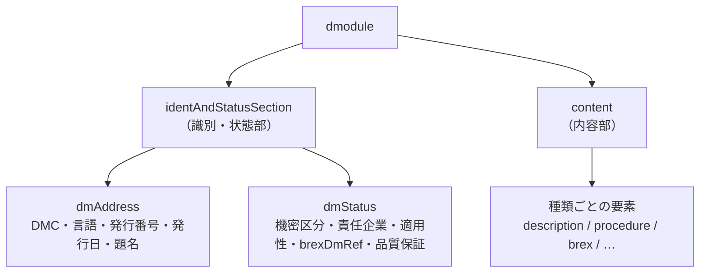

データモジュールは S1000D の最小の情報単位で、識別・状態部と内容部からなる XML です。データモジュールコード（DMC）は、そのデータモジュールが「どの製品の、どの部位の、どの種類の情報か」をハイフン区切りの文字列で表します。

## データモジュールの構造



識別・状態部には、本文を読まなくても分かる管理情報が集まっています。このプロジェクトの `s1000d-core` は、まずここを読みます。

| 要素 | 入っているもの | 何に使うか |
| --- | --- | --- |
| `dmCode` | DMC の構成要素（属性で分かれている） | 識別、ファイル名との照合 |
| `language` / `issueInfo` / `issueDate` | 言語と国、発行番号と作業中番号、発行日 | 版の判別 |
| `dmTitle` | 技術名称（`techName`）と情報名（`infoName`） | 人が読む題名 |
| `dmStatus/@issueType` | new / changed / … | 改版の種類 |
| `security` | 機密区分 | 配布の制御 |
| `applic` | どの機種・構成に当てはまるか | [適用性](/s1000d-stack/guide/applicability/)の判定（`s1000d-reader-mcp`） |
| `brexDmRef` | 従うべき BREX の DMC | BREX 照合の起点 |
| `qualityAssurance` | 未検証 / 第 1 検証 / 第 2 検証 | 検証状態の明示 |

内容部はデータモジュールの種類ごとに違います。種類はルート要素 `dmodule` の `xsi:noNamespaceSchemaLocation` が指すスキーマのファイル名（`descript.xsd`、`proced.xsd`、`brex.xsd` など）で分かります。この URL には版も入っており（`http://www.s1000d.org/S1000D_7/xml_schema_flat/descript.xsd` なら Issue 7）、`s1000d-core` はここから版と種類を推定します。

## DMC の読み方

```text
KENBAIKI-A-10-20-00-00A-040A-D
│        │ │  │  │  │   │    └ アイテムロケーションコード（1 文字）
│        │ │  │  │  │   └───── 情報コード（3 文字）＋ 情報コードバリアント（1 文字）
│        │ │  │  │  └───────── 分解コード（2 文字）＋ 分解コードバリアント（1〜3 文字）
│        │ │  │  └──────────── 組立コード（2 または 4 文字）
│        │ │  └─────────────── サブシステムコード（1 文字）＋ サブサブシステムコード（1 文字）
│        │ └────────────────── システムコード（2〜3 文字）
│        └──────────────────── システム差異コード（1〜4 文字）
└───────────────────────────── モデル識別コード（2〜14 文字）
```

上の例は、このプロジェクトのテストデータ（架空の指定席券売機 `KENBAIKI`）の説明データモジュールです。

| 区画 | 意味 | 例の値 |
| --- | --- | --- |
| モデル識別コード（MIC） | 製品やプロジェクト。実際の納品では NSPA への登録が前提 | `KENBAIKI` |
| システム差異コード | 同じ製品の派生の区別 | `A` |
| システム / サブシステム / サブサブシステム / 組立 | 製品の構造上の位置。体系（SNS）はプロジェクトが決め、BREX に書ける | `10` / `2` / `0` / `00` |
| 分解コードとバリアント | 組立をさらに分けた位置 | `00` / `A` |
| 情報コードとバリアント | 情報の種類。`040` は説明、`022` は BREX、`5xx` は手順など | `040` / `A` |
| アイテムロケーションコード | 作業を行う場所（装着状態・取り外し後など） | `D` |

学習用データモジュールでは、末尾に学習コード（3 文字）と学習イベントコード（1 文字）の区画が付きます。

### ファイル名

CSDB ではデータモジュールを次の名前で置くのが慣例です。

```text
DMC-KENBAIKI-A-10-20-00-00A-040A-D_002-01_JA-JP.XML
    └── DMC ──────────────────────┘ └発行┘ └言語┘
```

`_002-01` が発行番号と作業中番号、`_JA-JP` が言語と国です。`s1000d-core` の `parseDmcFileName` はこの形を分解し、`readDataModuleInfo` は中身の `dmCode` と突き合わせられます。

:::note[配布物の見本には例外があります]
S1000D 配布物のデータ辞書に含まれる見本ファイルには、`DMC-…_01-06.xml` のように発行情報ではなく例の通し番号が付いたものや、ファイル名の DMC と中身の DMC が一致しないものがあります。説明用の見本であり、CSDB の形ではありません。
:::

## 図と ICN

図や動画はデータモジュールの XML には入らず、ICN（Information Control Number）で参照します。ICN には MIC を基にした書式と CAGE コードを基にした書式があり、`s1000d-core` の `parseIcn` は両方を分解します。ファイル形式は ICN に含まれず、DOCTYPE の `ENTITY` 宣言と `NOTATION` 宣言で対応付けます。使ってよい形式はプロジェクトの BREX（`notationRuleList`）で決めます。

## このプロジェクトでの使い方

`s1000d-core` の関数で、ここに書いた情報をそのまま取り出せます。

```ts
import { readFileSync } from 'node:fs';
import { parseDmc, readDataModuleInfo } from '@shuji-bonji/s1000d-core';

const dmc = parseDmc('KENBAIKI-A-10-20-00-00A-040A-D');
if (dmc.ok) console.log(dmc.value.infoCode); // "040"

const info = readDataModuleInfo(readFileSync('DMC-KENBAIKI-A-10-20-00-00A-040A-D_002-01_JA-JP.XML', 'utf8'));
console.log(info.schemaName, info.issue);            // "descript" "7"
console.log(info.identAndStatus?.brexDmRef?.dmCode); // 従う BREX の DMC
```
