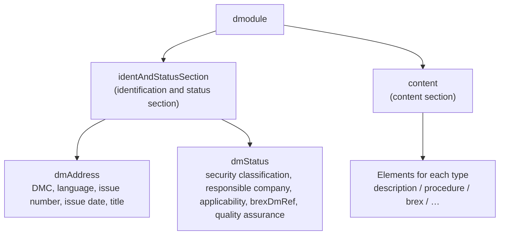

A data module is the smallest unit of information in S1000D®: an XML document made up of an identification and status section and a content section. The data module code (DMC) states, as a hyphen-separated string, which product, which part of that product and which kind of information the data module covers.

## Structure of a data module



The identification and status section gathers the management information that can be understood without reading the body.

| Element | What it holds | What it is used for |
| --- | --- | --- |
| `dmCode` | The segments of the DMC (split into attributes) | Identification, matching against the file name |
| `language` / `issueInfo` / `issueDate` | Language and country, issue number and in-work number, issue date | Telling issues apart |
| `dmTitle` | Technical name (`techName`) and information name (`infoName`) | The title people read |
| `dmStatus/@issueType` | new / changed / … | The kind of revision |
| `security` | Security classification | Controlling distribution |
| `applic` | Which models and configurations it applies to | [Applicability](/s1000d-stack/guide/applicability/) evaluation |
| `brexDmRef` | The DMC of the BREX (Business Rules Exchange) to follow | Starting point of the BREX check |
| `qualityAssurance` | Unverified / first verification / second verification | Stating the verification status |

The content section differs by data module type. The type can be told from the file name of the schema that `xsi:noNamespaceSchemaLocation` on the root element `dmodule` points to (`descript.xsd`, `proced.xsd`, `brex.xsd` and so on). This URL also carries the issue (`http://www.s1000d.org/S1000D_7/xml_schema_flat/descript.xsd` means Issue 7), so both the issue and the type can be read from it.

## Reading a DMC

```text
KENBAIKI-A-10-20-00-00A-040A-D
│        │ │  │  │  │   │    └ item location code (1 character)
│        │ │  │  │  │   └───── information code (3 characters) + information code variant (1 character)
│        │ │  │  │  └───────── disassembly code (2 characters) + disassembly code variant (1–3 characters)
│        │ │  │  └──────────── assembly code (2 or 4 characters)
│        │ │  └─────────────── subsystem code (1 character) + sub-subsystem code (1 character)
│        │ └────────────────── system code (2–3 characters)
│        └──────────────────── system difference code (1–4 characters)
└───────────────────────────── model identification code (2–14 characters)
```

The example above is a descriptive data module from this project's test data (a fictional reserved-seat ticket machine, `KENBAIKI`).

| Segment | Meaning | Value in the example |
| --- | --- | --- |
| Model identification code (MIC) | The product or project. For an actual delivery, registration with NSPA is assumed | `KENBAIKI` |
| System difference code | Distinguishes variants of the same product | `A` |
| System / subsystem / sub-subsystem / assembly | The position in the product's structure. The standard numbering system (SNS) is decided by the project and can be written into the BREX | `10` / `2` / `0` / `00` |
| Disassembly code and variant | A position that divides the assembly further | `00` / `A` |
| Information code and variant | The kind of information. `040` is description, `022` is BREX, `5xx` is procedures, and so on | `040` / `A` |
| Item location code | Where the work is done (installed, removed, and so on) | `D` |

In learning data modules, a learn code (3 characters) and a learn event code (1 character) are appended as further segments at the end.

### File name

In a CSDB, the convention is to store a data module under the following name.

```text
DMC-KENBAIKI-A-10-20-00-00A-040A-D_002-01_JA-JP.XML
    └── DMC ──────────────────────┘ └issue┘ └lang┘
```

`_002-01` is the issue number and in-work number, and `_JA-JP` is the language and country.

:::note[The samples in the distribution have exceptions]
Among the sample files included in the data dictionary of the S1000D distribution, some carry a running example number instead of issue information, such as `DMC-…_01-06.xml`, and some have a DMC in the file name that does not match the DMC inside. They are samples for explanation, not the form used in a CSDB.
:::

## Illustrations and ICNs

Illustrations and videos are not placed inside the data module's XML; they are referenced by an ICN (Information Control Number). An ICN has a format based on the MIC and a format based on the CAGE code. The file format is not part of the ICN; it is mapped through the `ENTITY` and `NOTATION` declarations in the DOCTYPE. Which formats may be used is decided by the project's BREX (`notationRuleList`).

## In this stack

The shared library `s1000d-core` extracts the information described here in the following order.

- It reads the identification and status section first and infers the issue and type from the `xsi:noNamespaceSchemaLocation` URL (`readDataModuleInfo`)
- It splits the file name with `parseDmcFileName` and matches it against the `dmCode` inside
- For ICNs, `parseIcn` splits both the MIC-based and the CAGE-based formats

The functions can be called directly.

```ts
import { readFileSync } from 'node:fs';
import { parseDmc, readDataModuleInfo } from '@shuji-bonji/s1000d-core';

const dmc = parseDmc('KENBAIKI-A-10-20-00-00A-040A-D');
if (dmc.ok) console.log(dmc.value.infoCode); // "040"

const info = readDataModuleInfo(readFileSync('DMC-KENBAIKI-A-10-20-00-00A-040A-D_002-01_JA-JP.XML', 'utf8'));
console.log(info.schemaName, info.issue);            // "descript" "7"
console.log(info.identAndStatus?.brexDmRef?.dmCode); // DMC of the BREX to follow
```
