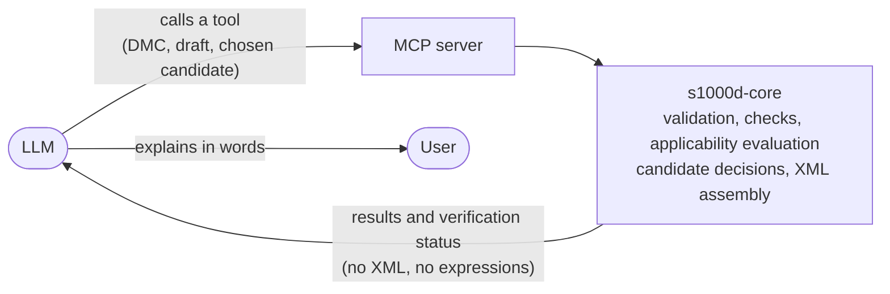

s1000d-stack is built on the principle that the server decides deterministically whether something is correct, and the LLM only puts the result into words. If an LLM reads or writes S1000D® XML directly, the same input can produce different answers, and nothing guarantees that the result fits the schema or the BREX (Business Rules Exchange). This page explains the decisions that follow from this principle and how the stack addresses the concerns about handling S1000D with an LLM.

## The server decides, the LLM explains

The responses of verify, reader and writer carry how far the XSD, BREX and reference steps have passed (the verification status, `verification`). With this verification status, the user can see how far the grounds of the LLM's explanation have been confirmed.

## Decisions

- **The LLM does not write XML**  
The LLM passes a structured draft; the server (s1000d-core) assembles the XML and allocates the codes. The assembled XML is always validated before it is returned.
- **The server decides the fix candidates**  
Candidates for fix suggestions are decided from the BREX rules, the XSD definitions and the CSDB index, and are returned with a certainty (exact / several / none) and where they come from. A fix is applied only when the choice matches a candidate computed by the server, so no value outside the candidates gets in.
- **Applicability expressions are not passed to the LLM**  
The server evaluates which product the content applies to and returns only applicable / notApplicable / undetermined and a display text.
- **The decision logic lives in one place**  
BREX checks and XSD validation live in s1000d-core, and the four MCP servers call the same code. This keeps the servers from reaching different decisions.
- **The specification, XML schemas, default BREX and official samples are not bundled**  
The ones the user obtained from s1000d.org are given with `S1000D_SPEC_DIR` (see [Specification files and trademarks](/s1000d-stack/guide/license/)).
- **Conformance is not decided**  
The stack reports up to the point that the XSD and the machine-checkable BREX rules found no violations. Whether something conforms to S1000D is judged by a person.

## How the stack addresses the concerns about handling S1000D with an LLM

| Concern | Answer in this stack |
| --- | --- |
| The specification is complex: several issues exist and project-specific BREX is added | XSD, the BREX chain, references and applicability are gathered in one verification status. The XSD is chosen per data module from the `xml_schema_flat/` folder that matches the issue in `xsi:noNamespaceSchemaLocation`; when no folder matches, the result is `schema-not-found` rather than a substitute from another issue. BREX is checked layer by layer along the chain down to the default BREX |
| The official schemas are distributed to registered users and cannot be reused openly | No approximate schema is built; validation uses the real XSD the user obtained. Without the XSD, the result says "not validated". Being able to tell "validated" from "validated against the real XSD" is the difference from approaches that validate against an approximate schema |
| Flattening to text loses the logic of applicability and references, and XML is verbose and consumes context | The reader does not flatten XML to text; it keeps sections, steps, warnings, figures and references as a tree. Applicability is evaluated and only the result is passed on; references are resolved with their titles. A large data module can be surveyed with `section: "outline"` (headings, step numbers, first sentence, size of each subtree) before its body is read |
| Letting the LLM write XML directly makes schema conformance and reference consistency hard to guarantee | Fix suggestions are decided by the server and the LLM does not propose values outside the candidates. s1000d-writer-mcp does not let the LLM write XML either; it assembles XML from structured input and always puts it through verification |
| Illustrations and multimedia, security classification and controlled language (STE) need separate handling | Illustrations are resolved as ICN references and their content is not read. The security classification is always placed at the top of the reader's response. No STE dictionary is bundled; the user's own glossary is referenced from the Skills (s1000d-review, s1000d-translate) |

The history of decisions and the open questions are recorded with numbers in [docs/DECISIONS.md](https://github.com/shuji-bonji/s1000d-stack/blob/main/docs/DECISIONS.md) in the hub repository.
