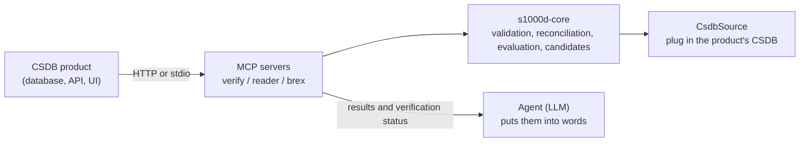

The goal of stage 2.5 of s1000d-stack is a foundation for embedding AI agents in a CSDB product (a system that stores and manages S1000D data modules). This page explains the four things an LLM agent must at least be able to do inside a CSDB, the parts used for embedding, the responsibilities that stay with the product, and how this stack answers the usual concerns about handling S1000D with an LLM. The design history is in `docs/design/agent-platform.md` in the hub repository.

## The four minimum requirements

The minimum requirement is that an LLM agent can do the following four things inside a CSDB. In all four, the decision is made deterministically by the server (the shared library `s1000d-core`); the LLM only puts the result into words.

| Requirement | Tool | What comes back |
| --- | --- | --- |
| Schema validation | verify-mcp `validate_schema` / `verify_data_module` | valid / invalid against the official XSD the user obtained, with line-numbered errors |
| Cross-reference check | verify-mcp `check_references`, `reconcile_dml` | Whether the targets of `dmRef` / `pmRef` / ICN / `internalRef` / `applicRefId` exist, with reasons. Reconciliation of a DML or DDN with the CSDB (missing, different issue, not listed in the DML) |
| Applicability check | reader-mcp `describe_applicability` / `read_data_module` | applicable / notApplicable / undetermined per product. The expressions themselves are never passed to the LLM |
| Fix suggestion | verify-mcp `suggest_fixes` | For each finding, candidates for what to change, where, and to which value. The server decides the candidates and attaches a confidence (exact / several / none) and the source |

## Parts used for embedding

| Part | Description |
| --- | --- |
| `CsdbSource` | By default `s1000d-core` treats `DMC-….XML` files inside a folder as the CSDB, but a product's CSDB is a database or an API. Listing the CSDB objects (`list()`) and fetching their content (`readText()`) are gathered in the `CsdbSource` interface, so the product can plug in its own implementation. The interface is synchronous; a store that can only be read asynchronously is loaded first and passed to `MemoryCsdbSource` |
| HTTP transport | The three MCP servers start over Streamable HTTP with `--http` (default `http://127.0.0.1:3000/mcp`), so a product's server or a web application can call them over HTTP. When bound to an address other than loopback they do not check `Host` and `Origin`, so they go behind the product's reverse proxy or authentication |
| Config file | The locations of the distribution (XSD, default BREX) and the CSDB are given by the environment variables `S1000D_SPEC_DIR` / `S1000D_CSDB_DIR` or by the config file `~/.config/s1000d-stack/config.json`. A product vendor already holds the distribution, so this arrangement can be used as is |
| Verification status | Every response carries `verification` (the state of the XSD, BREX and reference steps). The product can store it as an audit record |
| Security classification | reader-mcp responses start with `securityClassification` (the data module's value and the number of body elements per value). The values are not interpreted, so handling follows the product's rules |

## What stays with the product

- **Authentication, authorization and multi-tenancy** are not included. When exposed over HTTP, the servers go behind the product's authentication.
- **Assembling the agent** is the product's job. This stack provides core, MCP servers and Skills (procedures); the division of roles between Author / Reviewer / Translator / Project Manager, and the UI, are left to the product's design.
- **The specification, XSD and default BREX are not bundled.** The ones the user (the product vendor) obtained are used.
- **Conformance is not decided.** The stack reports that the XSD and the machine-checkable BREX rules found nothing; conformance to S1000D is judged by a person.

## How the stack answers the concerns about handling S1000D with an LLM

| Concern | Answer in this stack |
| --- | --- |
| The specification is complex: several issues exist and project-specific BREX is added | XSD, the BREX chain, references and applicability are gathered in one verification status. The XSD is chosen per data module from the `xml_schema_flat/` folder that matches the issue in `xsi:noNamespaceSchemaLocation`; when no folder matches, the result is `schema-not-found` rather than a substitute from another issue. BREX is checked layer by layer along the chain down to the default BREX |
| The official schemas are distributed to registered users and cannot be reused openly | No approximate schema is built; validation uses the real XSD the user obtained. Without the XSD, the result says "not validated". Being able to tell "validated" from "validated against the real XSD" is the difference from approaches that validate against an approximate schema |
| Flattening to text loses the logic of applicability and references, and XML is verbose and consumes context | The reader does not flatten XML to text; it keeps sections, steps, warnings, figures and references as a tree. Applicability is evaluated and only the result is passed on; references are resolved with their titles. A large data module can be surveyed with `section: "outline"` (headings, step numbers, first sentence, size of each subtree) before its body is read |
| Letting the LLM write XML directly makes schema conformance and reference consistency hard to guarantee | Fix suggestions are decided by the server and the LLM does not propose values outside the candidates. The stage 3 writer follows the same policy: the LLM does not write XML; the writer assembles XML from structured input and puts it through verification |
| Illustrations and multimedia, security classification and controlled language (STE) need separate handling | Illustrations are resolved as ICN references and their content is not read (the product holds the display renditions). The security classification is always placed at the top of the response. No STE dictionary is bundled; the user's own glossary will be referenced from a Skill (stage 3) |

## Reference implementation

As a real user of this foundation, a simple technical-manual web system that displays an S1000D CSDB directly is planned as the first deliverable of stage 4. With a minimal feature set — follow data modules from the PM table of contents, hide sections that do not apply to the selected product, show issue, verification status and security classification at the top of each page — it is also the place where anything missing from the API is fed back to core and the MCP servers.
