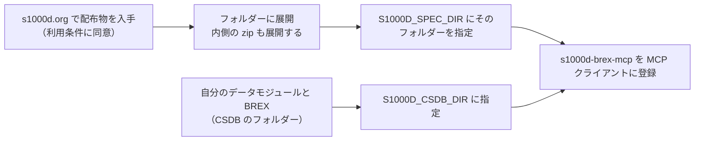

`s1000d-stack` を使い始めるために用意するものと、最初の操作を説明します。この道具が何をするものかは [S1000D Stack とは](/s1000d-stack/guide/overview/) をご覧ください。

## 用意するもの



1. **S1000D の配布物**。[s1000d.org](https://s1000d.org/) のダウンロードページから、対象の版（最初の対象は Issue 7）の zip を入手し、展開します。配布物の中に既定 BREX（`DMC-S1000D-*-04-10-0301-00A-022A-D_*.XML`）と XML スキーマが入っています。
2. **Node.js 22 以上**。MCP サーバーは `npx` で起動できます。
3. **MCP クライアント**。Claude Desktop や Claude Code など、MCP サーバーを登録できるものです。

:::caution[配布物は再配布できません]
S1000D の仕様書・XML スキーマ・既定 BREX・公式サンプルの利用条件は、非独占的な利用を許諾するだけで、再配布の権利を与えていません。このプロジェクトのパッケージにはそれらを含めず、利用者ご自身で入手したものを環境変数 `S1000D_SPEC_DIR` で指定する方式にしています。詳しくは[仕様書の扱いと商標](/s1000d-stack/guide/license/)をご覧ください。
:::

## 最初の一歩

Claude Desktop の設定ファイル（`claude_desktop_config.json`）に次を足して再起動します。

```json
{
  "mcpServers": {
    "s1000d-brex": {
      "command": "npx",
      "args": ["-y", "@shuji-bonji/s1000d-brex-mcp"],
      "env": {
        "S1000D_SPEC_DIR": "/path/to/s1000d/issue-7",
        "S1000D_CSDB_DIR": "/path/to/your/csdb"
      }
    }
  }
}
```

登録できたら、次のように頼んでみてください。

- 「既定 BREX のうち、descript（説明データモジュール）に関わるルールを 20 件、分かりやすく説明して」 → `explain_brex`
- 「このデータモジュール（パス）を BREX に照合して、違反を一覧にして」 → `check_against_brex`
- 「`securityClassification` の `01` はこの BREX では何を意味する？」 → `lookup_value`

:::note[s1000d-brex-mcp の公開について]
`@shuji-bonji/s1000d-brex-mcp`、`@shuji-bonji/s1000d-verify-mcp`、`@shuji-bonji/s1000d-reader-mcp` は 2026-10-25 時点で npm 未公開（開発中）です。公開までは、リポジトリを clone して `npm install && npm run build` し、`node dist/index.js` を `command` に指定して使えます。共有ライブラリ `@shuji-bonji/s1000d-core`（0.2.0）は npm に公開済みです。
:::

## 次に読むもの

- S1000D を初めて触る方は [IETM と S1000D](/s1000d-stack/guide/ietm-and-s1000d/) から
- この道具の全体像は [S1000D Stack とは](/s1000d-stack/guide/overview/) と [ユースケース](/s1000d-stack/use-cases/) へ
- BREX を渡された方は [BREX（ビジネスルール交換）](/s1000d-stack/guide/brex/) と [s1000d-brex-mcp](/s1000d-stack/mcp/brex-mcp/) へ
- 概念を体系的に学びたい方は Zenn Book [IETM入門 — 概念から S1000D まで](https://zenn.dev/shuji_bonji/books/ietm-overview) へ
