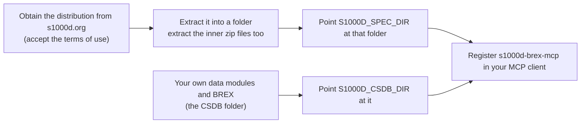

This page explains what you need before using `s1000d-stack` and the first steps to take. For what this set of tools does, see [What S1000D Stack is](/s1000d-stack/guide/overview/).

## What you need



1. **The S1000D® distribution.** From the download page at [s1000d.org](https://s1000d.org/), obtain the zip for the target issue (the first target is Issue 7) and extract it. The distribution contains the default BREX (Business Rules Exchange) data module (`DMC-S1000D-*-04-10-0301-00A-022A-D_*.XML`) and the XML schemas.
2. **Node.js 22 or later.** The MCP servers can be started with `npx`.
3. **An MCP client.** Something that can register MCP servers, such as Claude Desktop or Claude Code.

:::caution[The distribution cannot be redistributed]
The terms of use for the S1000D specification, XML schemas, default BREX and official samples grant non-exclusive use only and do not grant redistribution. They are therefore not included in any package or repository: obtain them from s1000d.org yourself and point the `S1000D_SPEC_DIR` environment variable at the extracted folder. For details, see [Specification files and trademarks](/s1000d-stack/guide/license/).
:::

## First steps

Add the following to the Claude Desktop configuration file (`claude_desktop_config.json`) and restart it.

```json
{
  "mcpServers": {
    "s1000d-brex": {
      "command": "npx",
      "args": ["-y", "@shuji-bonji/s1000d-brex-mcp"],
      "env": {
        "S1000D_SPEC_DIR": "/path/to/s1000d/issue-7",
        "S1000D_CSDB_DIR": "/path/to/your/csdb"
      }
    }
  }
}
```

Once it is registered, try asking for things like these.

- "From the default BREX, explain 20 rules that concern descript (descriptive data modules) in plain terms" → `explain_brex`
- "Check this data module (path) against the BREX and list the violations" → `check_against_brex`
- "What does `01` for `securityClassification` mean in this BREX?" → `lookup_value`


## What to read next

- If you are new to S1000D, start with [IETM and S1000D](/s1000d-stack/guide/ietm-and-s1000d/)
- For the overall picture of this set of tools, go to [What S1000D Stack is](/s1000d-stack/guide/overview/) and [Use cases](/s1000d-stack/use-cases/)
- If you have been handed a BREX, go to [BREX (Business Rules Exchange)](/s1000d-stack/guide/brex/) and [s1000d-brex-mcp](/s1000d-stack/mcp/brex-mcp/)
- To learn the concepts systematically, go to the Zenn Book [IETM入門 — 概念から S1000D まで](https://zenn.dev/shuji_bonji/books/ietm-overview) (in Japanese)
