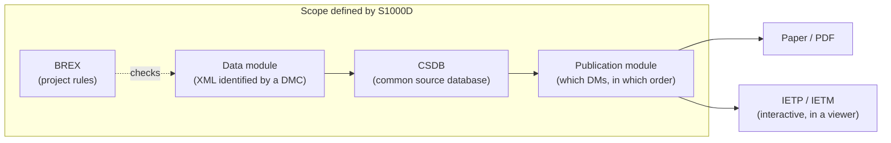

An IETM is an electronic technical manual that maintenance and operating personnel use interactively on screen; S1000D® is the international specification for producing, managing and exchanging its source data (data modules). The IETM is "what to produce", and S1000D is "how to produce it".

## Where the two terms come from

| | IETM | S1000D |
| --- | --- | --- |
| What it refers to | An interactive technical manual that users work with on screen (the deliverable) | The rules for producing, identifying, storing and exchanging the source data of technical documents (the specification) |
| Origin | 1992, three US Department of Defense military standards (MIL-M-87268 / MIL-D-87269 / MIL-Q-87270) | Started by ASD in Europe; now maintained jointly by ASD, AIA and A4A (formerly ATA) |
| How levels are divided | Functional classes Class 0–5 (requirements are now defined with a functionality matrix) | The output is called an IETP (a set of interactive technical publications), and IETM usually refers to an individual manual within it |

The US Department of Defense adopted S1000D in 2005, and most IETMs today are produced from S1000D data. However, an IETM can be produced without S1000D, and S1000D data can be output as paper or PDF only.

## Data flow

- A **data module** is the smallest unit of information that is complete on its own. Each kind of content has its own schema: descriptions, procedures, fault information, parts information, BREX and so on.
- The **CSDB** is where data modules are stored and managed. S1000D defines its functions but does not prescribe any particular software. In this stack, a folder that holds files named `DMC-….XML` is treated as a CSDB.
- A **publication module** defines which data modules appear in which order. It corresponds to the table of contents of a publication.
- **BREX (Business Rules Exchange)** is one kind of data module. It expresses in XML those rules agreed for a project that can be checked by machine. [BREX](/s1000d-stack/guide/brex/) explains this in detail.

## S1000D in Japan

In Japan, terms such as "electronic technical manual", "electronic manual" and "technical order" are used, and no established Japanese translation of IETM exists. As far as public information shows, domestic use of S1000D centres on manufacturers that deliver parts to foreign aircraft manufacturers or defence programs, and on the technical publication companies contracted to produce their documentation. In the development of the Mitsubishi Regional Jet (MRJ), suppliers were required to use S1000D 4.0.1 and the MRJ business rules. According to an article contributed by a technical publication company, the number of business rules exceeds 450.

:::tip[Further reading]
The history of IETMs, their class levels and the overall picture of S1000D concepts are covered chapter by chapter in the Zenn Book "IETM入門 — 概念から S1000D まで" (in Japanese) at [https://zenn.dev/shuji_bonji/books/ietm-overview](https://zenn.dev/shuji_bonji/books/ietm-overview). This site is limited to what you need to use the stack. Building on this relationship, how this stack uses S1000D is described separately under [Use cases](/s1000d-stack/use-cases/).
:::
