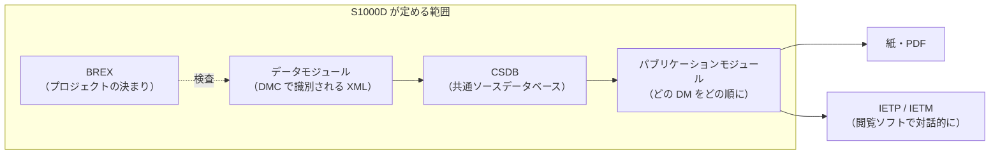

IETM は整備員や操作員が画面上で対話的に使う電子技術マニュアルで、S1000D はその元データ（データモジュール）を作成・管理・交換するための国際仕様です。IETM が「何を作るか」、S1000D が「どう作るか」に当たります。

## 2 つの言葉の出どころ

| | IETM | S1000D |
| --- | --- | --- |
| 何を指すか | 利用者が画面で使う対話型の技術マニュアル（成果物） | 技術文書の元データの作り方・識別・保管・交換の決まり（仕様） |
| 始まり | 1992 年、米国防総省の 3 つの軍用規格（MIL-M-87268 / MIL-D-87269 / MIL-Q-87270） | 欧州の ASD が始め、現在は ASD・AIA・A4A（旧 ATA）が共同で保守 |
| 段階の分け方 | Class 0〜5 の機能分類（現在は機能マトリクスで要件を定める） | 出力先を IETP（対話型の技術文書群）と呼び、IETM はその中の個々のマニュアルを指すことが多い |

米国防総省は 2005 年に S1000D を採用しており、現在の IETM の多くは S1000D のデータから作られます。ただし IETM は S1000D が無くても作れますし、S1000D のデータから紙や PDF だけを出力することもできます。

## データの流れ

- **データモジュール**は、それ単体で完結する最小の情報単位です。説明・手順・故障情報・部品情報・BREX など種類ごとにスキーマが分かれています。
- **CSDB** はデータモジュールを格納・管理する場所です。S1000D はその機能を定めますが、特定のソフトウェアは定めません。このプロジェクトでは、`DMC-….XML` の名前でファイルが置かれたフォルダーを CSDB と見なします。
- **パブリケーションモジュール**は、どのデータモジュールをどの順に並べるかを定めます。出版物の目次に当たります。
- **BREX** はデータモジュールの種類の 1 つで、プロジェクトで合意した決まりのうち機械で検査できるものを XML で書きます。詳しくは [BREX](/s1000d-stack/guide/brex/) で説明します。

## 体験型マニュアルとの対応

このプロジェクトのもう 1 つの柱は、画面や機器の操作を体験しながら学べるマニュアルを軽い Web 形式で作れるようにすることです。2021 年の作品 [experience_based_operation_explanation](https://github.com/shuji-bonji/experience_based_operation_explanation)（指定席券売機の操作説明）のデータ構造は、S1000D の考え方とよく対応します。

| 体験型マニュアルの JSON | S1000D |
| --- | --- |
| 画面のスクリーンショットと説明文 | 図（ICN で参照）とデータモジュールの内容部 |
| `screenId` | DMC（データモジュールコード） |
| ボタンと遷移先 | プロセスデータモジュール（提示順の制御） |
| 購入方法ごとのまとまり | パブリケーションモジュール |
| JSON を 1 か所で管理し使い回す | CSDB からの単一ソース・複数出力 |
| `index.html` と JavaScript | IETM（閲覧ソフト） |

この対応を頼りに、「軽い Web 形式で作り、必要になったら S1000D に出力する」道筋を作るのがこのプロジェクトの段階 2〜4 です。

## 日本での状況

国内では「電子技術マニュアル」「電子マニュアル」「技術指令書」といった言い方が使われ、IETM に定着した訳語はありません。公開情報から確認できる範囲では、S1000D の国内利用は海外の機体メーカーや防衛事業に部品を納めるメーカーと、その制作を受託する技術マニュアル制作会社が中心です。三菱リージョナルジェット（MRJ）の開発では供給企業に S1000D 4.0.1 と MRJ 用のビジネスルールが要求されました。技術マニュアル制作会社の寄稿では、ビジネスルールの数は 450 を超えるとされています。

:::tip[もっと詳しく]
IETM の歴史、クラス分類、S1000D の概念の全体像は、Zenn Book [IETM入門 — 概念から S1000D まで](https://zenn.dev/shuji_bonji/books/ietm-overview) に章を分けて書いています。このサイトは、スタックを使うために必要な範囲に絞っています。
:::
