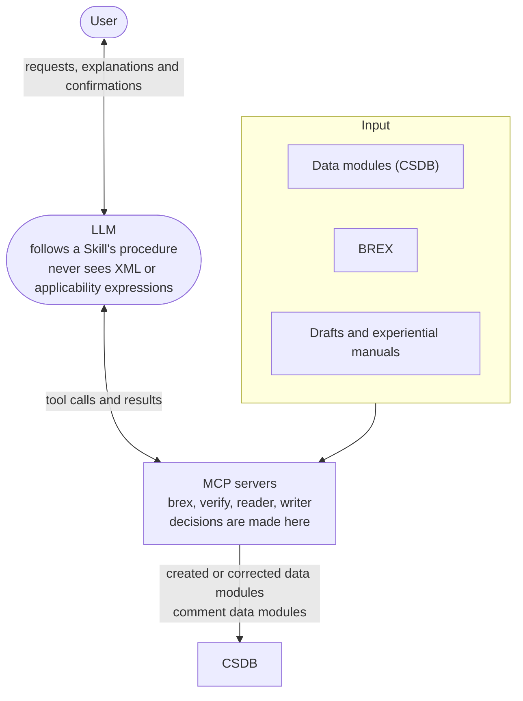

s1000d-stack is a set of tools that lets an LLM read technical documents written in S1000D® (data modules) correctly, check them against the business rules agreed for a project (BREX, Business Rules Exchange), and create them.

The aim is a state in which the LLM helps with authoring, checking, reviewing and translating technical documents, and every data module it creates and every body of text passed to it always carries how far it has passed XSD, BREX and reference verification (the verification status). The LLM only explains results in words; whether something is correct is decided by the server, based on the official XSD and BREX the user obtained.

## Who it is for

| Role | Problem | What becomes possible |
| --- | --- | --- |
| Suppliers delivering parts to foreign aircraft manufacturers or defence programs | The customer hands over a BREX, but it is a list of XPath expressions and allowed values, and it is hard to tell what it actually requires | You can read in plain sentences what each BREX rule requires, and confirm that the data modules you produced do not violate the rules, with the location of every violation |
| Technical publication companies | Before delivery, they want to confirm that the data modules they produced follow the customer's business rules. Review and translation also take effort | You can validate XSD, BREX and references together and get candidate corrections. You can keep review findings as comment data modules and translate data modules into another language |
| CSDB product vendors | They want to embed AI agents in their product, but have no means of making an LLM handle S1000D XML correctly | Validation, reference checks, applicability evaluation and fix suggestions can be called from the product as MCP servers |
| People starting to learn S1000D | Material in Japanese is scarce, and the specification is 3,700 pages long | Use this site to understand how S1000D works, then check your own data modules against the default BREX |

## What it does

- **Reads a BREX**  
Lists the rules of the BREX you were given as plain sentences that say what is required of each element. It can also look up the meaning of attribute values and SNS (standard numbering system) codes.
- **Checks**  
Validates a data module against the official XSD, the BREX chain (project → organisation → S1000D default BREX) and the existence of reference targets together, and combines the results into a single verification status. Each violation comes with its location (XPath and line number) and candidate corrections.
- **Reads**  
Passes the data module to the LLM as a structure of headings, steps, warnings and illustrations. Which product the content applies to (applicability) is evaluated by the server, and only the result is passed on.
- **Creates**  
From a structured draft passed by the LLM, or from the JSON of an experiential manual, the server assembles the XML of a data module and validates it. The LLM does not write XML.
- **Reviews and translates**  
Keeps review findings in the CSDB as comment data modules. Takes the sentences out of a data module, has the LLM translate them, and puts them back into a data module with the same DMC that differs only in language.
- **Embeds in a product**  
The MCP servers can be started over HTTP and used with a CSDB product's database or API plugged in as the CSDB (see [Embedding in a CSDB product](/s1000d-stack/use-cases/embedding/)).

Which servers and Skills are used for which task is summarised in [Architecture](/s1000d-stack/guide/architecture/), and why decisions are left to the server is explained in [Design principles](/s1000d-stack/guide/design-principles/).

## What it does not do

- **It does not include the S1000D specification, XML schemas, default BREX or official samples**  
Their terms of use do not grant redistribution, so you obtain them from s1000d.org yourself and point an environment variable at the files (see [Specification files and trademarks](/s1000d-stack/guide/license/)).
- **The servers do not summarise or translate**  
Summaries and translations are written by the LLM. The servers' job is to hand it everything it needs for that — headings, step numbers, warning types, reference targets, verification status — without omitting anything, and to put translated sentences back into data modules.
- **It does not show the LLM XML or applicability expressions**  
The server reads the structure and evaluates the expressions; the LLM receives the results.
- **It does not decide conformance to S1000D**  
It reports up to the point that the XSD and the machine-checkable BREX rules found no violations. Whether something conforms is judged by a person.
- **It is not an official or certified ASD tool**  
This is a personal project and is not affiliated with ASD.

## How to read this site

| Section | What it explains | Subject |
| --- | --- | --- |
| Guide | Where this stack fits, how to set it up, its components, its design principles, and how the specification files are handled | s1000d-stack |
| Understanding S1000D | How the S1000D specification works, limited to what you need to use the stack | S1000D, data modules, CSDB, BREX |
| MCP servers | Each server's configuration, tools, response shape and limitations | Each MCP server |
| Skills | In which order each Skill calls the MCP servers and what it confirms with the user | Each Skill |
| Libraries | The functions of the shared libraries and the design decisions behind them | Each library |
| Use cases | Which tools to combine in which situation, one case per page | The user |

In the articles under "Understanding S1000D", the body text explains only the S1000D specification; how this stack handles it is kept in a separate "In this stack" section at the end of the article. Where the body text must mention the stack, it is limited to a single sentence that begins with "In this stack".

:::tip[Where to go next]
See [Getting started](/s1000d-stack/guide/getting-started/) to set it up, [Architecture](/s1000d-stack/guide/architecture/) for the components, and [Use cases](/s1000d-stack/use-cases/) for the situations it is used in.
:::
