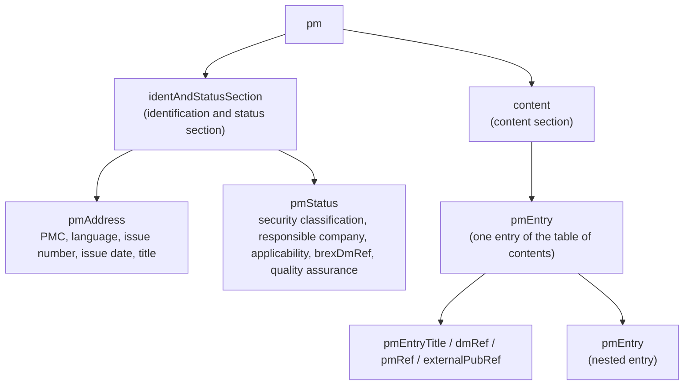

A publication module is the XML document that defines the content and structure of one publication in S1000D®. It has no body text of its own; it lists references to data modules in the order of the table of contents. The publication module code (PMC) states, as a hyphen-separated string, which product the publication is for, which organization issued it and which number it carries.

## Structure of a publication module



The identification and status section is built in almost the same way as that of a [data module](/s1000d-stack/guide/data-module-and-dmc/). `pmCode` takes the place of `dmCode`, and `pmTitle` takes the place of `dmTitle`.

| Element | What it holds | What it is used for |
| --- | --- | --- |
| `pmCode` | The segments of the PMC (split into attributes) | Identification, matching against the file name |
| `language` / `issueInfo` / `issueDate` | Language and country, issue number and in-work number, issue date | Telling issues apart |
| `pmTitle` | The title of the publication | The title people read |
| `pmStatus/@issueType` | new / changed / … | The kind of revision |
| `security` | Security classification | Controlling distribution |
| `applic` | Which models and configurations it applies to | [Applicability](/s1000d-stack/guide/applicability/) evaluation |
| `brexDmRef` | The DMC of the BREX (Business Rules Exchange) to follow | Starting point of the BREX check |
| `qualityAssurance` | Unverified / first verification / second verification | Stating the verification status |

The content section (`content`) holds one or more `pmEntry` elements. A `pmEntry` corresponds to one entry of the table of contents and contains the following elements.

| Element | What it holds |
| --- | --- |
| `pmEntryTitle` | The heading of the entry. It can be omitted |
| `dmRef` | A reference to a data module |
| `pmRef` | A reference to another publication module. It places one publication inside another |
| `externalPubRef` | A reference to a publication that was not produced with S1000D |
| `pmEntry` | A nested entry. The depth is free, as with sections under a chapter |

After `pmEntryTitle`, one or more of the other four elements follow in any order. The example below is the beginning of the content section of a publication module from this project's example data (a fictional reserved-seat ticket machine, `KENBAIKI`). The titles in the example data are written in Japanese; on this page they are shown in English.

```xml
<content>
  <pmEntry>
    <pmEntryTitle>Overview of the ticket machine</pmEntryTitle>
    <dmRef>
      <dmRefIdent>
        <dmCode modelIdentCode="KENBAIKI" systemDiffCode="A" systemCode="10"
          subSystemCode="2" subSubSystemCode="0" assyCode="00" disassyCode="00"
          disassyCodeVariant="A" infoCode="040" infoCodeVariant="A" itemLocationCode="D"/>
      </dmRefIdent>
    </dmRef>
  </pmEntry>
  <pmEntry>
    <pmEntryTitle>Buying a ticket from the route search</pmEntryTitle>
    <!-- five dmRef elements follow -->
  </pmEntry>
</content>
```

A publication module holds references only; the body text stays in the data modules. For this reason, several publication modules can refer to the same data module.

The type of publication can be written in the `pmType` attribute of `pm` (`pt01` to `pt99`), and the type of an entry in the `pmEntryType` attribute of `pmEntry` (`pmt01` to `pmt99`). Both can be omitted. Some values have a meaning fixed by the specification, such as `pmt01` for the title page and `pmt13` for the table of contents, and others are left for the project to define (`pt51` to `pt99`, `pmt51` to `pmt99`) (Chap 3.9.6.1).

## Reading a PMC

```text
KENBAIKI-K0001-7BTJ7-00
│        │     │     └ volume number (2 digits)
│        │     └────── number of the publication (5 characters)
│        └──────────── issuing authority (5 characters)
└───────────────────── model identification code (2–14 characters)
```

The rules for the PMC are in Chap 4.9.2. The whole code is 14 to 26 characters long and, together with the issue information (issue number and in-work number), points to one publication module.

| Segment | Attribute of `pmCode` | Meaning | Value in the example |
| --- | --- | --- | --- |
| Model identification code (MIC) | `modelIdentCode` | The product or project. It is the same code as the model identification code of a DMC | `KENBAIKI` |
| Issuing authority | `pmIssuer` | The CAGE code of the organization that issues the publication module | `K0001` |
| Number of the publication | `pmNumber` | A number assigned by the issuing authority. It must not repeat within one combination of model identification code and issuing authority | `7BTJ7` |
| Volume number | `pmVolume` | Used to split a publication into volumes without assigning a new number. It is `00` when there is only one volume | `00` |

Unlike a DMC, a PMC carries neither the position in the product's structure (system code and so on) nor the kind of information (information code). What a publication covers is read from `pmTitle` and the content section, not from the PMC.

### File name

In a CSDB, a publication module is stored under a name of the same form as a data module (Chap 7.5.1).

```text
PMC-KENBAIKI-K0001-7BTJ7-00_001-00_JA-JP.XML
    └── PMC ──────────────┘ └issue┘ └lang┘
```

`_001-00` is the issue number and in-work number, and `_JA-JP` is the language and country.

## In this stack

Reading, creating and verifying publication modules are handled by the following components.

- `parsePmc` in the shared library `s1000d-core` splits a PMC into its four segments, and `parsePmcFileName` extracts the PMC, the issue information and the language from a file name
- [`read_publication_module`](/s1000d-stack/reference/stack/reader/read-publication-module/) in [s1000d-reader-mcp](/s1000d-stack/mcp/reader-mcp/) returns the tree of `pmEntry` elements as a table of contents. For each `dmRef` and `pmRef`, it adds the file, title and issue found in the CSDB
- [`build_data_module`](/s1000d-stack/reference/stack/writer/build-data-module/) in [s1000d-writer-mcp](/s1000d-stack/mcp/writer-mcp/) creates a publication module when the `kind` of the draft is `pm`. [`convert_manual`](/s1000d-stack/reference/stack/writer/convert-manual/) creates one publication module for each experiential manual
- [`verify_csdb`](/s1000d-stack/reference/stack/verify/verify-csdb/) in [s1000d-verify-mcp](/s1000d-stack/mcp/verify-mcp/) verifies the `DMC-` and `PMC-` files by default

In the response of `read_publication_module`, a `pmEntry` becomes `kind: "section"` and each reference inside it becomes `kind: "entry"`.

```json
{
  "kind": "section",
  "element": "pmEntry",
  "title": "Overview of the ticket machine",
  "children": [
    {
      "kind": "entry",
      "element": "dmRef",
      "target": "KENBAIKI-A-10-20-00-00A-040A-D",
      "resolved": {
        "path": "…/DMC-KENBAIKI-A-10-20-00-00A-040A-D_001-00_JA-JP.XML",
        "techName": "Reserved-seat ticket machine operation manual (example)",
        "infoName": "Overview of the ticket machine",
        "issueInfo": { "issueNumber": "001", "inWork": "00" }
      }
    }
  ]
}
```

When no PMC is given at creation, s1000d-writer-mcp allocates one. The model identification code is the value in the numbering rules (`allocation`), the issuing authority is `allocation.icn.cageCode`, and the volume number is `00`. The number of the publication is the `sourceId` itself when it is five alphanumeric characters, and otherwise five characters calculated from the `sourceId`.

:::note[What it does not do]
- When creating, only `dmRef` and `pmRef` can be written inside a `pmEntry`. An `externalPubRef` can be read but not written
- This stack has no processing that produces paper, PDF or IETP screens from a publication module. A viewer is planned in a separate project ([Architecture](/s1000d-stack/guide/architecture/))
:::

The functions of `s1000d-core` can be called directly.

```ts
import { readFileSync } from 'node:fs';
import { parsePmc, parsePmcFileName, readContentFromXml } from '@shuji-bonji/s1000d-core';

const pmc = parsePmc('KENBAIKI-K0001-7BTJ7-00');
if (pmc.ok) console.log(pmc.value.pmIssuer, pmc.value.pmNumber); // "K0001" "7BTJ7"

const fileName = 'PMC-KENBAIKI-K0001-7BTJ7-00_001-00_JA-JP.XML';
const name = parsePmcFileName(fileName);
if (name.ok) console.log(name.value.issueInfo); // { issueNumber: "001", inWork: "00" }

const content = readContentFromXml(readFileSync(fileName, 'utf8'));
for (const entry of content.blocks) {
  console.log(entry.title, entry.children.map((c) => c.text));
}
// "Overview of the ticket machine" [ "KENBAIKI-A-10-20-00-00A-040A-D" ]
// "Buying a ticket from the route search" [ "KENBAIKI-A-10-20-00-00A-130A-D", … ]
```
