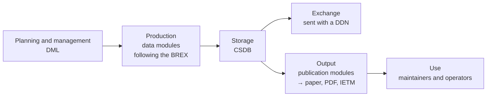

S1000D® is an international specification for procuring and producing technical publications such as maintenance and operating manuals. It covers aircraft, land vehicles, ships and all kinds of equipment, and can be used for both civil and defence products. Technical documents are created in small units called data modules, managed together in a CSDB (common source database), and output from there as paper, PDF, IETM and so on.

## Who maintains it

S1000D started in the European aerospace field in the early 1980s. At that time, documentation for civil aircraft was produced to ATA 100, while documentation for military aircraft was produced to each country's military specifications. Because the scattered specifications drove up costs, S1000D began as an effort to align how civil and defence documentation is produced, using ATA 100 as the starting point.

Today it is maintained jointly by ASD in Europe, AIA in the United States, and A4A (formerly ATA). From Issue 2, land and sea products were added to the scope alongside aircraft. The specification and the XML schemas can be downloaded from s1000d.org. The distribution comes with terms of use (see [Specification files and trademarks](/s1000d-stack/guide/license/)).

## What it defines

S1000D covers technical documentation from planning and management through production, exchange, distribution and use, across the life cycle of a product. It defines the shape of the data with XML schemas, but it does not define specific software such as the implementation of a CSDB or a viewer.

| What it defines | Main mechanisms | Article on this site |
| --- | --- | --- |
| Units of information and their identification | Data modules, DMC, ICN | [Data modules and the DMC](/s1000d-stack/guide/data-module-and-dmc/) |
| Storage and management | CSDB, data management lists, comments | [CSDB](/s1000d-stack/guide/csdb/) |
| Project-specific rules | Business rules, BREX (Business Rules Exchange) | [BREX](/s1000d-stack/guide/brex/) |
| Which products content applies to | Applicability | [Applicability](/s1000d-stack/guide/applicability/) |
| Assembling and outputting publications | Publication modules, page-oriented publications, IETP | [IETM and S1000D](/s1000d-stack/guide/ietm-and-s1000d/) |
| Exchanging data | Data dispatch note (DDN), file naming | [CSDB](/s1000d-stack/guide/csdb/) |

Data modules come in kinds that match their content — descriptions, procedures, fault information, illustrated parts data, wiring data, training and so on — and each kind has its own schema.

## Why it is used

- **Correct it in one place, and every output follows**  
The same information is not held twice in the CSDB; one data module is reused in several publications. Correct a data module once, and the paper publication and the IETM that use it show the same content.
- **Data can be exchanged between different systems**  
Because it is based on neutral international standards (ISO, W3C XML and so on), it is not tied to any company's software, and the same form of data can be passed between companies and to customers.
- **Issues are managed per data module**  
Each data module has its own issue number and status, so only the parts that changed are managed and exchanged, not the whole document.
- **Only what a user needs can be output**  
With applicability, only the content that applies to a product's model or modification state is displayed or output.

## Adapting it to a project

Because S1000D covers a wide range of products, it is not used as is: each project or organisation narrows down how it is used (tailoring). Agreements such as which elements to use and which values to allow are documented as business rules. The business rules that can be checked by machine are written in XML in a data module called BREX. Tailoring may change how the specification is used, but not the XML schemas themselves.

Business rules come in layers: the S1000D defaults, the organisation's rules and the project's rules. A customer hands you a BREX because you are asked to produce data that follows the project's rules within these layers.

## Issues

S1000D has been revised many times, and several issues are in use side by side. Because elements and attributes differ between issues, each data module records in its XML which issue's schema it follows (the URL in `xsi:noNamespaceSchemaLocation`). Most real-world examples, in Japan and elsewhere, use the Issue 4 series; the latest issue is Issue 7.

## The S-Series

S1000D is one of a family of specifications for product support (ILS, integrated logistics support) maintained by ASD and AIA, known as the S-Series. It includes S2000M for material management and S3000L for logistics support analysis, and they are designed to be used together. The whole family is described at [s-series.org](https://www.s-series.org/).

## In this stack

- The first target is Issue 7; Issue 4.2 is planned next
- The specification, XML schemas, default BREX and official samples are not bundled; the ones the user obtained from s1000d.org are given with `S1000D_SPEC_DIR` (see [Getting started](/s1000d-stack/guide/getting-started/))
- The mechanisms in the table above are handled by the following components: BREX by [s1000d-brex-mcp](/s1000d-stack/mcp/brex-mcp/), validating data modules and reconciling them with the DML by [s1000d-verify-mcp](/s1000d-stack/mcp/verify-mcp/), reading content, references and applicability by [s1000d-reader-mcp](/s1000d-stack/mcp/reader-mcp/), and creating data modules by [s1000d-writer-mcp](/s1000d-stack/mcp/writer-mcp/)
- The kinds of data module covered are descriptions, procedures, processes, fault isolation, publication modules and a few others; not every kind can be read. See "What it does not do" on each server's page
