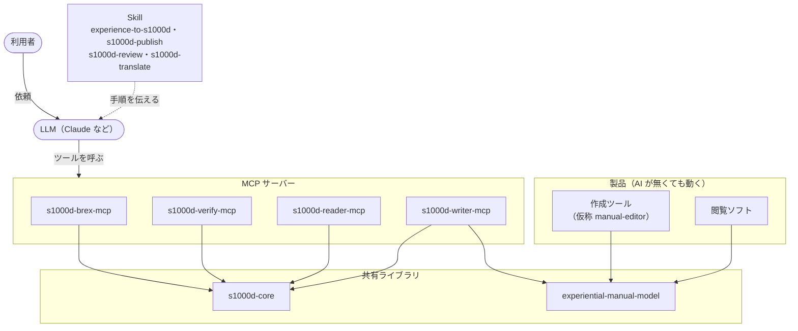

s1000d-stack は、共有ライブラリ・MCP サーバー・Skill・製品の 4 種類の部品からなります。共有ライブラリが S1000D の処理（読み取り・検証・組み立て）を持ち、MCP サーバーがその処理を LLM から呼べるツールにし、Skill がツールを呼ぶ順番と利用者に確かめることを LLM に伝えます。製品（作成ツール・閲覧ソフト）は、AI が無くても動く、人が使うソフトです。

各部品は独立したリポジトリで公開しています。このサイトを持つ hub リポジトリ [s1000d-stack](https://github.com/shuji-bonji/s1000d-stack) は、学習サイト（`site/`）、各部品の公開版を記録した構成表（`stack.json`）、計画と決定の記録（`docs/`）だけを持ちます。

## 共有ライブラリ

| ライブラリ | 何に使うか | 公開先 |
| --- | --- | --- |
| [s1000d-core](/s1000d-stack/ja/lib/s1000d-core/) | MCP サーバーが利用する共有ライブラリです。DMC・ICN の分解、識別・状態部の読み取り、BREX 照合、XSD 検証、参照の解決、適用性の評価、本文の読み取り、修正候補の決定、データモジュールの組み立て、修正の適用などの機能を提供します | [npm 0.8.1](https://www.npmjs.com/package/@shuji-bonji/s1000d-core) |
| [experiential-manual-model](https://github.com/shuji-bonji/experiential-manual-model) | 体験型マニュアル（画面を見ながら操作を体験して学ぶマニュアル）の共通データモデルです。型と JSON Schema、内容の検査、2021 年の作品からの変換を提供します。S1000D には依存しません | [npm 0.1.0](https://www.npmjs.com/package/@shuji-bonji/experiential-manual-model) |

## MCP サーバー

MCP サーバーは、LLM が呼び出せるツールを提供するプログラムです。4 つとも、データモジュールの XML や適用性の式を LLM に渡さず、判定の結果だけを返します。

| MCP サーバー | 何に使うか | ツール | 公開先 |
| --- | --- | --- | --- |
| [s1000d-brex-mcp](/s1000d-stack/ja/mcp/brex-mcp/) | 顧客やプロジェクトから渡された BREX（データモジュールの書き方の決まり）を読み解き、データモジュールがその決まりに従っているかを確かめます | 5 | [npm 0.4.0](https://www.npmjs.com/package/@shuji-bonji/s1000d-brex-mcp) |
| [s1000d-verify-mcp](/s1000d-stack/ja/mcp/verify-mcp/) | データモジュールが正しく書けているかを、公式の XML スキーマ（XSD）・BREX・参照先の有無でまとめて確かめ、直し方の候補を出します。データ管理リスト（DML、作るべきデータモジュールの一覧）との照合もします | 7 | [npm 0.6.0](https://www.npmjs.com/package/@shuji-bonji/s1000d-verify-mcp) |
| [s1000d-reader-mcp](/s1000d-stack/ja/mcp/reader-mcp/) | データモジュールの本文を、見出し・手順・警告・図の構造で LLM に渡します。参照先をたどり、どの製品に当てはまるか（適用性）を判定します | 6 | [npm 0.7.0](https://www.npmjs.com/package/@shuji-bonji/s1000d-reader-mcp) |
| [s1000d-writer-mcp](/s1000d-stack/ja/mcp/writer-mcp/) | データモジュールを作ります。LLM が渡した下書きから、サーバーが XML を組み立てて検証します。体験型マニュアルの変換、修正の適用、コメントデータモジュールの作成、翻訳用の文の出し入れも行います | 6 | [npm 0.1.1](https://www.npmjs.com/package/@shuji-bonji/s1000d-writer-mcp) |

## Skill

Skill は、どの MCP サーバーをどの順番で呼び、途中で利用者に何を確かめるかを LLM（Claude）に伝える手順書です。組み立てや検証の処理は持たず、判定はすべて MCP サーバーの応答を根拠にします。4 つとも個人の marketplace [shuji-bonji/claude-plugins](https://github.com/shuji-bonji/claude-plugins) で 0.1.0 を公開しています。

| Skill | 何に使うか | 必須の MCP サーバー |
| --- | --- | --- |
| [experience-to-s1000d](/s1000d-stack/ja/skill/experience-to-s1000d/) | 体験型マニュアルの JSON を、S1000D の CSDB（データモジュール・パブリケーションモジュール・図）に変換し、CSDB 全体を検証します | writer・verify |
| [s1000d-publish](/s1000d-stack/ja/skill/s1000d-publish/) | 構造化した下書き（題名・段落・手順・警告・表）から、データモジュールを 1 件ずつ作り、検証して CSDB に入れます。DML に載っているかも確かめます | writer・verify |
| [s1000d-review](/s1000d-stack/ja/skill/s1000d-review/) | データモジュールを、検証結果・BREX の手動確認の項目・文章（用語集と書き方）の 3 つの観点でレビューし、選んだ指摘をコメントデータモジュールとして残します | reader・verify |
| [s1000d-translate](/s1000d-stack/ja/skill/s1000d-translate/) | データモジュールから文を取り出して LLM が訳し、xcomet で採点したうえで、同じ DMC で言語だけが違うデータモジュールに戻します | writer |

## 製品

| 製品 | 何に使うか | 状態 |
| --- | --- | --- |
| 作成ツール（仮称 manual-editor） | 体験型マニュアルを画面の上で作り、experiential-manual-model の JSON で保存します。保存した JSON は Skill experience-to-s1000d で S1000D に変換できます | 試作 |
| 閲覧ソフト | 体験型マニュアルを表示し、利用者が操作を体験しながら学べるようにします。WebMCP を使って、AI が操作を案内できるようにする予定です | 構想 |

製品の操作説明は、製品のサイトに置く予定です。

## 対象とする版

最初の対象は Issue 7 です。次に Issue 4.2 を対象にする予定で、国内外の実例が Issue 4 系に多いためです。`s1000d-core` は版ごとに読み分けられる構造にしています。

:::note[設計上の決めごと]
判定をサーバーに置く理由と、LLM に XML を書かせないなどの決めごとは [設計方針](/s1000d-stack/ja/guide/design-principles/) にまとめています。決定の経緯と未決事項は、hub リポジトリの [docs/DECISIONS.md](https://github.com/shuji-bonji/s1000d-stack/blob/main/docs/DECISIONS.md) に番号付きで記録しています。
:::
