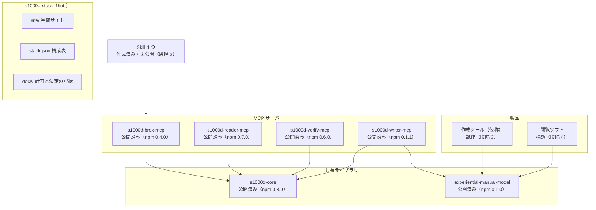

s1000d-stack は、構成表と学習サイトだけを持つ hub リポジトリと、独立した部品のリポジトリからなります。専門家エージェント（MCP と Skill）を先に作り、それを開発の道具として使いながら製品（作成ツール・閲覧ソフト）を作ります。

## 部品

| 部品 | 役割 | 状態（2026-10-28） |
| --- | --- | --- |
| [s1000d-core](/s1000d-stack/ja/lib/s1000d-core/) | DMC・ICN・識別・状態部・BREX 照合・XSD 検証・参照の解決・適用性の評価・本文の読み取り・修正候補の決定・データモジュールの組み立て・修正の適用の共有ライブラリ | [npm 0.8.0](https://www.npmjs.com/package/@shuji-bonji/s1000d-core) 公開済み |
| [s1000d-brex-mcp](/s1000d-stack/ja/mcp/brex-mcp/) | BREX の説明と照合（5 ツール） | [npm 0.4.0](https://www.npmjs.com/package/@shuji-bonji/s1000d-brex-mcp) 公開済み |
| [s1000d-reader-mcp](/s1000d-stack/ja/mcp/reader-mcp/) | データモジュールの本文を構造化して返す、参照の解決、適用性の判定（6 ツール） | [npm 0.7.0](https://www.npmjs.com/package/@shuji-bonji/s1000d-reader-mcp) 公開済み |
| [s1000d-verify-mcp](/s1000d-stack/ja/mcp/verify-mcp/) | 公式 XSD による検証、BREX 照合、参照切れの検出、修正提案、DML・DDN の照合（7 ツール） | [npm 0.6.0](https://www.npmjs.com/package/@shuji-bonji/s1000d-verify-mcp) 公開済み |
| [experiential-manual-model](https://github.com/shuji-bonji/experiential-manual-model) | 体験型マニュアルの共通データモデル（S1000D に依存しない）。型・JSON Schema・検査・2021 年の作品からの変換 | [npm 0.1.0](https://www.npmjs.com/package/@shuji-bonji/experiential-manual-model) 公開済み |
| [s1000d-writer-mcp](/s1000d-stack/ja/mcp/writer-mcp/) | LLM に XML を書かせずにデータモジュールを作る。体験型マニュアルの変換、修正の適用、コメントデータモジュールの作成、翻訳向けの文の出し入れ（6 ツール） | [npm 0.1.1](https://www.npmjs.com/package/@shuji-bonji/s1000d-writer-mcp) 公開済み |
| Skill（4 つ） | [experience-to-s1000d](/s1000d-stack/ja/skill/experience-to-s1000d/)（体験型マニュアルを CSDB に変換）、[s1000d-publish](/s1000d-stack/ja/skill/s1000d-publish/)（下書きからデータモジュールを作成）、[s1000d-review](/s1000d-stack/ja/skill/s1000d-review/)（レビューと comment DM）、[s1000d-translate](/s1000d-stack/ja/skill/s1000d-translate/)（翻訳） | 作成済み・未公開（段階 3） |
| 作成ツール（仮称 manual-editor） | 体験型マニュアルを画面の上で作り、experiential-manual-model の JSON で保存する製品。AI が無くても動く | 試作（段階 3） |
| 閲覧ソフト | 人が使う製品。AI が無くても動く | 構想（段階 4） |

## 段階

| 段階 | 成果物 | 完了の条件 |
| --- | --- | --- |
| 1 | hub（このサイト）、s1000d-core、s1000d-brex-mcp | 自作 BREX とデータモジュールで照合のテストが通る。既定 BREX を読み、自作データモジュールを照合して仕様書と矛盾しない。サイトの説明を仕様書と照合済み |
| 2 | s1000d-reader-mcp、s1000d-verify-mcp、experiential-manual-model | 公式 XSD（利用者が入手したもの）による検証、参照の解決、適用性の判定ができる。reader の応答に版と検証状態を含める |
| 2.5 | 修正提案、`CsdbSource`、HTTP transport、DML・DDN の照合、概要モードと機密区分、[CSDB 製品への組み込み](/s1000d-stack/ja/guide/embedding/)のページ | LLM エージェントがスキーマ検証・クロスリファレンスチェック・適用性チェック・修正提案の 4 つをでき、CSDB をフォルダー以外から読める |
| 3 | s1000d-writer-mcp、Skill 4 つ、作成ツールの試作（いずれも揃った） | 券売機の例を共通データモデル経由で S1000D に出力し、verify を通る |
| 4 | 閲覧ソフト | 共通データモデルを表示し、WebMCP で AI が操作を案内できる |

## 決めていること

- **名前は S1000D に寄せる**。MCP とライブラリは `s1000d-` で始めます。一般向けの製品には S1000D の名前を付けません。
- **仕様書・スキーマ・公式サンプルを同梱しない**。利用者が入手したものを `S1000D_SPEC_DIR` で指定します。
- **構成は houki-hub に揃える**。hub は構成表とサイトだけを持ち、各部品は独立したリポジトリです。
- **BREX の照合処理は s1000d-core に置く**。brex-mcp と verify-mcp はそれを呼ぶだけにします。
- **XML は @xmldom/xmldom、XPath は fontoxpath**。既定 BREX に XPath 2.0 の式があるためです。
- **XSD の検証は libxml2-wasm**。XSD ごとに 1 回コンパイルして使い回せ、公式サンプル 106 件を 0.5 秒以内で検証できます。インターフェースと実装は s1000d-core に置き、verify-mcp と reader-mcp が同じものを使います。
- **writer は LLM に XML を書かせない**。LLM は構造化した下書きを渡し、XML の組み立てと採番は s1000d-core が行い、組み立てた XML は必ず検証します。修正は、サーバーが計算した候補と一致する選択だけを適用します。
- **reader は適用性の式を LLM に渡さない**。判定はサーバーが行い、applicable / notApplicable / undetermined と表示文だけを返します。
- **npm への公開は Trusted Publisher**。tag の push で GitHub Actions が OIDC で公開します。

決定の経緯と未決事項は、hub リポジトリの `docs/DECISIONS.md` に番号付きで記録しています。

## 対象とする版

最初の対象は Issue 7 です。次に Issue 4.2 を対象にする予定で、国内外の実例が Issue 4 系に多いためです。`s1000d-core` は版ごとに読み分けられる構造にします。
