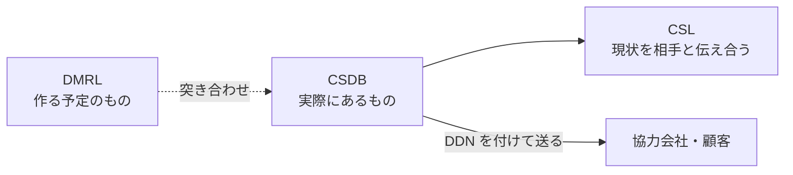

CSDB（Common Source DataBase、共通ソースデータベース）は、1 つのプロジェクトで技術出版物を作るのに必要なものを、すべて格納して管理する場所です。S1000D は CSDB に入れるもの（CSDB オブジェクト）のデータ構造を定めていますが、CSDB をどう設計し、どのソフトウェアで実装するかは定めていません（Issue 7 の Chap 4.2）。

## CSDB の役割

CSDB は、技術出版物の制作と執筆、品質保証、協力会社や顧客とのデータ交換を支えます。さらに、保管している形式に左右されずに、紙・PDF・IETM などのさまざまな媒体へ出力できるようにする役割も持ちます。

同じデータモジュールから紙の出版物と IETM の両方を作れるのは、出力の元を CSDB の 1 か所にまとめているためです。この考え方を単一ソース・複数出力と呼びます。

## CSDB に入るもの

CSDB の中心はデータモジュールです。図や動画などはデータモジュールの中に入れず、ICN（Information Control Number）で参照します。CSDB で管理するものは次のとおりで、図・マルチメディアなどを除き、すべて XML で作ります。

| CSDB オブジェクト | 何のためのものか | ファイル名の先頭 |
| --- | --- | --- |
| データモジュール | 最小の情報単位。説明・手順・故障情報・BREX など | `DMC-` |
| 図・マルチメディアなど | データモジュールから ICN で参照される図や動画 | `ICN-` |
| ICN メタデータファイル | 図・マルチメディアの管理情報 | `IMF-` |
| パブリケーションモジュール | どのデータモジュールをどの順に並べて出版物にするか | `PMC-` |
| データ管理リスト（DML） | プロジェクトで作る予定のデータモジュールの一覧（DMRL）や、CSDB の現状の一覧（CSL） | `DML-` |
| コメント | データモジュールなどへの指摘や問い合わせ | `COM-` |
| データ更新ファイル | 共通情報リポジトリ（CIR）のデータモジュールを差分で更新するためのもの | `UPF-` |
| 納入票（DDN） | データを相手に送るときに付ける送り状。送り手・受け手・送る中身を書く | `DDN-` |

ファイル名の付け方は、ファイルでデータを交換するときの決まりとして Chap 7.5.1 で定められています。データモジュールのファイル名の読み方は [データモジュールと DMC](/s1000d-stack/ja/guide/data-module-and-dmc/) で説明しています。

## 作る予定の一覧と現状の一覧

データ管理リストのうち DMRL（Data Management Requirement List）は、プロジェクトで作る予定のデータモジュールとパブリケーションモジュールの一覧です。プロジェクトの始めに作り、期間中は更新し続けます。予定の一覧なので、まだ CSDB に無いものも載っています。CSL（CSDB Status List）は、CSDB の現状を相手と伝え合うための一覧です。たとえば複数社で作るプロジェクトでは、ある会社が送ったデータモジュールや図が相手の CSDB に正しく入ったかを、CSL で確かめます。データを受け渡ししたあとに CSL を作って確かめる、といった運用は、プロジェクトのビジネスルールで決めます。

## 製品としての CSDB

仕様は、CSDB オブジェクトの定義・作成・管理・納入を支える道具を、CSDB（管理）システムと呼んでいます。CSDB の実装は仕様の範囲外なので、市販の CSDB 製品は、それぞれ独自のデータベースと画面でこれらの機能を提供しています。製品が違っても受け渡しができるように、仕様は受け渡しの形を定めています。その 1 つが、DDN を付けたファイルの組で送る方法（Chap 7.5.1）です。

## このスタックでは

- `DMC-….XML` などの名前でファイルが置かれたフォルダーを CSDB と見なします。フォルダーは環境変数 `S1000D_CSDB_DIR` か設定ファイルの `csdbDirs`、またはツールの引数 `csdbDirs` で指定し、複数を並べられます（[導入手順](/s1000d-stack/ja/guide/getting-started/)）
- ファイル名の先頭（`DMC-`・`PMC-`・`DML-`・`DDN-`・`IMF-`・`UPF-`・`ICN-`・`COM-`）で種類を見分け、DMC・PMC・ファイル名から引ける索引を作ります。参照の解決と BREX の連鎖の探索はこの索引を使います
- s1000d-verify-mcp の `verify_csdb` は CSDB 全体を検証し、`reconcile_dml` は DML・DDN と CSDB を突き合わせて、無いもの・版が違うもの・DML に載っていないものを返します
- s1000d-writer-mcp は、`write: true` のときだけ、指定した CSDB の先頭のフォルダーに書き込みます
- CSDB 製品のデータベースや API を CSDB として使うときは、`CsdbSource` に製品側の実装を差し込みます（[CSDB 製品に組み込む](/s1000d-stack/ja/use-cases/embedding/)）
