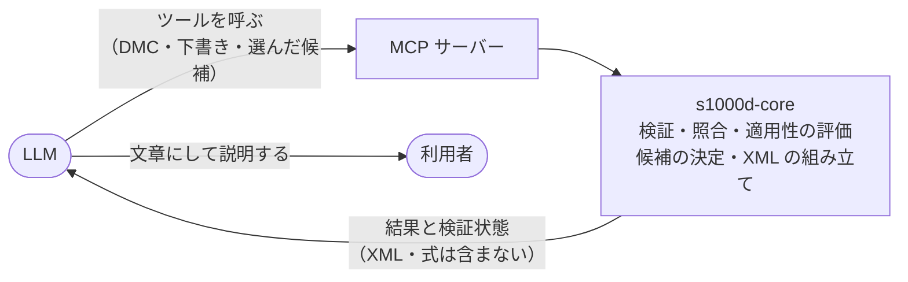

s1000d-stack は、正しいかどうかの判定をサーバーが決定論的に行い、LLM はその結果を文章にして説明する役に限る、という方針で作っています。LLM に S1000D の XML を直接読ませたり書かせたりすると、同じ入力でも答えが変わり、スキーマや BREX に合っているかを保証できないためです。このページでは、この方針から決めていることと、S1000D を LLM で扱うときの注意点にどう対応しているかを説明します。

## 判定はサーバー、説明は LLM

verify・reader・writer の応答には、XSD・BREX・参照の各工程をどこまで通ったか（検証状態、`verification`）が付きます。LLM の説明の根拠がどこまで確かめられたものかを、利用者はこの検証状態で確かめられます。

## 決めていること

- **LLM に XML を書かせない**  
LLM は構造化した下書きを渡し、XML の組み立てと採番はサーバー（s1000d-core）が行います。組み立てた XML は必ず検証してから返します
- **修正の候補はサーバーが決める**  
修正提案の候補は、BREX のルール・XSD の定義・CSDB の索引から決め、確からしさ（exact / several / none）と出どころを付けて返します。修正は、サーバーが計算した候補と一致する選択だけを適用するので、候補の外の値は入りません
- **適用性の式を LLM に渡さない**  
どの製品に当てはまるかはサーバーが判定し、applicable / notApplicable / undetermined と表示文だけを返します
- **判定の処理は 1 か所に置く**  
BREX の照合や XSD の検証は s1000d-core に置き、4 つの MCP サーバーは同じ処理を呼びます。サーバーごとに判定が食い違わないようにするためです
- **仕様書・XML スキーマ・既定 BREX・公式サンプルを同梱しない**  
利用者が s1000d.org から入手したものを `S1000D_SPEC_DIR` で指定します（[仕様書の扱いと商標](/s1000d-stack/ja/guide/license/)）
- **準拠を判定しない**  
XSD と、機械で照合できる BREX ルールに違反が無いことまでを返します。S1000D に準拠しているかどうかは人が判断します

## S1000D を LLM で扱うときの注意点への対応

| 注意点 | このスタックの対応 |
| --- | --- |
| 仕様が複雑で、版（Issue）が複数あり、プロジェクト固有の BREX が加わる | XSD・BREX の連鎖・参照・適用性を 1 つの検証状態にまとめます。XSD は `xsi:noNamespaceSchemaLocation` の版に合う `xml_schema_flat/` をデータモジュールごとに選び、合う版が無ければ他の版で代用せず `schema-not-found` と返します。BREX は連鎖を既定 BREX までたどって層ごとに照合します |
| 公式スキーマは登録ユーザー向けの配布で、オープンに再利用できない | 近似スキーマは作らず、利用者が入手した本物の XSD で検証します。XSD が無いときは「検証していない」と明記します。「検証した」と「本物の XSD で検証した」を区別できるのが、近似スキーマで検証する方式との違いです |
| テキスト化すると適用性や参照の論理情報が失われ、XML は冗長でコンテキスト長を消費する | reader は XML をテキスト化せず、節・手順・警告・図・参照を保った木にします。適用性は判定して結果だけを渡し、参照は題名付きで解決します。大きなデータモジュールは `section: "outline"`（見出し・手順の番号・最初の 1 文・部分木の大きさ）で当たりを付けてから本文を読めます |
| LLM に XML を直接書かせると、スキーマ準拠や参照の整合性を保証しにくい | 修正提案は候補をサーバーが決め、LLM は候補の外の値を出しません。s1000d-writer-mcp も LLM に XML を書かせず、構造化された入力から XML を組み立てて必ず検証に通します |
| 図・マルチメディア、機密区分、専門用語（STE）への対応が別に要る | 図は ICN として参照を解決し、中身は読みません。機密区分は reader の応答の先頭に必ず付けます。STE の辞書は同梱せず、利用者が持つ用語集を Skill（s1000d-review・s1000d-translate）から参照します |

決定の経緯と未決事項は、hub リポジトリの [docs/DECISIONS.md](https://github.com/shuji-bonji/s1000d-stack/blob/main/docs/DECISIONS.md) に番号付きで記録しています。
