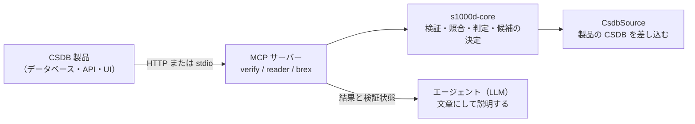

s1000d-stack の段階 2.5 の目標は、CSDB 製品（S1000D のデータモジュールを保管・管理するシステム）に AI エージェントを組み込める基盤を用意することです。このページでは、LLM エージェントが CSDB の中で最低限できるべき 4 つのこと、組み込みに使う部品、製品側に残す責務、そして S1000D を LLM で扱うときの注意点にこのスタックがどう答えているかを説明します。設計の経緯は hub リポジトリの `docs/design/agent-platform.md` にあります。

## 最低限の 4 つの要件

LLM エージェントが CSDB の中で次の 4 つをできることを、最低限の要件としています。4 つとも、判定はサーバー（共有ライブラリ `s1000d-core`）が決定論的に行い、LLM は結果を文章にして説明する役に限ります。

| 要件 | 使うツール | 何が返るか |
| --- | --- | --- |
| スキーマ検証 | verify-mcp `validate_schema` / `verify_data_module` | 利用者が入手した公式 XSD による valid / invalid と、行番号付きの違反 |
| クロスリファレンスチェック | verify-mcp `check_references`、`reconcile_dml` | `dmRef` / `pmRef` / ICN / `internalRef` / `applicRefId` の参照先の有無と理由。DML・DDN と CSDB の照合（無い・版が違う・DML に載っていない） |
| 適用性チェック | reader-mcp `describe_applicability` / `read_data_module` | 製品ごとの applicable / notApplicable / undetermined。式そのものは LLM に渡しません |
| 修正提案 | verify-mcp `suggest_fixes` | 違反ごとに「何を」「どこで」「どの値に」直すかの候補。候補はサーバーが決め、確からしさ（exact / several / none）と出どころを付けます |

## 組み込みに使う部品

| 部品 | 内容 |
| --- | --- |
| `CsdbSource` | `s1000d-core` は既定で「フォルダーの中の `DMC-….XML`」を CSDB と見なしますが、製品の CSDB はデータベースや API です。CSDB オブジェクトの一覧（`list()`）と中身の取得（`readText()`）を `CsdbSource` インターフェースに集めてあり、製品側が自分の実装を差し込めます。インターフェースは同期で、非同期にしか読めない置き場所は先に読み込んで `MemoryCsdbSource` に渡します |
| HTTP transport | 3 本の MCP サーバーは `--http` で Streamable HTTP として起動でき（既定 `http://127.0.0.1:3000/mcp`）、製品のサーバーや Web アプリから HTTP で呼べます。loopback 以外のアドレスに束縛したときは `Host` と `Origin` を検査しないので、製品側のリバースプロキシや認証の後ろに置きます |
| 設定ファイル | 配布物（XSD・既定 BREX）と CSDB の場所は、環境変数 `S1000D_SPEC_DIR` / `S1000D_CSDB_DIR` か、設定ファイル `~/.config/s1000d-stack/config.json` で指定します。製品ベンダーは自社で配布物を持っているので、この方式をそのまま使えます |
| 検証状態 | すべての応答に `verification`（XSD・BREX・参照の各工程の状態）が付きます。製品側はこれを監査の記録として保存できます |
| 機密区分 | reader-mcp の応答は先頭に `securityClassification`（データモジュールの値と、本文の要素に付いた値ごとの数）を持ちます。値は解釈しないので、扱いは製品の規則で決めます |

## 製品側に残す責務

- **認証・権限・マルチテナント**は持ちません。HTTP で公開するときは製品側の認証の後ろに置きます。
- **エージェントの組み立て**は製品側が行います。このスタックは core・MCP・Skill（手順）を提供し、Author / Reviewer / Translator / Project Manager の役割分担や UI は製品の設計に任せます。
- **仕様書・XSD・既定 BREX は同梱しません**。利用者（製品ベンダー）が入手したものを使います。
- **準拠の判定はしません**。XSD と機械で照合できる BREX ルールに違反が無いことまでを返し、S1000D への準拠は人が判断します。

## S1000D を LLM で扱うときの注意点への対応

| 注意点 | このスタックの対応 |
| --- | --- |
| 仕様が複雑で、版（Issue）が複数あり、プロジェクト固有の BREX が加わる | XSD・BREX の連鎖・参照・適用性を 1 つの検証状態にまとめます。XSD は `xsi:noNamespaceSchemaLocation` の版に合う `xml_schema_flat/` を DM ごとに選び、合う版が無ければ他の版で代用せず `schema-not-found` と返します。BREX は連鎖を既定 BREX までたどって層ごとに照合します |
| 公式スキーマは登録ユーザー向けの配布で、オープンに再利用できない | 近似スキーマは作らず、利用者が入手した本物の XSD で検証します。XSD が無いときは「検証していない」と明記します。「検証した」と「本物の XSD で検証した」を区別できるのが、近似スキーマで検証する方式との違いです |
| テキスト化すると適用性や参照の論理情報が失われ、XML は冗長でコンテキスト長を消費する | reader は XML をテキスト化せず、節・手順・警告・図・参照を保った木にします。適用性は判定して結果だけを渡し、参照は題名付きで解決します。大きなデータモジュールは `section: "outline"`（見出し・手順の番号・最初の 1 文・部分木の大きさ）で当たりを付けてから本文を読めます |
| LLM に XML を直接書かせると、スキーマ準拠や参照の整合性を保証しにくい | 修正提案は候補をサーバーが決め、LLM は候補の外の値を出しません。段階 3 の writer も LLM に XML を書かせず、構造化された入力から XML を組み立てて検証に通す方針です |
| 図・マルチメディア、機密区分、専門用語（STE）への対応が別に要る | 図は ICN として参照を解決し、中身は読みません（表示用の変換物は製品側が持ちます）。機密区分は応答の先頭に必ず付けます。STE の辞書は同梱せず、利用者が持つ用語集を Skill から参照する形にします（段階 3） |

## 参照実装

この基盤を使う側の実物として、S1000D の CSDB を直接表示する簡易な技術マニュアルの Web システムを段階 4 の最初の成果物にする予定です。PM の目次からデータモジュールをたどり、製品を選ぶと当てはまらない節が消え、各ページの先頭に版・検証状態・機密区分が出る、という最小の機能で、API に足りないものを core・MCP 側に戻すための場でもあります。
