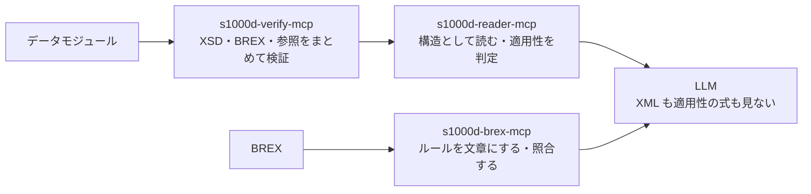

s1000d-stack は、S1000D® で書かれた技術文書（データモジュール）を LLM が正しく読み、プロジェクトで合意されたビジネスルール（BREX、Business Rules Exchange）に沿って検査し、作れるようにするための道具の束ねです。MCP サーバーと共有ライブラリを先に作り、それを使って体験型マニュアルの作成ツールと閲覧ソフトへ広げます。

## 誰のための道具か

| 立場 | 困っていること | この道具でできること |
| --- | --- | --- |
| 海外の機体メーカーや防衛事業に部品を納めるメーカー | 顧客から BREX を渡されるが、XPath と許可値の一覧で、何を求めているのか読み解きにくい | BREX のルールを、対象・使用可否・許可値とその意味の形で一覧にする |
| 技術マニュアル制作会社 | 納品前に、作ったデータモジュールが顧客のビジネスルールに従っているかを確かめたい | データモジュールを BREX の連鎖に照合し、違反を箇所付きで得る |
| S1000D を学び始めた人 | 日本語の資料が少なく、仕様書は 3,700 ページある | このサイトで仕組みを押さえ、自分で作ったデータモジュールを既定 BREX に照合して確かめられる |

## できること

- **BREX を読む**。渡された BREX データモジュールを、どの要素に何を求めているかが分かる文章にして一覧にします。属性値や SNS（システム番号）の意味も引けます
- **データモジュールを照合する**。BREX の連鎖（プロジェクト → 組織 → S1000D 既定 BREX）に各層ごとに照合し、違反を箇所（XPath と行番号）・値・ルール ID・重大度付きで返します
- **検証して、読む**。XSD・BREX・参照の検証結果を 1 つの検証状態にまとめ、データモジュールを見出し・手順・警告・図の構造で LLM に渡します。どの製品に当てはまるか（適用性）はサーバーが判定し、結果だけを渡します

## しないこと

- **S1000D の仕様書・XML スキーマ・既定 BREX・公式サンプルを同梱しません**。利用条件により再配布できないため、利用者が s1000d.org から入手したものを環境変数で指定します（[仕様書の扱いと商標](/s1000d-stack/ja/guide/license/)）
- **要約・翻訳はしません**。LLM が要約や回答を作るための材料（見出し、手順の番号、警告の種類、参照先、検証状態）を落とさずに渡すのが仕事です
- **XML と適用性の式を LLM に見せません**。構造の読み取りと式の評価はサーバーが行い、LLM は結果を受け取ります
- **ASD の公式・認定の道具ではありません**。ASD とは無関係の個人プロジェクトです

## このサイトの読み方

| 章 | 説明しているもの | 主語 |
| --- | --- | --- |
| ガイド | この道具の位置づけ、導入手順、部品・段階の構成、仕様書の扱い | s1000d-stack |
| S1000D を知る | S1000D 仕様の仕組み。スタックを使うために必要な範囲に絞っています | S1000D、データモジュール、BREX |
| MCP サーバー | 各サーバーの設定、ツール、応答の形、できないこと | 各 MCP サーバー |
| ライブラリ | MCP サーバーが共有するライブラリの関数と設計上の判断 | 各ライブラリ |
| ユースケース | 道具をどの場面でどう組み合わせるか。1 例 1 ページ | 利用者 |

「S1000D を知る」の各記事では、本文は S1000D 仕様の説明に限り、このスタックがそれをどう扱うかは記事末尾の「このスタックでは」の節に分けて書いています。本文の途中でスタックに触れるときは、文頭に「このスタックでは」と置いた 1 文に限ります。

:::tip[次に読むもの]
使い始めるには [導入手順](/s1000d-stack/ja/guide/getting-started/)、部品と段階の構成は [全体構成と進み方](/s1000d-stack/ja/guide/architecture/)、使い方の場面は [ユースケース](/s1000d-stack/ja/use-cases/) をご覧ください。
:::
