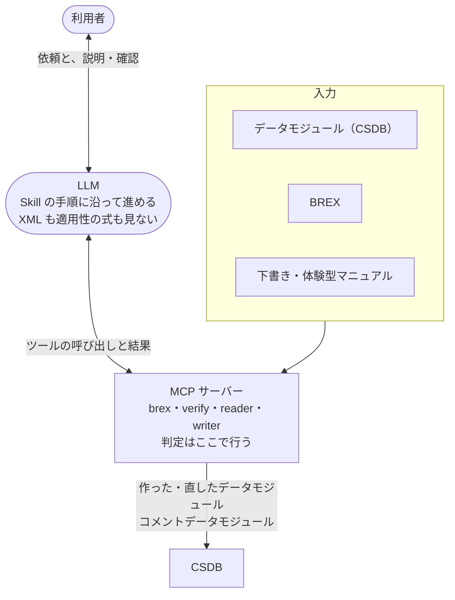

s1000d-stack は、S1000D® で書かれた技術文書（データモジュール）を LLM が正しく読み、プロジェクトで合意されたビジネスルール（BREX、Business Rules Exchange）に沿って検査し、作れるようにするための道具の束ねです。

目指しているのは、技術文書の作成・検査・レビュー・翻訳を LLM が手伝い、作ったデータモジュールや LLM に渡した本文に、XSD・BREX・参照の検証をどこまで通ったか（検証状態）が必ず付いている状態です。LLM は結果を文章にして説明する役に限り、正しいかどうかの判定は、利用者が入手した公式の XSD と BREX に基づいてサーバーが行います。

## 誰のための道具か

| 立場 | 困っていること | できるようになること |
| --- | --- | --- |
| 海外の機体メーカーや防衛事業に部品を納めるメーカー | 顧客から BREX を渡されるが、XPath と許可値の一覧で、何を求めているのか読み解きにくい | BREX の各ルールが何を求めているかを、文章で確かめられます。作ったデータモジュールがルールに違反していないかを、違反の箇所付きで確かめられます |
| 技術マニュアル制作会社 | 納品前に、作ったデータモジュールが顧客のビジネスルールに従っているかを確かめたい。レビューや翻訳にも手間がかかる | XSD・BREX・参照をまとめて検証し、直し方の候補まで得られます。レビューの指摘をコメントデータモジュールとして残し、データモジュールを別の言語に訳せます |
| CSDB 製品のベンダー | 製品に AI エージェントを組み込みたいが、LLM に S1000D の XML を正しく扱わせる手段が無い | 検証・参照の確認・適用性の判定・修正提案を、MCP サーバーとして製品から呼べます |
| S1000D を学び始めた人 | 日本語の資料が少なく、仕様書は 3,700 ページある | このサイトで仕組みを押さえ、自分で作ったデータモジュールを既定 BREX に照合して確かめられます |

## できること

- **BREX を読む**  
渡された BREX を、どの要素に何を求めているかが分かる文章にして一覧にします。属性値や SNS（システム番号）の意味も引けます。
- **検査する**  
データモジュールを、公式 XSD、BREX の連鎖（プロジェクト → 組織 → S1000D 既定 BREX）、参照先の有無でまとめて検証し、1 つの検証状態にします。違反には箇所（XPath と行番号）と、直し方の候補が付きます。
- **読む**  
データモジュールを見出し・手順・警告・図の構造で LLM に渡します。どの製品に当てはまるか（適用性）はサーバーが判定し、結果だけを渡します。
- **作る**  
LLM が渡した構造化した下書きや、体験型マニュアルの JSON から、サーバーがデータモジュールの XML を組み立てて検証します。LLM は XML を書きません。
- **レビューする・翻訳する**  
レビューの指摘をコメントデータモジュールとして CSDB に残します。データモジュールから文を取り出して LLM が訳し、同じ DMC で言語だけが違うデータモジュールに戻します。
- **製品に組み込む**  
MCP サーバーを HTTP で起動し、CSDB 製品のデータベースや API を CSDB として差し込んで使えます。（[CSDB 製品に組み込む](/s1000d-stack/ja/use-cases/embedding/)）

どの作業にどのサーバーと Skill を使うかは [全体構成](/s1000d-stack/ja/guide/architecture/) に、判定をサーバーに置く理由は [設計方針](/s1000d-stack/ja/guide/design-principles/) にまとめています。

## しないこと

- **S1000D の仕様書・XML スキーマ・既定 BREX・公式サンプルを同梱しません。**  
利用条件により再配布できないため、利用者が s1000d.org から入手したものを環境変数で指定します。（[仕様書の扱いと商標](/s1000d-stack/ja/guide/license/)）
- **サーバーは要約・翻訳をしません。**  
要約や訳文を作るのは LLM です。サーバーの仕事は、そのための材料（見出し、手順の番号、警告の種類、参照先、検証状態）を落とさずに渡すことと、訳した文をデータモジュールに戻すことです。
- **XML と適用性の式を LLM に見せません**  
構造の読み取りと式の評価はサーバーが行い、LLM は結果を受け取ります。
- **S1000D への準拠を判定しません。**  
XSD と、機械で照合できる BREX ルールに違反が無いことまでを返します。準拠しているかどうかは人が判断します。
- **ASD の公式・認定の道具ではありません。**  
ASD とは無関係の個人プロジェクトです。

## このサイトの読み方

| 章 | 説明しているもの | 主語 |
| --- | --- | --- |
| ガイド | この道具の位置づけ、導入手順、部品の構成、設計方針、仕様書の扱い | s1000d-stack |
| S1000D を知る | S1000D 仕様の仕組み。スタックを使うために必要な範囲に絞っています | S1000D、データモジュール、CSDB、BREX |
| MCP サーバー | 各サーバーの設定、ツール、応答の形、できないこと | 各 MCP サーバー |
| Skill | 各 Skill が MCP サーバーをどの順に呼び、利用者に何を確かめるか | 各 Skill |
| ライブラリ | MCP サーバーが共有するライブラリの関数と設計上の判断 | 各ライブラリ |
| ユースケース | 道具をどの場面でどう組み合わせるか。1 例 1 ページ | 利用者 |

「S1000D を知る」の各記事では、本文は S1000D 仕様の説明に限り、このスタックがそれをどう扱うかは記事末尾の「このスタックでは」の節に分けて書いています。本文の途中でスタックに触れるときは、文頭に「このスタックでは」と置いた 1 文に限ります。

:::tip[次に読むもの]
使い始めるには [導入手順](/s1000d-stack/ja/guide/getting-started/)、部品の構成は [全体構成](/s1000d-stack/ja/guide/architecture/)、使い方の場面は [ユースケース](/s1000d-stack/ja/use-cases/) をご覧ください。
:::
