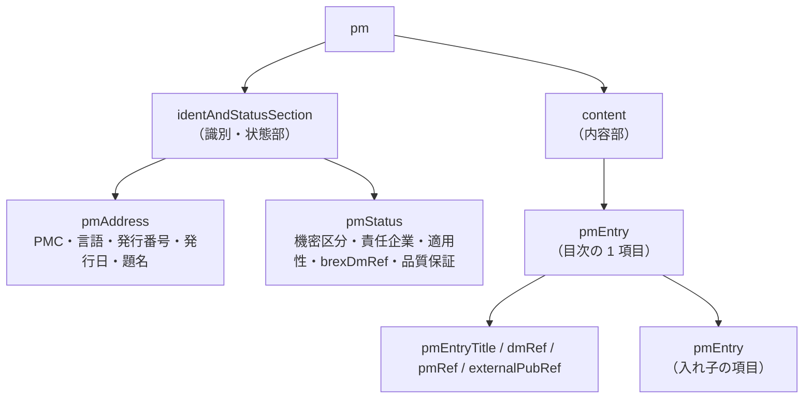

パブリケーションモジュールは、出版物 1 冊の中身と構成を決める XML です。本文は持たず、データモジュールへの参照を目次の順に並べます。パブリケーションモジュールコード（PMC）は、そのパブリケーションモジュールが「どの製品の、どの組織が発行した、何番の出版物か」をハイフン区切りの文字列で表します。

## パブリケーションモジュールの構造



識別・状態部の作りは[データモジュール](/s1000d-stack/ja/guide/data-module-and-dmc/)とほぼ同じです。`dmCode` に当たるのが `pmCode`、`dmTitle` に当たるのが `pmTitle` です。

| 要素 | 入っているもの | 何に使うか |
| --- | --- | --- |
| `pmCode` | PMC の構成要素（属性で分かれている） | 識別、ファイル名との照合 |
| `language` / `issueInfo` / `issueDate` | 言語と国、発行番号と作業中番号、発行日 | 版の判別 |
| `pmTitle` | 出版物の題名 | 人が読む題名 |
| `pmStatus/@issueType` | new / changed / … | 改版の種類 |
| `security` | 機密区分 | 配布の制御 |
| `applic` | どの機種・構成に当てはまるか | [適用性](/s1000d-stack/ja/guide/applicability/)の判定 |
| `brexDmRef` | 従うべき BREX の DMC | BREX 照合の起点 |
| `qualityAssurance` | 未検証 / 第 1 検証 / 第 2 検証 | 検証状態の明示 |

内容部（`content`）には `pmEntry` を 1 つ以上並べます。`pmEntry` は目次の 1 項目に当たり、中に次の要素を書きます。

| 要素 | 入っているもの |
| --- | --- |
| `pmEntryTitle` | 項目の見出しです。省略できます |
| `dmRef` | データモジュールへの参照です |
| `pmRef` | ほかのパブリケーションモジュールへの参照です。出版物の中に別の出版物を組み込めます |
| `externalPubRef` | S1000D で作られていない出版物への参照です |
| `pmEntry` | 入れ子の項目です。章の下に節を作るように、深さを自由に決められます |

`pmEntryTitle` の後ろに、残りの 4 つの要素を 1 つ以上、任意の順で並べます。次の例は、このプロジェクトの例のデータ（架空の指定席券売機 `KENBAIKI`）のパブリケーションモジュールから、内容部の先頭を抜き出したものです。

```xml
<content>
  <pmEntry>
    <pmEntryTitle>券売機の概要</pmEntryTitle>
    <dmRef>
      <dmRefIdent>
        <dmCode modelIdentCode="KENBAIKI" systemDiffCode="A" systemCode="10"
          subSystemCode="2" subSubSystemCode="0" assyCode="00" disassyCode="00"
          disassyCodeVariant="A" infoCode="040" infoCodeVariant="A" itemLocationCode="D"/>
      </dmRefIdent>
    </dmRef>
  </pmEntry>
  <pmEntry>
    <pmEntryTitle>乗換案内からきっぷを買う</pmEntryTitle>
    <!-- dmRef が 5 つ続きます -->
  </pmEntry>
</content>
```

パブリケーションモジュールが持つのは参照だけで、本文はデータモジュールの側にあります。そのため、同じデータモジュールを複数のパブリケーションモジュールから参照できます。

出版物の種類は `pm` の属性 `pmType`（`pt01`〜`pt99`）、項目の種類は `pmEntry` の属性 `pmEntryType`（`pmt01`〜`pmt99`）に書けます。どちらも省略できます。`pmt01` は表題紙、`pmt13` は目次のように仕様が意味を決めている値と、プロジェクトが意味を決める値（`pt51`〜`pt99`、`pmt51`〜`pmt99`）があります（Chap 3.9.6.1）。

## PMC の読み方

```text
KENBAIKI-K0001-7BTJ7-00
│        │     │     └ 巻番号（数字 2 文字）
│        │     └────── 出版物の番号（5 文字）
│        └──────────── 発行元（5 文字）
└───────────────────── モデル識別コード（2〜14 文字）
```

PMC の決まりは Chap 4.9.2 にあります。全体の長さは 14〜26 文字で、発行情報（発行番号と作業中番号）と合わせて 1 つのパブリケーションモジュールを指します。

| 区画 | `pmCode` の属性 | 意味 | 例の値 |
| --- | --- | --- | --- |
| モデル識別コード（MIC） | `modelIdentCode` | 製品やプロジェクト。DMC のモデル識別コードと同じものです | `KENBAIKI` |
| 発行元 | `pmIssuer` | パブリケーションモジュールを発行する組織の CAGE コード | `K0001` |
| 出版物の番号 | `pmNumber` | 発行元が付ける番号。モデル識別コードと発行元の組み合わせの中で重ならないように付けます | `7BTJ7` |
| 巻番号 | `pmVolume` | 番号を変えずに出版物を分冊にするときに使います。1 巻だけなら `00` です | `00` |

DMC と違い、PMC には製品の構造上の位置（システムコードなど）と情報の種類（情報コード）が入りません。出版物が何を扱っているかは、PMC ではなく `pmTitle` と内容部から読み取ります。

### ファイル名

CSDB では、パブリケーションモジュールをデータモジュールと同じ形の名前で置きます（Chap 7.5.1）。

```text
PMC-KENBAIKI-K0001-7BTJ7-00_001-00_JA-JP.XML
    └── PMC ──────────────┘ └発行┘ └言語┘
```

`_001-00` が発行番号と作業中番号、`_JA-JP` が言語と国です。

## このスタックでは

パブリケーションモジュールは、読む・作る・検証するの 3 つを次の部品が扱います。

- 共有ライブラリ `s1000d-core` の `parsePmc` が PMC を 4 つの区画に分解し、`parsePmcFileName` がファイル名から PMC・発行情報・言語を取り出します
- [s1000d-reader-mcp](/s1000d-stack/ja/mcp/reader-mcp/) の [`read_publication_module`](/s1000d-stack/ja/reference/stack/reader/read-publication-module/) は、`pmEntry` の木を目次として返します。`dmRef` と `pmRef` には、CSDB の中で見つかったファイル・題名・版を添えます
- [s1000d-writer-mcp](/s1000d-stack/ja/mcp/writer-mcp/) の [`build_data_module`](/s1000d-stack/ja/reference/stack/writer/build-data-module/) は、下書きの `kind` が `pm` のときにパブリケーションモジュールを作ります。[`convert_manual`](/s1000d-stack/ja/reference/stack/writer/convert-manual/) は、体験型マニュアル 1 冊につきパブリケーションモジュールを 1 件作ります
- [s1000d-verify-mcp](/s1000d-stack/ja/mcp/verify-mcp/) の [`verify_csdb`](/s1000d-stack/ja/reference/stack/verify/verify-csdb/) は、既定で `DMC-` と `PMC-` のファイルを検証します

`read_publication_module` の応答では、`pmEntry` が `kind: "section"`、その中の参照が `kind: "entry"` になります。

```json
{
  "kind": "section",
  "element": "pmEntry",
  "title": "券売機の概要",
  "children": [
    {
      "kind": "entry",
      "element": "dmRef",
      "target": "KENBAIKI-A-10-20-00-00A-040A-D",
      "resolved": {
        "path": "…/DMC-KENBAIKI-A-10-20-00-00A-040A-D_001-00_JA-JP.XML",
        "techName": "指定席券売機 操作マニュアル（例）",
        "infoName": "券売機の概要",
        "issueInfo": { "issueNumber": "001", "inWork": "00" }
      }
    }
  ]
}
```

作るときに PMC を指定しなければ、s1000d-writer-mcp が採番します。モデル識別コードは採番の規則（`allocation`）の値、発行元は `allocation.icn.cageCode`、巻番号は `00` です。出版物の番号は `sourceId` が英数字 5 文字ならその値、そうでなければ `sourceId` から計算した 5 文字になります。

:::note[できないこと]
- 作る側が `pmEntry` の中に書けるのは `dmRef` と `pmRef` です。`externalPubRef` は読み取れますが、書けません
- パブリケーションモジュールから紙・PDF・IETP の画面を作る処理は、このスタックにはありません。閲覧ソフトは別のプロジェクトで計画しています（[全体構成](/s1000d-stack/ja/guide/architecture/)）
:::

`s1000d-core` の関数はそのまま呼べます。

```ts
import { readFileSync } from 'node:fs';
import { parsePmc, parsePmcFileName, readContentFromXml } from '@shuji-bonji/s1000d-core';

const pmc = parsePmc('KENBAIKI-K0001-7BTJ7-00');
if (pmc.ok) console.log(pmc.value.pmIssuer, pmc.value.pmNumber); // "K0001" "7BTJ7"

const fileName = 'PMC-KENBAIKI-K0001-7BTJ7-00_001-00_JA-JP.XML';
const name = parsePmcFileName(fileName);
if (name.ok) console.log(name.value.issueInfo); // { issueNumber: "001", inWork: "00" }

const content = readContentFromXml(readFileSync(fileName, 'utf8'));
for (const entry of content.blocks) {
  console.log(entry.title, entry.children.map((c) => c.text));
}
// "券売機の概要" [ "KENBAIKI-A-10-20-00-00A-040A-D" ]
// "乗換案内からきっぷを買う" [ "KENBAIKI-A-10-20-00-00A-130A-D", … ]
```
