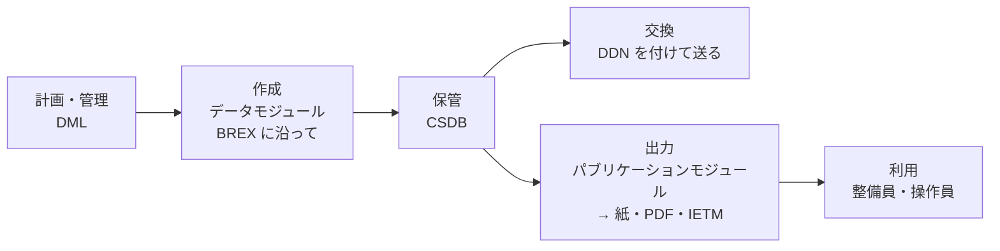

S1000D は、整備や操作のマニュアルなどの技術出版物を調達し、制作するための国際仕様です。航空機・陸上車両・船舶や各種の機器を対象に、民生・防衛を問わず使えます。技術文書をデータモジュールという小さな単位で作り、CSDB（共通ソースデータベース）にまとめて管理し、そこから紙・PDF・IETM などの出力を作ります。

## 誰が作っているか

S1000D は、1980 年代の初めに欧州の航空分野で始まりました。当時、民間機の文書は ATA 100 に沿って作られ、軍用機の文書は国ごとの軍用仕様で作られていました。仕様がばらばらなことで費用がかさむため、ATA 100 を元に民生と防衛の文書の作り方を揃える取り組みとして始まったものです。

現在は、欧州の ASD、米国の AIA、A4A（旧 ATA）が共同で保守しています。Issue 2 からは、航空機に加えて陸上と海上の製品も対象になりました。仕様書と XML スキーマは s1000d.org からダウンロードできます。配布物には利用条件が付いています（[仕様書の扱いと商標](/s1000d-stack/ja/guide/license/)）。

## 何を定めているか

S1000D は、技術文書の計画と管理・作成・交換・配布・利用までを、製品のライフサイクルを通して定めています。データの形は XML スキーマで定めますが、CSDB の実装や閲覧ソフトのような特定のソフトウェアは定めていません。

| 定めていること | 主な仕組み | このサイトの記事 |
| --- | --- | --- |
| 情報の単位と識別 | データモジュール、DMC、ICN | [データモジュールと DMC](/s1000d-stack/ja/guide/data-module-and-dmc/) |
| 保管と管理 | CSDB、データ管理リスト、コメント | [CSDB](/s1000d-stack/ja/guide/csdb/) |
| プロジェクトごとの決まり | ビジネスルール、BREX | [BREX](/s1000d-stack/ja/guide/brex/) |
| どの製品に当てはまるか | 適用性 | [適用性](/s1000d-stack/ja/guide/applicability/) |
| 出版物の組み立てと出力 | パブリケーションモジュール、ページ型の出版物、IETP | [IETM と S1000D](/s1000d-stack/ja/guide/ietm-and-s1000d/) |
| データの受け渡し | 納入票（DDN）、ファイル名の付け方 | [CSDB](/s1000d-stack/ja/guide/csdb/) |

データモジュールには、説明・手順・故障情報・図解部品カタログ・配線データ・訓練など、内容に応じた種類があり、種類ごとにスキーマが分かれています。

## なぜ使われるのか

- **1 か所直せば、すべての出力に反映される**  
同じ情報を CSDB に重複して持たず、1 つのデータモジュールを複数の出版物で使い回します。データモジュールを 1 つ直せば、それを使う紙の出版物も IETM も同じ内容になります
- **異なるシステムの間でデータを受け渡せる**  
国際的な中立の標準（ISO、W3C の XML など）に基づくため、特定の会社のソフトウェアに縛られず、会社の間や顧客との間で同じ形のデータを渡せます
- **データモジュール単位で版を管理できる**  
データモジュールごとに発行番号と状態を持つので、文書全体ではなく変わった部分だけを管理し、受け渡せます
- **利用者に合わせて必要な部分だけを出せる**  
適用性を使うと、製品の型式や改修の状態に合わせて、当てはまる内容だけを表示・出力できます

## プロジェクトに合わせて使う

S1000D は幅広い製品を対象にしているため、そのままでは使わず、プロジェクトや組織ごとに使い方を絞り込んで（テーラリングして）使います。どの要素を使うか、どの値を許すかといった合意は、ビジネスルールとして文書にします。ビジネスルールのうち機械で確かめられるものは、BREX というデータモジュールに XML で書きます。テーラリングで変えてよいのは使い方の範囲で、XML スキーマそのものは変えません。

ビジネスルールは、S1000D の既定のもの、組織のもの、プロジェクトのもの、と層になっています。顧客から BREX を渡されるのは、この層のうちプロジェクトの決まりに従って作ることを求められているためです。

## 版（Issue）

S1000D は改訂を重ねており、現場では複数の版が並んで使われています。版によって要素や属性が違うため、データモジュールは自分がどの版のスキーマに従っているかを XML の中に持っています（`xsi:noNamespaceSchemaLocation` の URL）。国内外の実例は Issue 4 系が多く、最新の版は Issue 7 です。

## S シリーズ

S1000D は、製品のライフサイクル全体にわたる支援を扱う仕様群、S シリーズの 1 つです。S シリーズは IPS（Integrated Product Support、統合製品支援）の仕様群と呼ばれ、資材管理の S2000M、後方支援分析の S3000L、予防保全の策定の S4000P、運用データのフィードバックの S5000F、訓練の分析と設計の S6000T と、仕様群の使い方を示す SX000i があります。組み合わせて使うことを前提に作られています。

以前は ILS（Integrated Logistics Support、統合後方支援）の仕様群と呼ばれていました。対象が後方支援（ロジスティクス）より広く、製品のライフサイクル全体に及ぶことから、2019 年に IPS という呼び方が導入されました。古い資料では ILS と書かれていることがあります。仕様群の全体は [s-series.org](https://www.s-series.org/) にあります。このスタックでは、S シリーズのうち S1000D だけを扱います。

## このスタックでは

- 最初の対象は Issue 7 で、次に Issue 4.2 を対象にする予定です
- 仕様書・XML スキーマ・既定 BREX・公式サンプルは同梱せず、利用者が s1000d.org から入手したものを `S1000D_SPEC_DIR` で指定します（[導入手順](/s1000d-stack/ja/guide/getting-started/)）
- 上の表の仕組みは、次の部品が扱います。BREX は [s1000d-brex-mcp](/s1000d-stack/ja/mcp/brex-mcp/)、データモジュールの検証と DML との照合は [s1000d-verify-mcp](/s1000d-stack/ja/mcp/verify-mcp/)、本文・参照・適用性の読み取りは [s1000d-reader-mcp](/s1000d-stack/ja/mcp/reader-mcp/)、データモジュールの作成は [s1000d-writer-mcp](/s1000d-stack/ja/mcp/writer-mcp/) です
- 対象にしているデータモジュールの種類は、説明・手順・プロセス・故障探求・パブリケーションモジュールなどで、すべての種類を読めるわけではありません。各サーバーのページの「できないこと」をご覧ください
