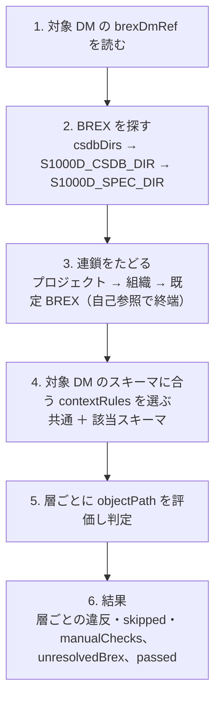

`s1000d-brex-mcp` は、BREX データモジュールを人が読める形にし、データモジュールを BREX の連鎖に照合する MCP サーバーです。5 つのツールを持ち、Claude Desktop や Claude Code から使えます。

[GitHub](https://github.com/shuji-bonji/s1000d-brex-mcp) / [npm](https://www.npmjs.com/package/@shuji-bonji/s1000d-brex-mcp)

## できること

| ツール | 内容 |
| --- | --- |
| `explain_brex` | BREX のルールを一覧にします。対象（XPath）、使用可否、許可する値とその意味、重大度、適用されるスキーマを返します。`kind`（structure / notation / nonContext）、`context`（スキーマ名）、`search`（文字列）で絞り、`offset` と `limit` で分けて読めます |
| `lookup_sns` | DMC またはコードから、システム番号（SNS）が何を指すかを返します。途中までしか一致しないときは `exact: false` |
| `lookup_value` | 要素・属性の値がプロジェクトで何を意味するか、どの値が許可されているかを返します。`value` を渡すと許可の判定も返します |
| `list_notations` | 使ってよい図・マルチメディアの形式を、基本セット（`baseSet`）、基本セットからの除外（`baseExcluded`）、スキーマ別の再定義と除外（`perContext`）に分けて返します。`context` にスキーマ名を渡すと、そのスキーマでの扱いを `effectiveFor.mode` で返します。`closed` は `allowed` に挙げた形式だけを使える、`open` は `excluded` に挙げた形式だけを禁止する（除外だけの BREX）、`unrestricted` はこの BREX では制限しない、という意味です |
| `check_against_brex` | データモジュールを BREX に照合し、違反を箇所（XPath と行番号）・実際の値・ルール ID・説明・重大度付きで返します。既定では `brexDmRef` の連鎖をたどり、各層に個別に照合します |

## できないこと

- XML スキーマ（XSD）による検証は行いません。XSD の検証と、XSD・BREX・参照をまとめた検証状態は [`s1000d-verify-mcp`](/s1000d-stack/ja/mcp/verify-mcp/) が返します。
- S1000D への準拠は判定しません。`passed: true` は「見つかったすべての層で、機械で検査できる BREX のルールに違反が無かった」ことだけを意味します。`nonContextRules` は `manualChecks` として返し、判断は人が行います。
- 重大度コード（`brsl01`〜`brsl99`）の意味は解釈しません。

これらは MCP の `instructions`（クライアントのシステムコンテキストに載る説明）にも書いてあり、LLM がツールを選ぶ前に読めるようにしています。

## 設定

| 環境変数 | 内容 |
| --- | --- |
| `S1000D_SPEC_DIR` | S1000D の配布物を展開したフォルダー。既定 BREX をこの下から探します。内側の zip も展開しておいてください |
| `S1000D_CSDB_DIR` | プロジェクトのデータモジュールが置かれたフォルダー。`:`（Windows は `;`）区切りで複数指定できます |

ツールの引数 `csdbDirs` でフォルダーを追加することもできます。BREX は、ファイルのパス、DMC（`DMC-` 接頭辞は任意）、省略（既定 BREX）のどれでも指定できます。

```json
{
  "mcpServers": {
    "s1000d-brex": {
      "command": "npx",
      "args": ["-y", "@shuji-bonji/s1000d-brex-mcp"],
      "env": {
        "S1000D_SPEC_DIR": "/path/to/s1000d/issue-7",
        "S1000D_CSDB_DIR": "/path/to/project/csdb"
      }
    }
  }
}
```

## 照合の流れ



結果の読み方の要点は 3 つです。

- **`unresolvedBrex` が空でない結果は不完全**です。連鎖の途中の BREX が見つからなかったので、その層の照合は行われていません。`S1000D_SPEC_DIR` か `csdbDirs` を確認してください。
- **`skipped`** は XPath を評価できなかったルールです。空でなければ、その BREX の書き方かエンジン側の問題です。
- **`manualChecks`** は `nonContextRules` です。機械では判定できないので、人が読んで確かめます。

## 応答の例

`check_against_brex` の違反 1 件は次の形です。

```json
{
  "kind": "value",
  "ruleId": "KB-00004",
  "objectPath": "//responsiblePartnerCompany/@enterpriseCode",
  "objectUse": "責任企業は本社コードにする",
  "brSeverityLevel": "brsl02",
  "location": {
    "path": "/dmodule/identAndStatusSection/dmStatus/responsiblePartnerCompany/@enterpriseCode",
    "line": 27,
    "column": 7
  },
  "actualValue": "K0001",
  "allowedValues": ["K0002"]
}
```

`kind` は `forbidden`（使ってはならない対象があった）、`missing`（必ず含める対象が無かった）、`value`（値が許可値に合わない）、`notation`（使っている図の形式が許可されていない）の 4 つです。

