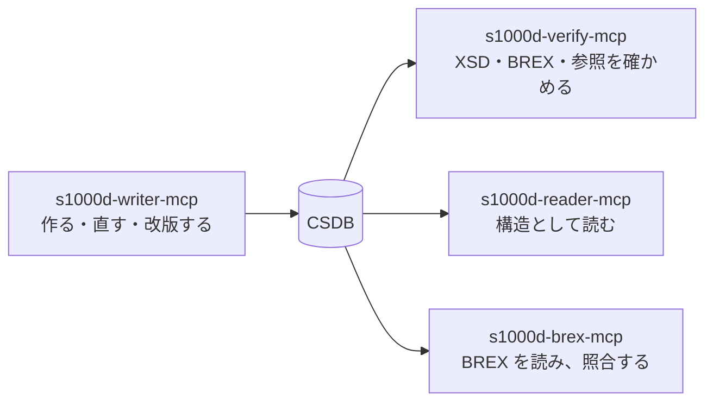

import SectionPages from '../../../../components/SectionPages.astro';

S1000D Stack は、LLM が S1000D® のデータを読み、確かめ、作るための MCP サーバーを 4 つ持ちます。どのサーバーも、判定は共有ライブラリ `s1000d-core` が決定論的に行い、LLM には結果だけを渡します（[設計方針](/s1000d-stack/ja/guide/design-principles/)）。

## 各サーバーのページ

各ページで、設定のしかた、ツールの一覧、応答の読み方を説明しています。ツールごとの引数は [Stack リファレンス](/s1000d-stack/ja/reference/stack/) にあります。

<SectionPages dir="mcp" order={['brex-mcp', 'verify-mcp', 'reader-mcp', 'writer-mcp']} />
