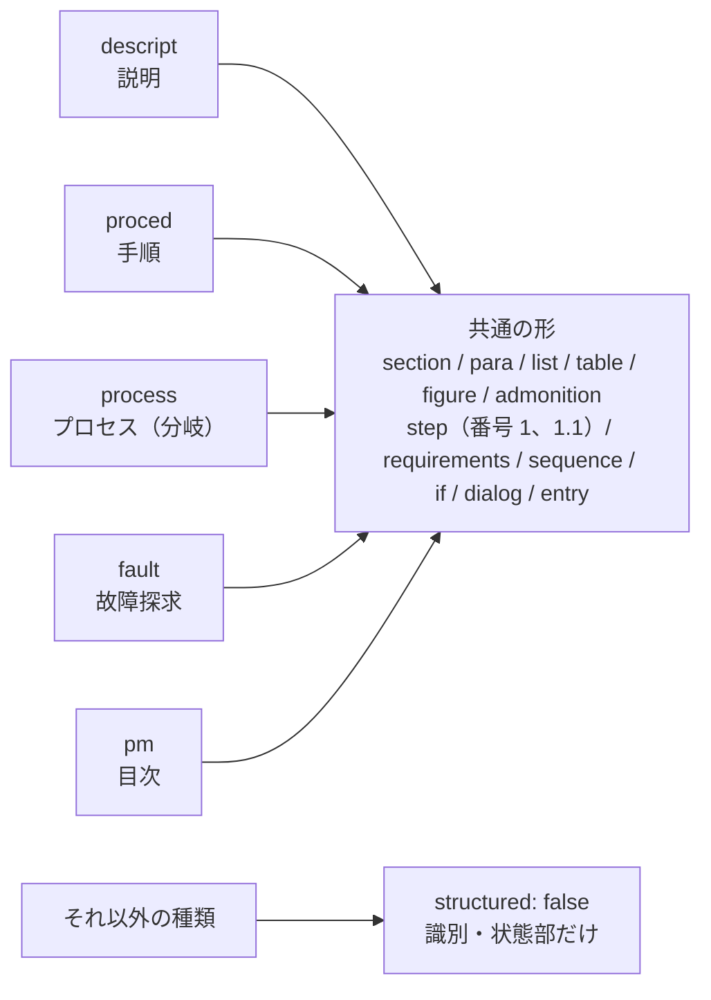
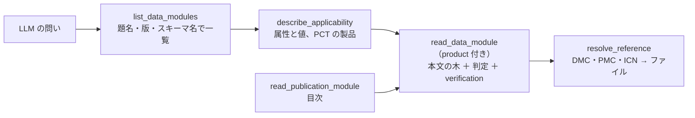

`s1000d-reader-mcp` は、データモジュールとパブリケーションモジュールを LLM が**構造として**読むための MCP サーバーです。見出しの階層、番号付きの手順、警告・注意・注記、図（ICN）、表、参照先の題名を保ったまま返し、どの製品に当てはまるか（[適用性](/s1000d-stack/ja/guide/applicability/)）はサーバーが判定して結果だけを渡します。すべての応答に「どこまで検証済みか」（`verification`）が付きます。6 つのツールを持ちます。

## できること

| ツール | 内容 |
| --- | --- |
| `list_data_modules` | CSDB の中のデータモジュール（指定すれば PM・DML・DDN・IMF・UPF も）を、DMC・題名・版・言語・スキーマ名・適用性の表示文付きで一覧にします。モデル識別コード・システムコード・情報コード・スキーマ名・題名の文字で絞れます |
| `read_data_module` | データモジュール 1 件を構造で読みます。識別・状態部、本文の木、参照（題名付き）、検証状態。`product` を渡すとブロックごとに `applicable` / `notApplicable` / `undetermined` を付けます |
| `read_publication_module` | パブリケーションモジュールを目次として読みます。`pmEntry` の木と、各 `dmRef` / `pmRef` の解決先（ファイル・題名・版） |
| `resolve_reference` | DMC・PMC・ICN を CSDB のファイルに解決します。ICN は参照元の DOCTYPE 宣言（ファイル名と NOTATION）も返します |
| `describe_applicability` | 適用性の語彙を返します。ACT の製品属性、CCT の条件、PCT の製品、文書の `applic` 文（id と表示文）、PCT が値を割り当てていない属性。ここでは何も判定しません |
| `read_icn_metadata` | ICN メタデータファイル（IMF）を読みます。ICN・版・題名・キーワード・機密区分と、状態部の項目の一覧 |

## 本文の形

内容部の XML はそのまま返さず、データモジュールの種類ごとの読み取り部分が共通の形（節点の木）に揃えます。



- 手順には `1`、`1.1` のような番号を組み立てて付けます。
- 段落の中の参照は `[→ DMC 題名]` の形で文に埋め込み、`refs` にも集めます。参照先の題名は CSDB から読みます。LLM が DMC だけを見て中身を推測しないためです。
- 要件（`preliminaryRqmts` / `closeRqmts`）は「conditions: … / persons: … / support equipment: …」の 1 文に要約します。
- 故障探求の問いと答えは `question` と `choices`（答えごとの次の手順の id）にします。
- 読み取り部分が知らない要素は捨てず、`kind: "unknown"` として文だけを残し、`content.unknownElements` に名前と数を返します。読み取り部分を広げる材料になります。Issue 7 の Bike Samples では、`descript` と `pm` に未知の要素は無く、`proced` の未知は回路遮断器（`circuitBreaker…`）の群だけです。

## 適用性と検証状態

`product` を渡さないときは、適用性はすべて `undetermined` で、`displayText`（人が読む適用範囲の文）だけを返します。`assert` の式はどんなときも返しません。適用性の仕組み（ACT・CCT・PCT、式の評価）は [適用性のページ](/s1000d-stack/ja/guide/applicability/)に書いています。

### 3 値の読み方

| 状態 | 意味 | LLM の読み方 |
| --- | --- | --- |
| `applicable` | 渡した製品に当てはまる | そのまま使う |
| `notApplicable` | 当てはまらない | 答えに混ぜない。`omitNotApplicable` で本文から省ける |
| `undetermined` | 判定できない。`reason` に「製品に `type` の値が無い」「`product` が渡されていない」「適用性リポジトリに無い」などの理由 | 「当てはまらない」と読まない。足りない値を利用者に聞く |

`and` / `or` が確定した枝で足りなかった値は理由に含めません。

### 製品の値をどう決めるか

`describe_applicability` が、対象データモジュールの ACT・CCT・PCT を CSDB から探して、使える属性と値、PCT に登録された製品、文書の中の `applic` 文の一覧を返します。LLM はこれを見て利用者に「どの機種ですか」と聞き、答えを `product` として `read_data_module` に渡します。

PCT に登録された製品をそのまま渡すこともできますが、PCT が値を割り当てていない属性があると、その属性を使う文は `undetermined` のままになります。`describe_applicability` はそのような属性を `propertiesNotAssignedInPct` として一覧にするので、不足分を補ってください。

### 別のデータモジュールにある適用性文

`referencedApplicGroupRef/applicRef` が `applicIdentValue` で指す `applic` 文は、`S1000D_CSDB_DIR` の中から `applic/@applicIdentValue` を持つデータモジュール（適用性リポジトリ）を集めて解決します。見つからなければ「リポジトリに無い」理由で `undetermined` になります。

### 検証状態

検証は既定で XSD だけを行います（`verify: "schema"`）。`verify: "full"` で BREX の連鎖への照合と参照の解決も行い、`verify: "none"` で省きます。省いた工程は `not-run`、XSD が見つからなければ `schema-not-found` と明記され、どちらも `valid` ではありません。XSD に違反した文書は要素の位置が仕様と違う可能性があるため、本文の読み取りも疑ってください。



## できないこと

- **要約・翻訳はしません。** 要約に要る材料（見出し、手順の番号、警告の種類、参照先）を落とさずに返すのが仕事です。
- **S1000D への準拠は判定しません。** XSD・BREX の違反の中身は [`s1000d-verify-mcp`](/s1000d-stack/ja/mcp/verify-mcp/)、BREX のルールの説明は [`s1000d-brex-mcp`](/s1000d-stack/ja/mcp/brex-mcp/) で読んでください。
- 本文を構造化しているのは `descript` / `proced` / `process` / `fault` / `pm` の 5 種です。他の種類は `content.structured: false` で、識別・状態部だけを返します。

## 設定

| 環境変数 | 内容 |
| --- | --- |
| `S1000D_SPEC_DIR` | S1000D の配布物を展開したフォルダー。XSD と既定 BREX をこの下から探します |
| `S1000D_CSDB_DIR` | プロジェクトのデータモジュールが置かれたフォルダー。`:`（Windows は `;`）区切りで複数指定できます。DMC での読み取り、参照先、ACT・CCT・PCT、適用性リポジトリをここから探します |

```json
{
  "mcpServers": {
    "s1000d-reader": {
      "command": "npx",
      "args": ["-y", "@shuji-bonji/s1000d-reader-mcp"],
      "env": {
        "S1000D_SPEC_DIR": "/path/to/s1000d/issue-7",
        "S1000D_CSDB_DIR": "/path/to/project/csdb"
      }
    }
  }
}
```

## 応答の例

`read_data_module` の手順 1 件は次の形です（Bike Samples の手順データモジュールを、PCT の製品に `type` を補って読んだもの）。

```json
{
  "kind": "step",
  "element": "proceduralStep",
  "number": "1",
  "text": "Open the light circuit breaker located on the handlebar",
  "applicRefId": "app-0001",
  "applicability": {
    "state": "applicable",
    "displayText": "Mountain storm Mk1",
    "applicId": "app-0001"
  },
  "children": []
}
```

