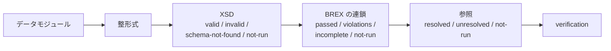

`s1000d-verify-mcp` は、データモジュールを XML スキーマ（XSD）で検証し、BREX の連鎖に照合し、参照（`dmRef`・`pmRef`・ICN・`internalRef`・`applicRefId`）が解決できるかを確かめて、結果を 1 つの**検証状態**（`verification`）にまとめて返す MCP サーバーです。5 つのツールを持ちます。検証状態は `s1000d-reader-mcp` が本文の応答に埋め込むものと同じ形で、どちらも共有ライブラリ `s1000d-core` の同じ関数で作ります。

[GitHub](https://github.com/shuji-bonji/s1000d-verify-mcp) / [npm](https://www.npmjs.com/package/@shuji-bonji/s1000d-verify-mcp)

## できること

| ツール | 内容 |
| --- | --- |
| `verify_data_module` | データモジュール 1 件を、整形式 → XSD → BREX の連鎖 → 参照の順に検証し、`verification` と各工程の詳細（XSD 違反の行番号、BREX 違反の箇所、未解決の参照と理由）を返します。`skip` で工程を省けます |
| `validate_schema` | XSD 検証だけを行います。使う XSD は `xsi:noNamespaceSchemaLocation` のファイル名で決め、`S1000D_SPEC_DIR` の下の `xml_schema_flat/` から探します。版は `brex.xsd` 冒頭の `Issue number:` から読みます |
| `check_references` | 参照を 5 種類集め、参照先の有無を理由付き（`not-found` / `no-entity-declaration` / `file-not-found` / `no-such-id` / `no-csdb`）で返します。仕様書の章への `dmRef`（モデル識別コード `S1000D`）は参照切れではないので別枠にします |
| `verify_csdb` | フォルダーの中の CSDB オブジェクト（既定は DMC と PMC）をまとめて検証し、1 件ごとの検証状態と件数の集計を返します。`offset` と `limit` で分けて読み、`reportPath` で詳細を JSON に書き出せます |
| `list_schemas` | `S1000D_SPEC_DIR` の下で見つかった `xml_schema_flat/` の一覧（版、XSD の数、スキーマ名）を返します。`schema-not-found` の原因を調べるのに使います |

## 検証状態の読み方



| 項目 | 値 | 意味 |
| --- | --- | --- |
| `schema.state` | `valid` | XSD を見つけて検証し、違反が 0 |
| | `invalid` | 違反あり。`errorCount` と、行番号付きの libxml2 の文章 |
| | `schema-not-found` | XSD が見つからない。`reason` に理由（`S1000D_SPEC_DIR` 未設定、`xml_schema_flat/` 無し、版が合わない、など） |
| | `not-run` | `skip` で省いた、または整形式でない |
| `brex.state` | `passed` | すべての層で違反 0、評価できなかったルール 0、未解決の BREX 0 |
| | `violations` | 違反あり |
| | `incomplete` | 違反は 0 だが、連鎖の途中の BREX が無いか、評価できないルールがある。検査されていない部分がある |
| `references.state` | `resolved` / `unresolved` | 未解決の参照が 0 か 1 以上か |

:::caution[`schema-not-found` は `valid` ではありません]
XSD が見つからなかったときは検証が行われていないだけで、文書が正しいことを意味しません。`list_schemas` で配布物の置き方を確かめてください。XSD に違反した文書では要素の位置が仕様と違う可能性があるため、BREX の違反が誤って出たり隠れたりします。`schema.state` が `invalid` のときは BREX の結果を参考程度に読んでください（応答の `_notes` にも書きます）。
:::

## できないこと

- **S1000D への準拠は判定しません。** `valid` と `passed` は「XSD と、機械で検査できる BREX のルールに誤りが無かった」ことだけを意味します。`nonContextRules`（文章で書かれた取り決め）は `manualChecks` として返し、判断は人が行います。プロジェクトのビジネスルール文書はどのツールの対象でもありません。
- BREX のルールの説明や値の意味は返しません。それは [`s1000d-brex-mcp`](/s1000d-stack/ja/mcp/brex-mcp/) の `explain_brex` / `lookup_value` の仕事です。重大度コード（`brsl01`〜`brsl99`）はそのまま返します。
- 適用性（どの製品に当てはまるか）は判定しません。`check_references` は `applicRefId` の参照先があるかだけを見ます。判定は [`s1000d-reader-mcp`](/s1000d-stack/ja/mcp/reader-mcp/) が行います。

## 設定

| 環境変数 | 内容 |
| --- | --- |
| `S1000D_SPEC_DIR` | S1000D の配布物を展開したフォルダー。XSD（`xml_schema_flat/`。内側の「XML Schema Package」の zip を展開しておく）と既定 BREX をこの下から探します |
| `S1000D_CSDB_DIR` | プロジェクトのデータモジュールが置かれたフォルダー。`:`（Windows は `;`）区切りで複数指定できます。参照先の DM・PM・ICN ファイルと、連鎖の途中の BREX をここから探します |

```json
{
  "mcpServers": {
    "s1000d-verify": {
      "command": "npx",
      "args": ["-y", "@shuji-bonji/s1000d-verify-mcp"],
      "env": {
        "S1000D_SPEC_DIR": "/path/to/s1000d/issue-7",
        "S1000D_CSDB_DIR": "/path/to/project/csdb"
      }
    }
  }
}
```

## XSD の探し方

配布物の中には `brex.xsd` を含む `xml_schema_flat/` が 2 つあります。XML Schema Package のものと、データ辞書（`data_dictionary_7/Files/`）の中の写しです。写しの方は `xs:import` が `http://www.w3.org/2001/xml.xsd` のような絶対 URL で、libxml2 がネットワークに出ようとして失敗するため、使いません。XML Schema Package 側の XSD は `xml.xsd` のように相対パスで import しているので、同じフォルダーの XSD をまとめて登録すれば解決します。

XSD 検証は `libxml2-wasm`（libxml2 の WebAssembly 版）で行い、XSD ごとに 1 回コンパイルして使い回します。Issue 7 の Bike Samples 106 件を 0.5 秒以内で検証できます。採用の経緯（`xmllint-wasm` との比較）は hub リポジトリの `docs/DECISIONS.md` の D-15 にあります。

## 公式サンプルで分かること

Bike Samples の DMC 106 件と PMC 4 件は、すべて Issue 7 の XSD に適合します。一方、`dmRef` 1,843 件のうち 954 件はモデル識別コード `S1000D` の DMC、つまり仕様書の章への参照で、CSDB には無いので未解決になります（ほぼすべてビジネスルール文書 `…-024A-D` の中）。`check_references` はこれを `specificationReferences` として別枠で返し、`unresolved` には入れません。また、DOCTYPE で `.PNG` と宣言された ICN の実ファイルが `.SVG` という不整合が 1 件あり、`file-not-found` として報告されます。拡張子の違いを許す寛容な解決は入れていません。宣言どおりに置かれていないことは、納品の検査で見つけたい事実だからです。

