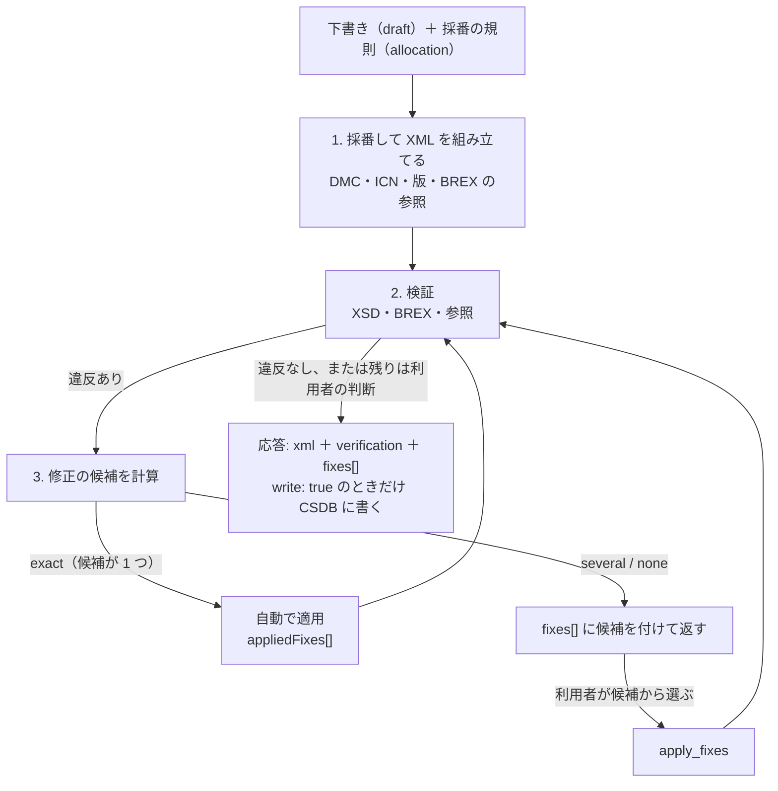

`s1000d-writer-mcp` は、S1000D® のデータモジュールを LLM が **XML を書かずに**作るための MCP サーバーです。LLM は題名・段落・手順・参照先を木の形（下書き）で渡し、採番の規則を添えます。サーバーが DMC や ICN を付けて XML を組み立て、XSD・BREX・参照で検証し、直し方が 1 つに決まる修正だけを自動で適用します。残った修正は候補を付けて返します。ツールは 6 つで、データモジュールの作成、体験型マニュアルの変換、修正の適用、コメントデータモジュールの作成、翻訳用の文の取り出しと書き戻しを行います。

[GitHub](https://github.com/shuji-bonji/s1000d-writer-mcp) / [npm](https://www.npmjs.com/package/@shuji-bonji/s1000d-writer-mcp)

## 3 つの方針

- **LLM に XML を書かせません。** 入力は下書き（`draft`）の木だけで、XML を渡す入口はありません。DMC・ICN・BREX の参照は、LLM が考え出さずに、採番の規則からサーバーが付けます。既存の XML を渡せるのは `apply_fixes` と `extract_segments` / `apply_segments` だけで、どれも文書の構造を変えません。
- **候補の外の値で直しません。** 修正を適用するとき、サーバーは候補を計算し直し、その候補と一致する選択だけを適用します。値を自由に書き込む入口はありません。
- **既定では書き込みません。** 組み立てた XML は応答に返すだけです。CSDB への書き込みは、`write: true` を渡したときだけ行います。

## できること

| ツール | 内容 |
| --- | --- |
| `build_data_module` | 下書き 1 件（説明・手順・プロセス・故障探求・パブリケーションモジュール）と採番の規則から、データモジュールを 1 件組み立てます。組み立てたあとに XSD・BREX・参照を検証し、`exact` の修正だけを最大 `maxFixRounds` 回（既定 3）まで自動で適用します。残った修正は `fixes[]` に候補付きで返します |
| `convert_manual` | 体験型マニュアル（[`@shuji-bonji/experiential-manual-model`](https://www.npmjs.com/package/@shuji-bonji/experiential-manual-model)）を、Topic ごとのデータモジュールとパブリケーションモジュール 1 件に変換します。各データモジュールは `build_data_module` と同じ流れで組み立てて検証します。データモジュール・パブリケーションモジュール・ICN の相互の参照は、CSDB に今回作ったデータモジュールを重ねた上で解決します。変換で表せなかったものは `notRepresented` に件数で返します |
| `apply_fixes` | 既存のデータモジュールに、`fixes[]` で返した候補の中から選んだ修正を適用します。選択は候補の写しでなければならず、候補の外の値や範囲に合わない値は、理由を付けて `rejected[]` に入れます。適用後に再検証します |
| `create_comment` | コメントデータモジュール（`comment`）を組み立てて検証します。連番は、省略すると CSDB の次の番号になります |
| `extract_segments` | データモジュールから、人が読む文（題名・段落・手順・警告・表のセル・図の題）を翻訳用に取り出します。インライン要素は `{1}` `{2}` の記号に置き換え、骨組みの照合に使う `skeletonHash` を返します |
| `apply_segments` | 訳した文を元のデータモジュールに戻します。DMC は同じで、言語だけが変わります。取り出したあとにデータモジュールが変わっていれば、`skeleton-mismatch` で止まります |

## 下書きと採番の規則

### 下書き（`draft`）

下書きは、データモジュールの種類（`kind`: `descript` / `proced` / `process` / `fault` / `pm`）、言語、題名、機密区分（`securityClassification`）と、本文の節点の木（`body`）からなります。節点の種類（section / para / list / table / figure / admonition / step など）は、[s1000d-reader-mcp](/s1000d-stack/ja/mcp/reader-mcp/) の `read_data_module` が返す節点と同じです。読んだ木は、そのまま書き戻せます。

- `kind` ごとに置ける節点が決まっています。合わない節点は、XML を組み立てる前に `input-error` で返します。これは入力の形の検査で、XSD 検証の代わりではありません。
- 参照は文に埋め込まず、節点の `refs` に書きます。
- 機密区分は省略できません。値は解釈せず、そのまま書きます。

### 採番の規則（`allocation`）

`allocation` には、モデル識別コード・システム差異コード・SNS・種類ごとの情報コード（`rules.infoCodeByKind`）・ICN に使う CAGE コードを渡します。

- **情報コードの既定はありません。** 省略すると `input-error` です。情報コードの意味はプロジェクトが決めるため、利用者に聞いてから渡してください。
- **サーバーは状態を持ちません。** 採番の台帳（`ledger`）は入力で受け取り、応答で返します。前の応答の `ledger` をそのまま渡すと、同じ `sourceId` には同じ DMC、同じ素材には同じ ICN が付きます。台帳を保管するのは呼び出す側です。
- CSDB に同じデータモジュールがあり、下書きに版（`issueInfo`）が無いときは、`issuePolicy` で決めます。既定は発行番号を上げる `increment-issue` で、作業中番号を上げる `increment-inwork`、版を変えない `keep` も選べます。



## 応答の読み方

すべての応答の末尾には、その応答で何が起きたかを文で書いた `_notes` が付きます。

### 検証状態（`verification`）

XSD・BREX・参照の各工程の状態です。形と意味は [s1000d-verify-mcp](/s1000d-stack/ja/mcp/verify-mcp/) の検証状態と同じです。XSD が見つからなければ `schema-not-found`、省いた工程は `not-run` と明記され、どちらも `valid` ではありません。サーバーは検証の結果を伝えるだけで、S1000D への準拠は判定せず、違反の重大度も解釈しません。

### 自動で適用した修正（`appliedFixes[]`）

自動で適用するのは、`confidence` が `exact` で、候補がちょうど 1 つの修正だけです。たとえば、BREX が責任企業を 1 つに決めているときの置き換えや、BREX が禁じている要素の削除です。適用した修正は、変更前後の値つきで `appliedFixes[]` に返します。自動の修正は、結果を確かめてから使ってください。`maxFixRounds: 0` で自動の修正を止められます。

### 残った修正（`fixes[]`）の適用

`fixes[]` には、自動で直せなかった修正が候補付きで入ります。`confidence` が `several` のときは候補が複数ある（または範囲・正規表現で示された値）ことを、`none` のときは候補が無いことを表します。`none` は、利用者に聞いてください。

候補から選んだ修正は、候補の `location` と 1 件の候補を写して `apply_fixes` の `selections[]` に渡します（`{ location, action, target?, value? }`）。サーバーは候補を計算し直して照合し、次のいずれかに当たる選択は適用せず、理由を付けて `rejected[]` に返します。

| `reason` | 意味 |
| --- | --- |
| `candidate-not-offered` | その位置と候補を持つ修正が、提案の中に無い |
| `value-not-allowed` | 範囲や正規表現の候補で、渡した値が範囲や形に合わない |
| `provide-is-not-a-document-change` | `provide` の候補は文書ではなく製品の値を与えるものなので、`product` に渡す |

適用した修正は `applied[]` に、変更の内容つきで返します。適用後は再検証し、残った修正を `fixes[]` に返します。

### 入力の誤り（`input-error`）

下書きや採番の規則の誤りは、ツールの失敗（`isError`）ではなく `error: { code: "input-error", path, detail }` で返します。`path` は誤りの位置です（例: `/body[1]`、`/allocation/rules/infoCodeByKind/proced`）。その位置を直して、もう一度呼んでください。このほかに、想定している停止として `skeleton-mismatch`（取り出したあとにデータモジュールが変わった）と `write-conflict`（同じ名前のファイルがある）があります。

### 書き込みの規則

- `write: true` を渡したときだけ、`csdbDirs` の最初のフォルダー（無ければ `S1000D_CSDB_DIR` の最初）に `DMC-….XML` を書きます。書き先が無ければ書かず、理由（`no-csdb-dir`）を `writeSkipped` に返します。
- 同じ名前のファイルがあるときは上書きしません（`write-conflict`）。`overwrite: true` を渡すと上書きします。
- XSD に違反する XML は書きません（`schema-invalid`）。`allowInvalid: true` を渡すと書きます。XSD が見つからない `schema-not-found` は違反ではなく、未検証として書きます。
- `convert_manual` は、`write: true` のとき、図などの原本を ICN のファイル名でコピーします。
- `apply_fixes` に `path` を渡して `write: true` にすると、そのファイルを直接書き換えます。`xml` を渡したときは、データモジュール自身の名前で最初のフォルダーに書きます。
- 書いたパスは、応答の `written[]` に入ります。

## 体験型マニュアルの変換

`convert_manual` は、体験型マニュアルの Topic の種類ごとに、次のデータモジュールを作ります。

| マニュアルの要素 | 出力 |
| --- | --- |
| マニュアル全体 | パブリケーションモジュール 1 件。目次の並びは Topic の順 |
| 説明（`description`） | `descript` |
| 手順（`procedure`） | `proced` |
| 故障探求（`troubleshooting`） | `fault` |
| 画面遷移（`screenFlow`） | `process` 1 件と、画面ごとの `proced` |
| 用語集 | 用語集のデータモジュール（全 Topic を変換するときだけ） |
| 適用範囲（`scopes`） | データモジュールの適用性 |
| 素材（`assets`） | ICN を採番し、図への参照を入れる |

変換で表せなかったもの（ホットスポットの座標、`scopeRefs` の一部など）は、黙って捨てずに `notRepresented` に件数で返します。

## 翻訳用の文の出し入れ

`extract_segments` と `apply_segments` は、翻訳そのものではなく、文の出し入れだけを行います。訳すのは LLM か人で、訳の採点も別の道具で行います。

- 取り出す対象は、人が読む文だけです。属性値・DMC・ICN・適用性の式・`id` は取り出しません。
- 文の中のインライン要素（強調や参照など）は `{1}` `{2}` の記号になります。訳文にも同じ記号を残してください。
- 戻すときは、`extract_segments` が返した `skeletonHash` を渡します。取り出したあとにデータモジュールが変わっていれば、`skeleton-mismatch` で止まります。
- 未知の `id`、重複した `id`、記号が合わない文は適用せず、`unapplied[]` に入れて元の文を残します。
- 戻した結果は検証して返します。

## できないこと

- **LLM が書いた XML は受け取りません。** 組み立てるのは下書きからだけです。
- **候補の外の値では直しません。**
- **検証を省きません。** 組み立てた XML は必ず検証して返します。
- **S1000D への準拠は判定せず、違反の重大度も解釈しません。** 違反の中身は [`s1000d-verify-mcp`](/s1000d-stack/ja/mcp/verify-mcp/)、BREX のルールの説明は [`s1000d-brex-mcp`](/s1000d-stack/ja/mcp/brex-mcp/) で読んでください。`commentType` や `commentPriorityCode` なども、列挙のまま書き、意味は付けません。
- **翻訳はしません。** 文を取り出して戻すだけです。
- **図の作成や、制限言語（STE）の判定はしません。** 図は ICN を採番して参照を入れるだけで、STE の辞書は同梱しません。
- **段落の中のインライン要素（強調など）は、下書きでは表せません。**
- ACT・CCT・PCT は作りません。適用性は、下書きの `applic` と、既存の適用性リポジトリを前提にします。

## 設定

| 環境変数 | 内容 |
| --- | --- |
| `S1000D_SPEC_DIR` | S1000D の配布物を展開したフォルダー。XSD と既定 BREX をこの下から探します |
| `S1000D_CSDB_DIR` | プロジェクトのデータモジュールが置かれたフォルダー。`:`（Windows は `;`）区切りで複数指定できます。BREX の連鎖・参照先・既存の版をここから探し、最初のフォルダーが書き込み先になります |

```json
{
  "mcpServers": {
    "s1000d-writer": {
      "command": "npx",
      "args": ["-y", "@shuji-bonji/s1000d-writer-mcp"],
      "env": {
        "S1000D_SPEC_DIR": "/path/to/s1000d/issue-7",
        "S1000D_CSDB_DIR": "/path/to/project/csdb"
      }
    }
  }
}
```

ツールの引数 `csdbDirs` でフォルダーを追加することもできます（先頭が書き込み先）。環境変数が無いときは、設定ファイル `~/.config/s1000d-stack/config.json`（`XDG_CONFIG_HOME` があればその下、`S1000D_CONFIG` で場所を変更可）の `specDir` と `csdbDirs` を読みます。書き方は[導入手順](/s1000d-stack/ja/guide/getting-started/)にあります。

既定は stdio です。`--http` を付けると Streamable HTTP（既定 `http://127.0.0.1:3000/mcp`。`--host` / `--port` / `--path` で変更）で起動し、CSDB 製品のサーバーや Web アプリから HTTP で呼べます。loopback に束縛したときは `Host` と `Origin` を localhost 系に限り、それ以外のアドレスでは検査しません。このサーバーはファイルを書き込めるので、認証の無い公開は避け、製品側のリバースプロキシや認証の後ろに置いてください。認証・権限・マルチテナントはサーバーでは持ちません（[CSDB 製品に組み込む](/s1000d-stack/ja/use-cases/embedding/)の「製品側に残す責務」）。

## 関連ページ

- 作った結果を読むには [s1000d-reader-mcp](/s1000d-stack/ja/mcp/reader-mcp/)、違反の詳細と修正の提案を見るには [s1000d-verify-mcp](/s1000d-stack/ja/mcp/verify-mcp/) を使います。
- XML の組み立て・採番・修正の適用・文の出し入れの処理は、共有ライブラリの[書く側の機能](/s1000d-stack/ja/lib/s1000d-core/#書く側の機能)にあります。
- 使う場面は[ユースケース](/s1000d-stack/ja/use-cases/)の使い方 3、全体の位置づけは[全体構成](/s1000d-stack/ja/guide/architecture/)にあります。
