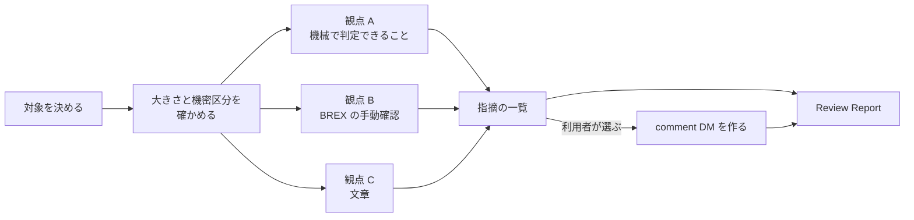

`s1000d-review` は、既存の S1000D® のデータモジュールをレビューし、指摘を comment DM（コメントデータモジュール）として CSDB に残す Skill です。データモジュールは書き換えません。Skill は、どの MCP サーバーをどの順番で呼び、各段階で利用者に何を聞くかを Claude に伝えるもので、判定の処理は持ちません。

[GitHub](https://github.com/shuji-bonji/s1000d-review-skill) / [Release](https://github.com/shuji-bonji/s1000d-review-skill/releases)

## 何をする Skill か

- **渡すもの**: 対象のデータモジュール（DMC かファイルのパス、またはフォルダー）と、CSDB のフォルダーです。文章の観点でも見るときは、用語集のファイル（2 列の CSV、Markdown の表、DeepL の用語集）を渡します。comment DM にするときは、`commentType` と `commentPriorityCode` の値をプロジェクトの決まりで選んで伝えます。
- **受け取るもの**: 観点を書き分けた指摘の一覧、利用者が選んだ指摘を入れた comment DM、Review Report（対象、観点ごとの指摘、comment DM にしたものとしなかったもの、検証状態）です。comment DM の書き込みは、利用者が確認した後に行います。

## 前提の MCP サーバー

| MCP サーバー | 必須・任意 | 最低版 | 役割 |
| --- | --- | --- | --- |
| [s1000d-reader-mcp](/s1000d-stack/ja/mcp/reader-mcp/) | 必須 | 0.7.0 | データモジュールの一覧と読み取りを行います（`list_data_modules`、`read_data_module`）。読む前に、大きさと機密区分を確かめます |
| [s1000d-verify-mcp](/s1000d-stack/ja/mcp/verify-mcp/) | 必須 | 0.6.0 | XSD・BREX・参照・適用性の指摘と、修正の候補を得ます（`suggest_fixes`） |
| [s1000d-brex-mcp](/s1000d-stack/ja/mcp/brex-mcp/) | 任意 | 0.4.0 | BREX の機械で判定できない取り決めの本文を得ます（`check_against_brex`、`explain_brex`） |
| [s1000d-writer-mcp](/s1000d-stack/ja/mcp/writer-mcp/) | 任意 | 0.1.1 | comment DM を作ります（`create_comment`）。接続されていないときは、指摘を文章で返すだけです |

必須のサーバーが接続されていないとき、Skill は作業を始めず、接続の方法を伝えて止まります。任意のサーバーが接続されていないときは、報告の該当項目に「未実施（ツール未接続）」と書きます。

## 指摘の 3 つの観点

すべての指摘に、どの観点の指摘かを書きます。観点を混ぜて書きません。

| 観点 | 根拠 | 確からしさ |
| --- | --- | --- |
| 機械で判定できること | verify サーバーの修正提案（XSD・BREX・参照・適用性） | サーバーの判定です。そのまま指摘にします |
| BREX の機械で判定できない取り決め | brex サーバーの手動確認の一覧と、データモジュールの本文 | LLM が本文と照らした所見です。「確認してください」と書きます |
| 文章（用語・書き方） | 利用者が渡した用語集と書き方の決まり | LLM の所見です。用語集の該当行を引用します。用語集がないときは、「用語集の根拠なし」と書きます |

## 手順の流れ



1. 対象と CSDB のフォルダーを確かめ、データモジュールの大きさと機密区分を見ます。機密区分の値は解釈せず、利用者に見せて、本文を指摘に引用してよいかを確かめます。引用しないと決まったときは、場所と観点だけを書きます。
2. 3 つの観点で指摘を集めます。
3. すべての指摘に通し番号と観点を付けた一覧を見せます。comment DM にする指摘は、利用者が選びます。
4. writer サーバーが接続されていれば、書き込まずに comment DM を作って見せ、利用者が確認した後に書き込みます。接続されていなければ、一覧を返して終わります。
5. 対象、観点ごとの指摘、comment DM にしたものとしなかったものを Review Report にまとめます。

## Skill がしないこと

- データモジュールを書き換えません。修正を適用するときは、[s1000d-publish](/s1000d-stack/ja/skill/s1000d-publish/)の手順を使います。
- BREX の重大度（`brSeverityLevel`）の値を解釈しません。
- STE（ASD-STE100）への適合を判定しません。辞書は同梱していないので、利用者が辞書のファイルを渡したときだけ、その中の語を照合します。
- 機密区分を利用者に確かめる前に、本文を引用しません。
- 図の中身を読みません。図は ICN の参照と題だけを読みます。
- `schema-not-found` と `not-run` を合格とは書きません。S1000D への準拠は判定しません。

## 入れ方

Claude Code では、次のコマンドで入れます。

```text
/plugin install s1000d-review@shuji-bonji
```

必須の MCP サーバーは、Skill の `plugin.json` に依存として宣言してあります。MCP サーバーの設定（`S1000D_SPEC_DIR` など）は[導入手順](/s1000d-stack/ja/guide/getting-started/)にあります。

## 関連ページ

- [s1000d-reader-mcp](/s1000d-stack/ja/mcp/reader-mcp/): データモジュールを構造として読むサーバーです。
- [s1000d-verify-mcp](/s1000d-stack/ja/mcp/verify-mcp/): 指摘と修正の候補を返すサーバーです。
- [s1000d-brex-mcp](/s1000d-stack/ja/mcp/brex-mcp/): BREX の取り決めを説明するサーバーです。
- [s1000d-writer-mcp](/s1000d-stack/ja/mcp/writer-mcp/): comment DM を作るサーバーです。
- [s1000d-publish](/s1000d-stack/ja/skill/s1000d-publish/): 指摘をもとにデータモジュールを書き直すときの Skill です。
