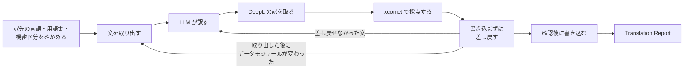

`s1000d-translate` は、S1000D® のデータモジュールを別の言語に訳し、同じ DMC で言語だけが違うデータモジュールを作る Skill です。writer サーバーは翻訳も採点もせず、文を取り出して戻すだけです。訳すのは LLM で、採点は xcomet が行います。Skill は、どのサーバーをどの順番で呼び、各段階で利用者に何を聞くかを Claude に伝えます。

[GitHub](https://github.com/shuji-bonji/s1000d-translate-skill) / [Release](https://github.com/shuji-bonji/s1000d-translate-skill/releases)

## 何をする Skill か

- **渡すもの**: 対象のデータモジュール（DMC かファイルのパス）、訳先の言語（例: `en` と `US`）、CSDB のフォルダーです。用語集があれば、2 列の CSV、Markdown の表、DeepL の用語集のいずれかで渡します。
- **受け取るもの**: 同じ DMC で言語だけが違うデータモジュールと、Translation Report（文の件数、採点の分布、DeepL と比べて差し替えた文、差し戻せなかった文、訳されずに残った文、検証状態）です。書き込みは、利用者が確認した後に行います。

## 前提の MCP サーバー

| MCP サーバー | 必須・任意 | 最低版 | 役割 |
| --- | --- | --- | --- |
| [s1000d-writer-mcp](/s1000d-stack/ja/mcp/writer-mcp/) | 必須 | 0.1.1 | 翻訳用の文を取り出し（`extract_segments`）、訳した文をデータモジュールに戻して検証します（`apply_segments`） |
| [xcomet-mcp-server](https://www.npmjs.com/package/xcomet-mcp-server) | 任意 | 0.7.0（確認した版） | 訳文を採点します（`xcomet_batch_evaluate`） |
| DeepL の MCP サーバー | 任意 | — | 比較用の訳と用語集を得ます（`translate-text`、`list-glossaries`） |
| [s1000d-reader-mcp](/s1000d-stack/ja/mcp/reader-mcp/) | 任意 | 0.7.0 | 機密区分を確かめ、訳したデータモジュールを読んで見せます（`read_data_module`） |

必須のサーバーが接続されていないとき、Skill は作業を始めず、接続の方法を伝えて止まります。任意のサーバーが接続されていないときは、報告の該当項目に「未実施（ツール未接続）」と書きます。

## 手順の流れ



1. 訳先の言語、用語集、機密区分を確かめます。DeepL に本文を送る前に、機密区分の値を利用者に見せ、送ってよいかを確かめます。
2. 訳す文を取り出します。文の中のインライン要素は `{1}`、`{2}` に置き換わっているので、訳文には各プレースホルダーを 1 回ずつ残します。
3. LLM が訳します。DeepL が接続されていて、送ってよいときは、同じ文を DeepL でも訳します。
4. xcomet が接続されていれば、訳文を採点します。得点が低い文は、DeepL の訳と比べて採用を決めます。得点は xcomet の値をそのまま写し、LLM は点数を付け直しません。
5. 書き込まずに差し戻します。プレースホルダーが合わない文や、取り出していない `id` の文は適用されず、元の文が残るので、訳を直してやり直します。取り出した後にデータモジュールが変わったときは、`skeleton-mismatch` で止まるので、文の取り出しからやり直します。
6. 利用者が訳先の言語、書き込み先、ファイル名を確認してから書き込みます。
7. 取り出されない文（識別・状態部のデータ制限の文など）は元の言語のまま残るので、その一覧を Translation Report に書きます。

## Skill がしないこと

- 訳の採点を代わりに行いません。xcomet が接続されていないときは、LLM が点数を付けず、「未実施（ツール未接続）」と書きます。
- 文を結合・分割・並べ替えず、取り出していない文を足しません。
- 取り出されない文を、訳したとは書きません。
- 利用者が確認する前に、本文を DeepL に送りません。
- データモジュール以外の文書（PDF など）を訳しません。
- `schema-not-found` と `not-run` を合格とは書きません。S1000D への準拠は判定しません。

## 入れ方

Claude Code では、次のコマンドで入れます。

```text
/plugin install s1000d-translate@shuji-bonji
```

必須の MCP サーバーは、Skill の `plugin.json` に依存として宣言してあります。MCP サーバーの設定（`S1000D_SPEC_DIR` など）は[導入手順](/s1000d-stack/ja/guide/getting-started/)にあります。

## 関連ページ

- [s1000d-writer-mcp](/s1000d-stack/ja/mcp/writer-mcp/): 文を取り出して戻すサーバーです。
- [s1000d-reader-mcp](/s1000d-stack/ja/mcp/reader-mcp/): データモジュールを構造として読むサーバーです。
- [s1000d-review](/s1000d-stack/ja/skill/s1000d-review/): 訳したデータモジュールのレビューに使う Skill です。
- [ユースケース](/s1000d-stack/ja/use-cases/): 使い方 2 に、既存のデータモジュールを扱う流れがあります。
