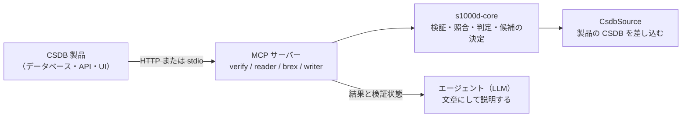

CSDB 製品（S1000D のデータモジュールを保管・管理するシステム。[CSDB](/s1000d-stack/ja/guide/csdb/) を参照）のベンダーが、製品に AI エージェントを組み込むときの使い方です。s1000d-stack の MCP サーバーを製品のサーバーから呼び、製品のデータベースや API を CSDB として差し込みます。エージェントの組み立てと画面、認証は製品側が持ちます。

## エージェントが CSDB の中でできること

LLM エージェントが CSDB の中で最低限できるべきこととして、次の 4 つを用意しています。4 つとも、判定はサーバー（共有ライブラリ `s1000d-core`）が決定論的に行い、LLM は結果を文章にして説明する役に限ります（[設計方針](/s1000d-stack/ja/guide/design-principles/)）。

| できること | 使うツール | 何が返るか |
| --- | --- | --- |
| スキーマ検証 | verify-mcp `validate_schema` / `verify_data_module` | 利用者が入手した公式 XSD による valid / invalid と、行番号付きの違反 |
| クロスリファレンスチェック | verify-mcp `check_references`、`reconcile_dml` | `dmRef` / `pmRef` / ICN / `internalRef` / `applicRefId` の参照先の有無と理由。DML・DDN と CSDB の照合（無い・版が違う・DML に載っていない） |
| 適用性チェック | reader-mcp `describe_applicability` / `read_data_module` | 製品ごとの applicable / notApplicable / undetermined。式そのものは LLM に渡しません |
| 修正提案 | verify-mcp `suggest_fixes` | 違反ごとに「何を」「どこで」「どの値に」直すかの候補。候補はサーバーが決め、確からしさ（exact / several / none）と出どころを付けます |

書く側の作業（データモジュールの組み立て、修正の適用、コメントデータモジュールの作成、翻訳用の文の出し入れ）は [s1000d-writer-mcp](/s1000d-stack/ja/mcp/writer-mcp/) が受け持ちます。レビューや翻訳の手順は Skill（[s1000d-review](/s1000d-stack/ja/skill/s1000d-review/)・[s1000d-translate](/s1000d-stack/ja/skill/s1000d-translate/) など）にあり、製品のエージェントの手順を組むときの見本として使えます。

## 組み込みに使う部品

| 部品 | 内容 |
| --- | --- |
| `CsdbSource` | `s1000d-core` は既定で「フォルダーの中の `DMC-….XML`」を CSDB と見なしますが、製品の CSDB はデータベースや API です。CSDB オブジェクトの一覧（`list()`）と中身の取得（`readText()`）を `CsdbSource` インターフェースに集めてあり、製品側が自分の実装を差し込めます。インターフェースは同期で、非同期にしか読めない置き場所は先に読み込んで `MemoryCsdbSource` に渡します |
| HTTP transport | 4 つの MCP サーバーは `--http` で Streamable HTTP として起動でき（既定 `http://127.0.0.1:3000/mcp`）、製品のサーバーや Web アプリから HTTP で呼べます。loopback 以外のアドレスに束縛したときは `Host` と `Origin` を検査しないので、製品側のリバースプロキシや認証の後ろに置きます |
| 設定ファイル | 配布物（XSD・既定 BREX）と CSDB の場所は、環境変数 `S1000D_SPEC_DIR` / `S1000D_CSDB_DIR` か、設定ファイル `~/.config/s1000d-stack/config.json` で指定します。製品ベンダーは自社で配布物を持っているので、この方式をそのまま使えます |
| 検証状態 | verify・reader・writer の応答には `verification`（XSD・BREX・参照の各工程の状態）が付きます。製品側はこれを監査の記録として保存できます |
| 書き込み | writer は `write: true` のときだけ CSDB に書き込みます。書き込む必要が無ければ `write` を省き、返った XML を製品が自分の置き場所に書き込めます |
| 機密区分 | reader-mcp の応答は先頭に `securityClassification`（データモジュールの値と、本文の要素に付いた値ごとの数）を持ちます。値は解釈しないので、扱いは製品の規則で決めます |

## 製品側に残す責務

- **認証・権限・マルチテナント**は持ちません。HTTP で公開するときは製品側の認証の後ろに置きます。
- **エージェントの組み立て**は製品側が行います。このスタックは core・MCP・Skill（手順）を提供し、Author / Reviewer / Translator / Project Manager の役割分担や画面は製品の設計に任せます。
- **仕様書・XSD・既定 BREX は同梱しません**。利用者（製品ベンダー）が入手したものを使います。
- **準拠の判定はしません**。XSD と機械で照合できる BREX ルールに違反が無いことまでを返し、S1000D への準拠は人が判断します。

## 今後の予定

この基盤を使う側の実例として、S1000D の CSDB を直接表示する簡易な技術マニュアルの Web システムを作る予定です。パブリケーションモジュールの目次からデータモジュールをたどり、製品を選ぶと当てはまらない節が消え、各ページの先頭に版・検証状態・機密区分が出る、という最小の機能で、API に足りないものを core・MCP 側に戻すための場でもあります。

設計の経緯は hub リポジトリの [docs/design/agent-platform.md](https://github.com/shuji-bonji/s1000d-stack/blob/main/docs/design/agent-platform.md) にあります。
