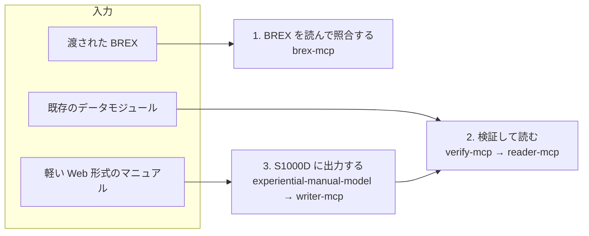

s1000d-stack は、S1000D の技術文書を LLM が BREX に沿って読み、検査し、作れるようにする道具の束ねです。ここでは、その道具をどの場面でどう組み合わせるかを 3 つに分けて説明します。1 と 2 は既存の S1000D データを扱う使い方、3 は S1000D を持たない現場から S1000D を作る使い方です。

## 1. 渡された BREX を読んで、データモジュールを照合する

顧客やプロジェクトから BREX データモジュールを渡された制作者が、その内容を把握し、作ったデータモジュールが決まりに合っているかを納品前に確かめる使い方です。

- `explain_brex` が BREX のルールを「どの要素に何を求めているか」が分かる文章にして一覧にします
- `check_against_brex` がデータモジュールを BREX の連鎖（プロジェクト → 組織 → S1000D 既定 BREX）に照合し、違反を箇所（XPath と行番号）・値・ルール ID・重大度付きで返します
- `lookup_value` が属性値や SNS（システム番号）の意味を引きます

使う部品は [s1000d-brex-mcp](/s1000d-stack/ja/mcp/brex-mcp/) です。BREX そのものの説明は [BREX（ビジネスルール交換）](/s1000d-stack/ja/guide/brex/) にあります。

## 2. 既存のデータモジュールを検証して、LLM に読ませる

既存の CSDB（`DMC-….XML` が置かれたフォルダー）を対象に、LLM が整備手順や故障情報を根拠付きで答えられるようにする使い方です。XML をそのまま LLM に渡すのではなく、先に検証し、構造化した本文だけを渡します。

- [s1000d-verify-mcp](/s1000d-stack/ja/mcp/verify-mcp/) が公式 XSD による検証・BREX 照合・参照切れの検出をまとめて行い、検証状態を付けます
- [s1000d-reader-mcp](/s1000d-stack/ja/mcp/reader-mcp/) がデータモジュールを見出し・手順・警告・図の構造で返し、参照先を解決し、どの製品に当てはまるか（適用性）を判定します。適用性の式は LLM に渡さず、applicable / notApplicable / undetermined と表示文だけを返します

データモジュールのレビューは Skill [s1000d-review](/s1000d-stack/ja/skill/s1000d-review/)、別の言語への翻訳は Skill [s1000d-translate](/s1000d-stack/ja/skill/s1000d-translate/) の手順で行えます。

## 3. 軽い Web 形式のマニュアルを作り、必要になったら S1000D に出力する

S1000D を導入していない現場でも、画面や機器の操作を体験しながら学べるマニュアルを Web 形式で作り、顧客から S1000D を求められた時点でデータモジュールとして出力する使い方です。使う部品の構成は [全体構成](/s1000d-stack/ja/guide/architecture/) にあります。作成ツールと閲覧ソフトの操作説明は製品のサイトに置き、ここでは流れだけを書きます。

この使い方が成り立つ根拠は、2021 年の作品 [experience_based_operation_explanation](https://github.com/shuji-bonji/experience_based_operation_explanation)（指定席券売機の操作説明）のデータ構造が、S1000D の考え方と次のように対応することです。

| 体験型マニュアルの JSON | S1000D |
| --- | --- |
| 画面のスクリーンショットと説明文 | 図（ICN で参照）とデータモジュールの内容部 |
| `screenId` | DMC（データモジュールコード） |
| ボタンと遷移先 | プロセスデータモジュール（提示順の制御） |
| 購入方法ごとのまとまり | パブリケーションモジュール |
| JSON を 1 か所で管理し使い回す | CSDB からの単一ソース・複数出力 |
| `index.html` と JavaScript | IETM（閲覧ソフト） |

この対応を、S1000D に依存しない共通データモデル experiential-manual-model として定め、[s1000d-writer-mcp](/s1000d-stack/ja/mcp/writer-mcp/) がそこからデータモジュールを生成します。LLM は XML を書かず、writer が下書きから XML を組み立てて検証し、候補が 1 つに決まる修正だけを自動で適用します。生成したデータモジュールは使い方 2 の verify-mcp で検証できるため、出力の正しさを S1000D の側から確かめられます。

作成ツールは試作の段階で、名前は仮称（manual-editor）です。ツールが保存した JSON を Skill [experience-to-s1000d](/s1000d-stack/ja/skill/experience-to-s1000d/) に渡すと、writer による変換と verify による検証が、利用者への確認を挟みながら進みます。体験型マニュアルを経由せず、文章からデータモジュールを作るときは、Skill [s1000d-publish](/s1000d-stack/ja/skill/s1000d-publish/) を使います。

:::tip[製品に組み込む使い方]
CSDB 製品のベンダーが、製品に AI エージェントを組み込むために MCP サーバーを使う方法は [CSDB 製品に組み込む](/s1000d-stack/ja/use-cases/embedding/) で説明しています。
:::
