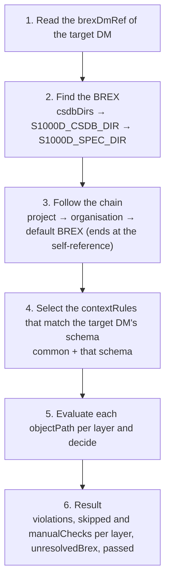

`s1000d-brex-mcp` is an MCP server that turns a BREX (Business Rules Exchange) data module into a form people can read, and checks data modules against the BREX chain. It has 5 tools and can be used from Claude Desktop and Claude Code.

## What it does

| Tool | Description |
| --- | --- |
| `explain_brex` | Lists the rules of a BREX. Returns the target (XPath), whether it may be used, the allowed values and their meaning, the severity level and the schemas the rule applies to. Narrow the list with `kind` (structure / notation / nonContext), `context` (schema name) and `search` (a string), and read it in parts with `offset` and `limit` |
| `lookup_sns` | Returns what a standard numbering system (SNS) code refers to, from a DMC or a code. When only a prefix matches, `exact: false` |
| `lookup_value` | Returns what an element or attribute value means in the project and which values are allowed. Pass `value` to also get whether that value is allowed |
| `list_notations` | Returns the illustration and multimedia formats that may be used, split into the base set and the per-schema additions and exclusions |
| `check_against_brex` | Checks a data module against a BREX and returns each violation with its location (XPath and line number), actual value, rule ID, description and severity level. By default it follows the `brexDmRef` chain and checks against each layer separately |

## What it does not do

- It does not validate against the XML schema (XSD). XSD validation, and the verification status that combines XSD, BREX and references, are returned by [`s1000d-verify-mcp`](/s1000d-stack/mcp/verify-mcp/).
- It does not judge conformance to S1000D®. `passed: true` means only that no machine-checkable BREX rule was violated in any of the layers that were found. `nonContextRules` are returned as `manualChecks`, and the judgement is left to a person.
- It does not interpret the meaning of severity level codes (`brsl01` to `brsl99`).

These points are also written in the MCP `instructions` (the description placed in the client's system context), so the LLM can read them before choosing a tool.

## Configuration

| Environment variable | Description |
| --- | --- |
| `S1000D_SPEC_DIR` | The folder where the S1000D distribution is extracted. The default BREX is searched for under it. Extract the inner zip files as well |
| `S1000D_CSDB_DIR` | The folder that holds the project's data modules. Several folders can be given, separated by `:` (`;` on Windows) |

Folders can also be added with the tool argument `csdbDirs`. A BREX can be given as a file path, as a DMC (the `DMC-` prefix is optional), or omitted (the default BREX).

```json
{
  "mcpServers": {
    "s1000d-brex": {
      "command": "npx",
      "args": ["-y", "@shuji-bonji/s1000d-brex-mcp"],
      "env": {
        "S1000D_SPEC_DIR": "/path/to/s1000d/issue-7",
        "S1000D_CSDB_DIR": "/path/to/project/csdb"
      }
    }
  }
}
```

## How a check runs



There are 3 key points for reading the result.

- **A result whose `unresolvedBrex` is not empty is incomplete.** A BREX partway along the chain was not found, so that layer was not checked. Check `S1000D_SPEC_DIR` or `csdbDirs`.
- **`skipped`** lists the rules whose XPath could not be evaluated. If it is not empty, the cause is either the way that BREX is written or a problem on the engine side.
- **`manualChecks`** are the `nonContextRules`. A machine cannot decide them, so a person reads and confirms them.

## Example response

One violation from `check_against_brex` has the following shape.

```json
{
  "kind": "value",
  "ruleId": "KB-00004",
  "objectPath": "//responsiblePartnerCompany/@enterpriseCode",
  "objectUse": "The responsible partner company must be the head office code",
  "brSeverityLevel": "brsl02",
  "location": {
    "path": "/dmodule/identAndStatusSection/dmStatus/responsiblePartnerCompany/@enterpriseCode",
    "line": 27,
    "column": 7
  },
  "actualValue": "K0001",
  "allowedValues": ["K0002"]
}
```

`kind` is one of 4 values: `forbidden` (a target that must not be used was present), `missing` (a target that must be included was absent), `value` (the value does not match an allowed value) and `notation` (the illustration format in use is not allowed).

:::note[Release status]
As of 2026-10-25, `@shuji-bonji/s1000d-brex-mcp` is not yet published on npm (in development). It will be published together with the stage 2 components (`s1000d-verify-mcp` and `s1000d-reader-mcp`). You can run it from the repository with `npm install && npm run build` and then start `node dist/index.js`.
:::
