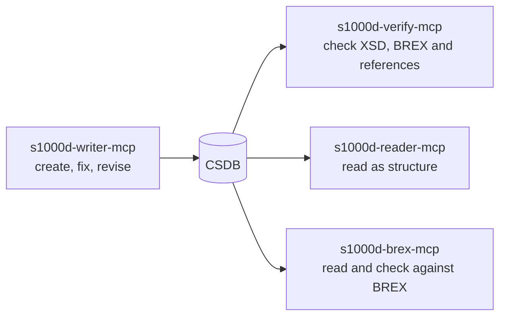

import SectionPages from '../../../components/SectionPages.astro';

S1000D Stack has four MCP servers that let an LLM read, check and create S1000D® data. In every server, the decisions are made deterministically by the shared library `s1000d-core`, and the LLM receives only the results ([Design principles](/s1000d-stack/guide/design-principles/)).

## Pages for each server

Each page explains the configuration, the list of tools and how to read the responses. The arguments of each tool are in the [Stack reference](/s1000d-stack/reference/stack/).

<SectionPages dir="mcp" order={['brex-mcp', 'verify-mcp', 'reader-mcp', 'writer-mcp']} />
