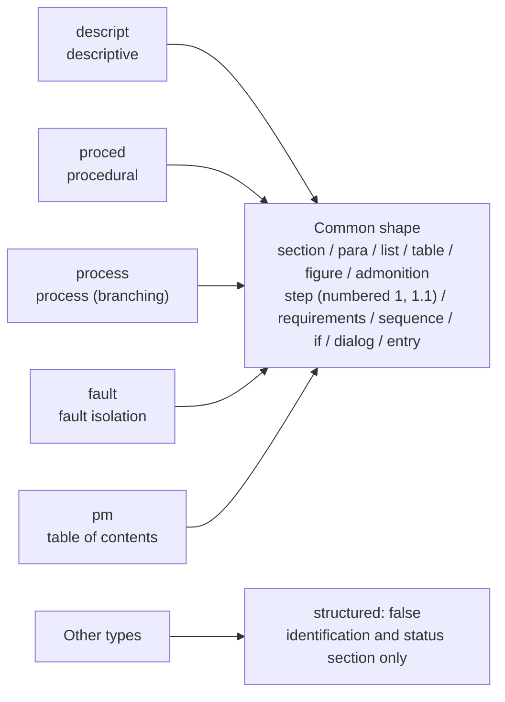
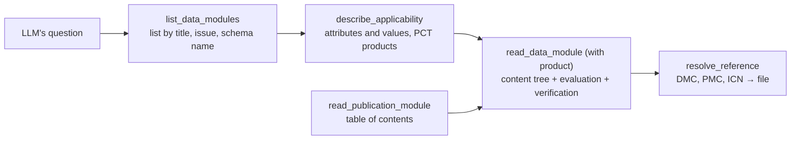

`s1000d-reader-mcp` is an MCP server that lets an LLM read data modules and publication modules **as structure**. It returns the heading hierarchy, numbered steps, warnings, cautions and notes, illustrations (ICN), tables and the titles of referenced targets intact, and the server evaluates which product the content applies to ([applicability](/s1000d-stack/guide/applicability/)) and passes on only the result. Every response carries "how far it has been verified" (`verification`). It has 6 tools.

[GitHub](https://github.com/shuji-bonji/s1000d-reader-mcp) / [npm](https://www.npmjs.com/package/@shuji-bonji/s1000d-reader-mcp)

## What it does

| Tool | Description |
| --- | --- |
| [`list_data_modules`](/s1000d-stack/reference/stack/reader/list-data-modules/) | Lists the data modules in the CSDB (and, if requested, PM, DML, DDN, IMF and UPF as well) with DMC, title, issue, language, schema name and the display text of their applicability. The list can be narrowed by model identification code, system code, information code, schema name and characters in the title. A DML or DDN row also carries its code, its entry or item count and a reconciliation summary against the CSDB (`found` / `issue-mismatch` / `not-found` / `not-checked`). The per-entry result comes from `reconcile_dml` in `s1000d-verify-mcp` |
| [`read_data_module`](/s1000d-stack/reference/stack/reader/read-data-module/) | Reads one data module as structure: the identification and status section, the content tree, references (with titles) and the verification status. When `product` is passed, each block is marked `applicable` / `notApplicable` / `undetermined`. With `includeLocation: true`, every node carries `location` (`path`, `line`, `column`) |
| [`read_publication_module`](/s1000d-stack/reference/stack/reader/read-publication-module/) | Reads a publication module as a table of contents: the `pmEntry` tree and the resolved target (file, title, issue) of each `dmRef` / `pmRef` |
| [`resolve_reference`](/s1000d-stack/reference/stack/reader/resolve-reference/) | Resolves a DMC, PMC or ICN to a file in the CSDB. For an ICN it also returns the DOCTYPE declaration of the referencing file (file name and NOTATION) |
| [`describe_applicability`](/s1000d-stack/reference/stack/reader/describe-applicability/) | Returns the applicability vocabulary: the product attributes of the ACT, the conditions of the CCT, the products of the PCT, the `applic` statements in the document (id and display text), and the attributes to which the PCT assigns no value. Nothing is evaluated here |
| [`read_icn_metadata`](/s1000d-stack/reference/stack/reader/read-icn-metadata/) | Reads an ICN metadata file (IMF): ICN, issue, title, keywords, security classification, and a list of the items in the status section |

## Shape of the content

The XML of the content section is not returned as is; the reading code for each type of data module brings it into a common shape (a tree of nodes).



- Steps are given constructed numbers such as `1` and `1.1`.
- References inside a paragraph are embedded in the sentence in the form `[→ DMC title]` and also collected in `refs`. The title of the referenced target is read from the CSDB, so that the LLM does not guess the content from the DMC alone.
- Requirements (`preliminaryRqmts` / `closeRqmts`) are summarised in one sentence: "conditions: … / persons: … / support equipment: …".
- Fault isolation questions and answers become `question` and `choices` (the id of the next step for each answer).
- Elements that the reading code does not know are not discarded: they are kept as `kind: "unknown"` with their text only, and their names and counts are returned in `content.unknownElements`. This gives material for extending the reading code. In the Issue 7 Bike Samples, none of the 5 structured types has unknown elements (s1000d-core 0.12.0 and later).

### The place of a node (`includeLocation`)

When you pass `includeLocation: true` to `read_data_module`, every node of the body and of the outline (`section: "outline"`) carries `location` (`path`, `line`, `column`). `path` is the place, in the document as it is now, of the element that the node was read from (for example `/dmodule/content/procedure/mainProcedure/proceduralStep[2]`). The default is `false`, and no `location` is returned.

`edit_data_module` of [s1000d-writer-mcp](/s1000d-stack/mcp/writer-mcp/) takes this `location.path` as the place to edit. Copy the value as it is; do not build it yourself.

A paragraph that is returned as the `text` of its parent node has no node of its own, so it has no `location`. This is the case for the paragraphs directly under a step (`proceduralStep`) that have no child nodes: they are merged into the `text` of the step node. From 0.13.0, when you read the body with `includeLocation: true` (`section` `content` or `all`), the step node carries `textLocations` (the `location` of each merged paragraph, in order). The nodes of the outline (`section: "outline"`) do not carry it. To remove or move only such a paragraph, use the `path` in `textLocations`. A list item (one with a single paragraph, which becomes its `text`) has no `textLocations`, so edit the list item itself.

### Reasons for update and change markup

From 0.13.0, `read_data_module` returns the reasons for update and the change markup that are written in the data module. The values are returned as written; the server does not judge what changed or whether the markup follows the specification.

| Item | Description |
| --- | --- |
| `identAndStatus.reasonForUpdates` | The `reasonForUpdate` elements of the identification and status section, in document order (`id`, `updateReasonType`, `updateHighlight`, `applicRefId`, `paragraphs`). When there is none, the item itself is absent |
| `change` of a node or a reference | The `changeType`, `changeMark` and `reasonForUpdateRefIds` written on that element |
| `content.changeMarks` | All the elements that have any of the three attributes, and `changeInline`, in document order (`element`, `path`, `line`, `column` and the three attributes). It also contains elements that do not become nodes (`title`, a table `row` and so on) and elements of the data module types whose content is not read as structure |

To add change markup with `edit_data_module` of [s1000d-writer-mcp](/s1000d-stack/mcp/writer-mcp/) in an edit from the second one for the same reason, pass `identAndStatus.reasonForUpdates[].id` as `marking.reasonRefId`.

## Applicability and verification status

When `product` is not passed, applicability that has an expression (`assert`, `evaluate`) is `undetermined`, and only `displayText` (the human-readable statement of the applicable range) is returned. Applicability with a display text only has nothing to evaluate, so it is `applicable` even without `product` (`reason` is `no expression (display text only)`). The `assert` expressions are never returned. How applicability works (ACT, CCT, PCT and the evaluation of expressions) is described on the [applicability page](/s1000d-stack/guide/applicability/).

### Reading the three states

| State | Meaning | How the LLM reads it |
| --- | --- | --- |
| `applicable` | Applies to the product passed | Use as is |
| `notApplicable` | Does not apply | Do not mix into the answer. `omitNotApplicable` can leave it out of the content |
| `undetermined` | Cannot be evaluated. `reason` gives the cause, such as "the product has no value for `type`", "`product` was not passed" or "not in the applicability repository" | Do not read as "does not apply". Ask the user for the missing value |

Values that were missing in an `and` / `or` branch that was already decided are not included in the reason.

### Choosing the product values

`describe_applicability` finds the ACT, CCT and PCT of the target data module in the CSDB and returns the attributes and values that can be used, the products registered in the PCT, and a list of the `applic` statements in the document. The LLM looks at this, asks the user "which model is it?", and passes the answer to `read_data_module` as `product`.

A product registered in the PCT can be passed as is, but if there are attributes to which the PCT assigns no value, the statements that use those attributes stay `undetermined`. `describe_applicability` lists such attributes as `propertiesNotAssignedInPct`, so fill in what is missing.

### Applicability statements in another data module

An `applic` statement that `referencedApplicGroupRef/applicRef` points to by `applicIdentValue` is resolved by collecting the data modules in `S1000D_CSDB_DIR` that have `applic/@applicIdentValue` (the applicability repository). If it is not found, the state is `undetermined` with the reason "not in the repository".

### Verification status

By default, verification runs only the XSD (`verify: "schema"`). `verify: "full"` also checks against the BREX (Business Rules Exchange) chain and resolves references, and `verify: "none"` skips verification. A skipped step is stated explicitly as `not-run`, and a missing XSD as `schema-not-found`; neither is `valid`. A document that violates the XSD may have elements in positions that differ from the specification, so treat the reading of its content with suspicion as well.



## What it does not do

- **It does not summarise or translate.** Its job is to return the material a summary needs (headings, step numbers, warning types, reference targets) without omitting anything.
- **It does not judge conformance to S1000D®.** Read the details of XSD and BREX violations with [`s1000d-verify-mcp`](/s1000d-stack/mcp/verify-mcp/), and the explanation of BREX rules with [`s1000d-brex-mcp`](/s1000d-stack/mcp/brex-mcp/).
- The content is structured for 5 types: `descript` / `proced` / `process` / `fault` / `pm`. Other types return `content.structured: false` and only the identification and status section.

## Configuration

| Environment variable | Description |
| --- | --- |
| `S1000D_SPEC_DIR` | The folder where the S1000D distribution was extracted. The XSD and the default BREX are looked up under it |
| `S1000D_CSDB_DIR` | The folder that holds the project's data modules. Several folders can be given, separated by `:` (`;` on Windows). Reading by DMC, reference targets, the ACT, CCT and PCT, and the applicability repository are looked up here |

```json
{
  "mcpServers": {
    "s1000d-reader": {
      "command": "npx",
      "args": ["-y", "@shuji-bonji/s1000d-reader-mcp"],
      "env": {
        "S1000D_SPEC_DIR": "/path/to/s1000d/issue-7",
        "S1000D_CSDB_DIR": "/path/to/project/csdb"
      }
    }
  }
}
```

When the environment variables are not set, the server reads `specDir` and `csdbDirs` from the config file `~/.config/s1000d-stack/config.json` (under `XDG_CONFIG_HOME` if it is set; `S1000D_CONFIG` changes the location). Use it when environment variables do not reach the server, as when it is installed as a plugin in Claude Desktop. See [Getting started](/s1000d-stack/guide/getting-started/) for the format.

When the tool argument `csdbDirs` is given, only those folders are used; `S1000D_CSDB_DIR` and `csdbDirs` in the config file are not used (they are not added together). Folders that do not exist are skipped and listed in `_notes` of the response.

A mistake that the caller can fix by changing an argument is returned not as a tool failure (`isError`) but as `error: { code, path, detail }`, the same shape as s1000d-writer-mcp. `code` is one of `file-not-found` (no such file), `no-csdb` (no CSDB folder), `not-found` (the DMC, PMC or ICN is not in the CSDB) and `input-error` (an argument is malformed or missing), and `path` names the argument to fix (`/path`, `/csdbDirs` and so on).

The default is stdio. With `--http` the server starts over Streamable HTTP (default `http://127.0.0.1:3000/mcp`; change it with `--host` / `--port` / `--path`), so a CSDB product's server or a web application can call it over HTTP. When bound to a loopback address, `Host` and `Origin` are limited to localhost names; on any other address they are not checked, so put the server behind the product's reverse proxy or authentication. Authentication, authorization and multi-tenancy are not part of the server (the boundary in the [embedding design](https://github.com/shuji-bonji/s1000d-stack/blob/main/docs/design/agent-platform.md)).

## Example response

One step from `read_data_module` has the following shape (a procedural data module from the Bike Samples, read with `type` added to a PCT product).

```json
{
  "kind": "step",
  "element": "proceduralStep",
  "number": "1",
  "text": "Open the light circuit breaker located on the handlebar",
  "applicRefId": "app-0001",
  "applicability": {
    "state": "applicable",
    "displayText": "Mountain storm Mk1",
    "applicId": "app-0001"
  },
  "children": []
}
```

