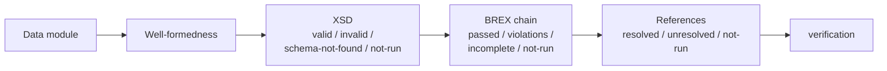

`s1000d-verify-mcp` is an MCP server that validates a data module against the XML schema (XSD), checks it against the BREX (Business Rules Exchange) chain, confirms that its references (`dmRef`, `pmRef`, ICN, `internalRef` and `applicRefId`) can be resolved, and returns the results as a single **verification status** (`verification`). It also suggests fixes (`suggest_fixes`), returning candidate corrections for each finding, and reconciles a data management list or a data dispatch note with the CSDB (`reconcile_dml`), for a total of 7 tools. The verification status has the same shape as the one `s1000d-reader-mcp` embeds in its content responses; both are built by the same function in the shared library `s1000d-core`.

[GitHub](https://github.com/shuji-bonji/s1000d-verify-mcp) / [npm](https://www.npmjs.com/package/@shuji-bonji/s1000d-verify-mcp)

## What it does

| Tool | Description |
| --- | --- |
| `verify_data_module` | Verifies one data module in the order well-formedness → XSD → BREX chain → references, and returns `verification` together with the details of each step (line numbers of XSD violations, locations of BREX violations, unresolved references and their reasons). Steps can be skipped with `skip` |
| `validate_schema` | Runs XSD validation only. The XSD to use is chosen by the file name in `xsi:noNamespaceSchemaLocation` and looked up in `xml_schema_flat/` under `S1000D_SPEC_DIR`. The issue is read from `Issue number:` at the top of `brex.xsd` |
| `check_references` | Collects references of 5 kinds and returns whether each target exists, with a reason (`not-found` / `no-entity-declaration` / `file-not-found` / `no-such-id` / `no-csdb`). A `dmRef` to a chapter of the specification (model identification code `S1000D`) is not a broken reference, so it is reported separately |
| `verify_csdb` | Verifies the CSDB objects in a folder (DMC and PMC by default) in one run, and returns the verification status of each object and a count summary. Read the results in parts with `offset` and `limit`, and write the details to JSON with `reportPath` |
| `suggest_fixes` | Runs the same verification as `verify_data_module` and returns candidate corrections for each finding. The server decides the candidates and adds where they come from and how certain they are (`exact` / `several` / `none`). If `product` is given, applicability that cannot be decided because the product lacks a value also gets candidate values. It does not apply any correction to the document |
| `reconcile_dml` | Reconciles a data management list (DML) or a data dispatch note (DDN) with the CSDB and returns, per entry, `found` / `issue-mismatch` (the object exists but not the listed issue) / `not-found` / `not-checked`, plus the DMs and PMs that are in the CSDB but not listed in the DML. Omit both `path` and `xml` to reconcile every DML and DDN in the CSDB. Values such as `dmlType` are not interpreted |
| `list_schemas` | Returns the list of `xml_schema_flat/` folders found under `S1000D_SPEC_DIR` (issue, number of XSDs, schema names). Use it to find the cause of `schema-not-found` |

## Reading the verification status



| Field | Value | Meaning |
| --- | --- | --- |
| `schema.state` | `valid` | The XSD was found, validation ran, and there are 0 violations |
| | `invalid` | There are violations. `errorCount` and the libxml2 messages with line numbers |
| | `schema-not-found` | The XSD was not found. `reason` says why (`S1000D_SPEC_DIR` not set, no `xml_schema_flat/`, issue does not match, and so on) |
| | `not-run` | Skipped with `skip`, or the document is not well-formed |
| `brex.state` | `passed` | 0 violations in every layer, 0 rules that could not be evaluated, 0 unresolved BREX |
| | `violations` | There are violations |
| | `incomplete` | 0 violations, but a BREX in the middle of the chain is missing or some rules cannot be evaluated. Part of the document has not been checked |
| `references.state` | `resolved` / `unresolved` | Whether the number of unresolved references is 0 or 1 or more |

:::caution[`schema-not-found` is not `valid`]
When the XSD is not found, validation simply did not run; it does not mean the document is correct. Use `list_schemas` to confirm how the distribution is laid out. In a document that violates the XSD, elements may not be where the specification puts them, so BREX violations can be reported wrongly or hidden. When `schema.state` is `invalid`, treat the BREX results as indicative only (the response says so in `_notes` as well).
:::

## Reading the fix suggestions

The response of `suggest_fixes` contains the verification status (`verification`) and the list of fix suggestions (`fixes`). Each fix suggestion has the following fields.

| Field | Content |
| --- | --- |
| `kind` | What the suggestion is about (`schema` / `brex-value` / `brex-forbidden` / `brex-missing` / `brex-notation` / `reference` / `applicability`) |
| `location` | Where the finding is (XPath and line number) |
| `problem` | What is wrong (the text of the original result) |
| `candidates` | Candidate corrections: `action` (`replace` / `remove` / `add` / `retarget` / `provide`), `value`, `target` (what to change) and `description` |
| `confidence` | `exact` = one candidate with a fixed value, `several` = choose among several candidates, or a value that fits a range or pattern, `none` = no candidate could be decided |
| `source` | Where the candidates come from (BREX rule ID, name of the XSD definition, CSDB, ids in the document, ACT/CCT/PCT) |
| `note` | Why no candidate could be decided, or what to watch for when choosing |

The server decides every candidate. Only values with a clear origin become candidates: for a BREX value violation, the rule's allowed values and their descriptions; for an XSD error, the enumerated values, patterns and element names in the libxml2 message or in the XSD definitions; for a broken reference, similar data module codes in the CSDB or files that differ only in the extension. The intended use is that the LLM chooses among the candidates and explains them, and does not invent values outside them. The MCP `instructions` say the same.

- When `confidence` is `none`, ask the user.
- A candidate whose `valueForm` is `range` or `pattern` is a constraint, not a value. Ask the user for a concrete value that satisfies it.
- A candidate whose `action` is `provide` is not a change to the document; it is a value for the product used to evaluate applicability.
- A `dmRef` to a chapter of the specification (model identification code `S1000D`) is not an error, so by default it is not listed; only the count is returned in `omitted.specificationReferences`.
- After applying a correction, verify the document again.

## What it does not do

- **It does not judge conformance to S1000D®.** `valid` and `passed` mean only that no errors were found against the XSD and the BREX rules that a machine can check. `nonContextRules` (rules written as prose) are returned as `manualChecks`, and a person makes the judgement. The project's business rules document is not the subject of any tool.
- It does not return explanations of BREX rules or the meaning of values. That is the job of `explain_brex` / `lookup_value` in [`s1000d-brex-mcp`](/s1000d-stack/mcp/brex-mcp/). Severity codes (`brsl01` to `brsl99`) are returned as they are.
- It does not evaluate applicability (which product the content applies to). `check_references` only checks whether the target of `applicRefId` exists. Evaluation is done by [`s1000d-reader-mcp`](/s1000d-stack/mcp/reader-mcp/). The exception is `suggest_fixes` with `product`, which reports only applicability that cannot be decided because the product lacks a value.
- It does not apply corrections to the document. `suggest_fixes` only returns candidates.

## Configuration

| Environment variable | Description |
| --- | --- |
| `S1000D_SPEC_DIR` | The folder where the S1000D distribution is extracted. The XSDs (`xml_schema_flat/`; extract the inner "XML Schema Package" zip beforehand) and the default BREX are looked up under it |
| `S1000D_CSDB_DIR` | The folder that holds the project's data modules. Several folders can be given, separated by `:` (`;` on Windows). The referenced DM, PM and ICN files, and the BREX in the middle of the chain, are looked up here |

```json
{
  "mcpServers": {
    "s1000d-verify": {
      "command": "npx",
      "args": ["-y", "@shuji-bonji/s1000d-verify-mcp"],
      "env": {
        "S1000D_SPEC_DIR": "/path/to/s1000d/issue-7",
        "S1000D_CSDB_DIR": "/path/to/project/csdb"
      }
    }
  }
}
```

When the environment variables are not set, the server reads `specDir` and `csdbDirs` from the config file `~/.config/s1000d-stack/config.json` (under `XDG_CONFIG_HOME` if it is set; `S1000D_CONFIG` changes the location). Use it when environment variables do not reach the server, as when it is installed as a plugin in Claude Desktop. See [Getting started](/s1000d-stack/guide/getting-started/) for the format.

The default is stdio. With `--http` the server starts over Streamable HTTP (default `http://127.0.0.1:3000/mcp`; change it with `--host` / `--port` / `--path`), so a CSDB product's server or a web application can call it over HTTP. When bound to a loopback address, `Host` and `Origin` are limited to localhost names; on any other address they are not checked, so put the server behind the product's reverse proxy or authentication. Authentication, authorization and multi-tenancy are not part of the server (the boundary in the [embedding design](https://github.com/shuji-bonji/s1000d-stack/blob/main/docs/design/agent-platform.md)).

## How XSDs are found

The distribution contains 2 `xml_schema_flat/` folders that include `brex.xsd`: the one in the XML Schema Package, and a copy inside the data dictionary (`data_dictionary_7/Files/`). The copy is not used, because its `xs:import` uses absolute URLs such as `http://www.w3.org/2001/xml.xsd`, and libxml2 tries to go out to the network and fails. The XSDs on the XML Schema Package side import with relative paths such as `xml.xsd`, so registering all the XSDs in the same folder together resolves them.

XSD validation is done with `libxml2-wasm` (the WebAssembly build of libxml2); each XSD is compiled once and reused. The 106 Bike Samples of Issue 7 can be validated in under 0.5 seconds. The background to this choice (the comparison with `xmllint-wasm`) is in D-15 of `docs/DECISIONS.md` in the hub repository.

## What the official samples show

All 106 DMCs and 4 PMCs of the Bike Samples conform to the Issue 7 XSD. On the other hand, 954 of the 1,843 `dmRef` elements point to DMCs with the model identification code `S1000D`, that is, to chapters of the specification; they are not in the CSDB, so they are unresolved (almost all of them inside the business rules document `…-024A-D`). `check_references` returns these separately as `specificationReferences` and does not count them in `unresolved`. There is also 1 inconsistency where an ICN declared as `.PNG` in the DOCTYPE has an actual file with the extension `.SVG`, which is reported as `file-not-found`. No lenient resolution that tolerates a different extension is included, because a file that is not placed as declared is exactly the kind of fact a delivery inspection should find. Instead, `suggest_fixes` returns "the file with the same name and the extension `.SVG`" as a candidate for this reference, and its description notes that the `NDATA` of the declaration must be changed to match.

