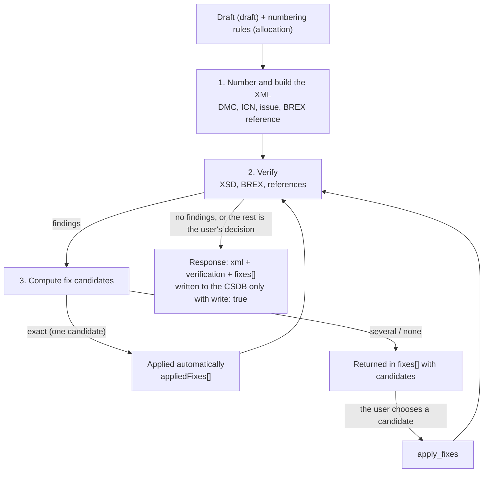
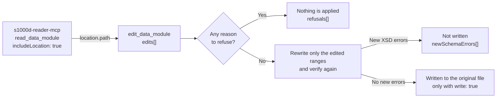
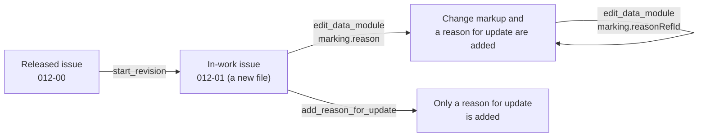

`s1000d-writer-mcp` is an MCP server that lets an LLM create S1000D® data modules **without writing XML**. The LLM passes titles, paragraphs, steps and reference targets as a tree (a draft) together with the numbering rules. The server assigns the DMC and ICNs, builds the XML, verifies it against the XSD, BREX (Business Rules Exchange) and references, and automatically applies only the fixes that have exactly one way to be fixed. The fixes that remain are returned with candidates. It has 9 tools, which create data modules, convert experiential manuals, apply fixes, edit the structure of existing data modules, start an in-work issue, add a reason for update, create comment data modules, and hand sentences out and back for translation.

[GitHub](https://github.com/shuji-bonji/s1000d-writer-mcp) / [npm](https://www.npmjs.com/package/@shuji-bonji/s1000d-writer-mcp)

## Three principles

- **It does not let the LLM write XML.** When a data module is created, the only input is a tree called a draft (`draft`); there is no entry point for XML written by an LLM. The LLM does not invent DMCs, ICNs or the BREX reference: the server assigns them from the numbering rules. The tools that take existing XML are `apply_fixes`, `edit_data_module`, `start_revision`, `add_reason_for_update`, `extract_segments` and `apply_segments`. Only `edit_data_module` inserts, removes or moves nodes, and the content to add is given as draft nodes, not as XML.
- **It does not fix with values outside the candidates.** When a fix is applied, the server computes the candidates again and applies only a selection that matches one of them. There is no way to write a value freely.
- **It does not write by default.** The XML it builds is only returned in the response. It is written to the CSDB only when you pass `write: true`. The `xml` in the response is what the server built and verified; it is not meant to be edited by the LLM and saved. To change it, pass that `xml` to `apply_fixes` (fixes chosen from the candidates) or to `edit_data_module` (inserting, removing or moving nodes).

## What it does

| Tool | Description |
| --- | --- |
| [`build_data_module`](/s1000d-stack/reference/stack/writer/build-data-module/) | Builds one data module from one draft (descriptive, procedural, process, fault isolation or publication module) and the numbering rules. After building, it verifies the XSD, BREX and references, and automatically applies only the `exact` fixes, up to `maxFixRounds` times (default 3). The fixes that remain are returned in `fixes[]` with candidates |
| [`convert_manual`](/s1000d-stack/reference/stack/writer/convert-manual/) | Converts an experiential manual ([`@shuji-bonji/experiential-manual-model`](https://www.npmjs.com/package/@shuji-bonji/experiential-manual-model)) into one data module per Topic and one publication module. Each data module is built and verified in the same flow as `build_data_module`. References between data modules, publication modules and ICNs are resolved against the CSDB with the data modules built in this call laid over it. What the conversion cannot express is returned as counts in `notRepresented` |
| [`apply_fixes`](/s1000d-stack/reference/stack/writer/apply-fixes/) | Applies to an existing data module the fixes selected from the candidates returned in `fixes[]`. A selection must be a copy of a candidate; a value outside the candidates, or a value that does not fit a range, is put into `rejected[]` with a reason. The result is verified again |
| [`edit_data_module`](/s1000d-stack/reference/stack/writer/edit-data-module/) | Changes the structure of an existing procedural or descriptive data module: inserts, removes or moves a node. Places are `location.path` values, and a node to insert is a draft node (`step`, `para`, `admonition`, `listItem`). Only the edited ranges of the original text are rewritten; every other character stays as it was. Without `marking`, it changes neither the issue information nor change markup (`changeType` and so on). With `marking`, it adds change markup to an in-work issue. A result with XSD errors that the edits introduced is not written |
| [`start_revision`](/s1000d-stack/reference/stack/writer/start-revision/) | Starts an in-work issue of a released data module. `inWork` becomes `01`, `issueNumber` stays, and `issueType` is the value you give (`changed`, `revised` or `status`; the server does not choose it). The change markup and the reasons for update of the previous issue are removed, and elements marked `changeType="delete"` are taken out. The released issue is not changed: the in-work issue is written as a new file. If you pass `reason`, one reason for update is added in the same call |
| [`add_reason_for_update`](/s1000d-stack/reference/stack/writer/add-reason-for-update/) | Adds one reason for update (`reasonForUpdate`) to the identification and status section of an in-work issue. It does not touch the content and adds no change markup. Use it to write the reason of a change that has no change markup (an editorial change `urt01`, or an issue whose `issueType` is `revised` or `status`) |
| [`create_comment`](/s1000d-stack/reference/stack/writer/create-comment/) | Builds and verifies a comment data module (`comment`). If the sequence number is omitted, it is the next number in the CSDB |
| [`extract_segments`](/s1000d-stack/reference/stack/writer/extract-segments/) | Takes out of a data module the sentences that a person reads (titles, paragraphs, steps, warnings, table cells, figure titles) for translation. Inline elements are replaced by the placeholders `{1}` `{2}`, and `skeletonHash`, used to check the skeleton, is returned |
| [`apply_segments`](/s1000d-stack/reference/stack/writer/apply-segments/) | Puts translated sentences back into the original data module. The DMC stays the same and only the language changes. If the data module has changed since the sentences were taken out, it stops with `skeleton-mismatch` |

## Drafts and numbering rules

### The draft (`draft`)

A draft consists of the type of data module (`kind`: `descript` / `proced` / `process` / `fault` / `pm`), the language, the title, the security classification (`securityClassification`) and a tree of content nodes (`body`). The names of the node kinds (section / para / list / table / figure / admonition / step and so on) are the same as those of the nodes returned by `read_data_module` of [s1000d-reader-mcp](/s1000d-stack/mcp/reader-mcp/). A draft, however, can express only part of the structures that the reader can read. If you read a data module in the CSDB, copy the tree into a draft and build it again, the elements and attributes that a draft cannot express are lost from the new issue. To change an existing data module, use `apply_fixes` (problems found by verification), `edit_data_module` (inserting, removing or moving nodes) or `apply_segments` (translation).

- Each `kind` has the node kinds it accepts. A node that does not fit is returned as `input-error` before any XML is built. This is a check of the shape of the input and does not replace XSD validation.
- References are not embedded in a sentence; they go in the `refs` of the node.
- The security classification cannot be omitted. The value is not interpreted and is written as given.

### The numbering rules (`allocation`)

`allocation` carries the model identification code, the system difference code, the SNS, the information code for each kind (`rules.infoCodeByKind`) and the CAGE code used for ICNs.

- **There is no default information code.** Omitting it gives `input-error`. The meaning of an information code is the project's decision, so ask the user and then pass it.
- **The server keeps no state.** The numbering ledger (`ledger`) comes in with the input and goes out in the response. If you pass the `ledger` of the previous response back, the same `sourceId` gets the same DMC and the same asset gets the same ICN. Storing the ledger is the caller's job.
- When the CSDB already has the same data module and the draft gives no issue (`issueInfo`), `issuePolicy` decides. The default is `increment-issue`, which raises the issue number; `increment-inwork`, which raises the in-work number, and `keep`, which leaves the issue unchanged, can also be chosen.



## Reading the response

At the end of every response, `_notes` states in sentences what happened in that response.

### Verification status (`verification`)

The state of each step: XSD, BREX and references. Its shape and meaning are the same as the verification status of [s1000d-verify-mcp](/s1000d-stack/mcp/verify-mcp/). A missing XSD is stated as `schema-not-found` and a skipped step as `not-run`; neither is `valid`. The server only reports the result of verification: it does not judge conformance to S1000D, and it does not interpret the severity of findings.

### Fixes applied automatically (`appliedFixes[]`)

Only a fix whose `confidence` is `exact` and which has exactly one candidate is applied automatically. Examples are replacing a value when the BREX fixes the responsible partner company to one value, and removing an element the BREX forbids. Each applied fix is returned in `appliedFixes[]` with the values before and after. Check the result before using an automatic fix. `maxFixRounds: 0` turns automatic fixing off.

### Applying the remaining fixes (`fixes[]`)

`fixes[]` holds the fixes that could not be applied automatically, with candidates. `confidence: "several"` means there are several candidates (or a value given as a range or pattern), and `none` means there is no candidate. For `none`, ask the user.

To apply a fix chosen from the candidates, copy the `location` and one candidate and pass them in `selections[]` of `apply_fixes` (`{ location, action, target?, value?, position? }`; copy `position` too when the candidate has it). The server computes the candidates again and checks the selection against them. A selection that falls under one of the following is not applied and is returned in `rejected[]` with a reason.

| `reason` | Meaning |
| --- | --- |
| `candidate-not-offered` | No suggested fix has this location and candidate |
| `value-not-allowed` | For a range or pattern candidate, the value passed does not fit the range or form |
| `provide-is-not-a-document-change` | A `provide` candidate gives a value to the product, not to the document, so pass it as `product` |

Applied fixes are returned in `applied[]` with what changed. After applying, the server verifies again and returns the fixes that remain in `fixes[]`.

### Input errors (`input-error`)

A mistake in the draft or in the numbering rules is returned not as a tool failure (`isError`) but as `error: { code: "input-error", path, detail }`. `path` is the location of the mistake (for example `/body[1]` or `/allocation/rules/infoCodeByKind/proced`). Fix that location and call again. Other expected stops are `skeleton-mismatch` (the data module changed after the sentences were taken out) and `write-conflict` (a file of the same name exists).

### Rules for writing

- Only when you pass `write: true`, it writes `DMC-….XML` into the first folder of `csdbDirs` (or, if there is none, the first folder of `S1000D_CSDB_DIR`). With no place to write, it does not write and returns the reason (`no-csdb-dir`) in `writeSkipped`.
- It does not overwrite a file of the same name (`write-conflict`). Pass `overwrite: true` to overwrite it.
- It does not write XML that violates the XSD (`schema-invalid`). Pass `allowInvalid: true` to write it. `schema-not-found` (no XSD was found) is not a violation, and the XML is written as not validated.
- With `write: true`, `convert_manual` copies the original files of figures and the like under their ICN file names.
- If you pass `path` to `apply_fixes` with `write: true`, that file is rewritten in place. If you pass `xml`, the result is written to the first folder under the data module's own file name.
- `edit_data_module` also rewrites the file in place when you pass `path` with `write: true` (the issue does not change, so the file name does not change). A result with XSD errors that the edits introduced, and a result that removes an `id` to which another data module refers, are not written even with `allowInvalid: true`.
- With `write: true`, `start_revision` writes the in-work issue under a new file name. If you pass `path`, it is written to the same folder; if you pass `xml`, to the first folder. The file of the released issue is not changed. A file of the same name gives `write-conflict`.
- If you pass `path` to `add_reason_for_update` with `write: true`, that file is rewritten in place.
- The paths that were written are listed in `written[]` of the response.

## Editing the structure of an existing data module

`edit_data_module` inserts (`insert`), removes (`remove`) or moves (`move`) nodes in a procedural (`proced`) or descriptive (`descript`) data module that is already in the CSDB. It does not build the data module again from a draft: it rewrites only the edited ranges of the original XML text. The parts that were not touched, such as the layout of attributes, line breaks and comments, stay the same character for character.



### How to write the edits (`edits[]`)

| `op` | Fields |
| --- | --- |
| `insert` | `to` (the place of the anchor node), `position`, `node` (the node to insert: one draft node) |
| `remove` | `at` (the place of the node to remove) |
| `move` | `at` (the place of the node to move), `to` (the place of the anchor node), `position` |

- A place is the `location.path` of a node in the response of `read_data_module` of [s1000d-reader-mcp](/s1000d-stack/mcp/reader-mcp/), called with `includeLocation: true` (for example `/dmodule/content/procedure/mainProcedure/proceduralStep[2]`). Copy it as it is; do not build a place yourself.
- When you pass several edits, write every place as it is in the document before the edits. The caller does not need to work out how an earlier edit shifts the numbers.
- `position` is before or after the anchor node (`before`, `after`) or inside it (`first-child`, `last-child`).
- The elements that can be removed or moved are `proceduralStep`, `para`, `warning`, `caution`, `note` and `listItem`. The nodes that can be inserted are `step`, `para`, `admonition` and `listItem`.
- If the node to insert has no `id`, the server does not give it one. It adds no value just to make verification pass.

### Reading the response

| Field | Description |
| --- | --- |
| `applied` | When it is `false`, nothing was applied. If there is a reason to refuse even one edit, none of the edits is applied |
| `refusals[]` | The reason and the place for each refused edit. Examples: `released-issue` (a released issue), `location-not-found` (the place selects no node), `unsupported-node` (an element that is not supported), `not-allowed-here` (the parent cannot take that element as a child), `id-referenced` (another place in the same data module refers to the `id` of the node to remove) and `id-duplicate` (the `id` of the node to insert already exists) |
| `newSchemaErrors[]` | XSD errors that were not there before the edits. If there is even one, the result is not written. The XSD fixes the order of elements (in a step, warnings and cautions come before paragraphs), so change the position or the edit and call again against the original document. This result cannot be passed to `apply_fixes` |
| `referencedFromOtherObjects[]` | The places where a `dmRef` in another data module or publication module in the CSDB refers to an `id` that was removed. If there is even one, the result is not written. Decide whether to fix the referring side first or to give up the edit |
| `verification` | The verification status after the edits |
| `fixes[]` | Fix candidates for the problems that were there before the edits |
| `changes[]` | The edits that were applied. With `marking`, each has the markup that was added (`mark`). `kept: true` is a node that was not taken out but kept with `delete` markup |
| `reasonForUpdate` | With `marking`, the reason for update that the added markup refers to. `added: true` means it was added in this call |

### Without `marking`, the issue and change markup are not changed

Without `marking`, `edit_data_module` changes neither the issue information (`issueInfo`) nor change markup (`changeType`, `changeMark`, `reasonForUpdate`).

- A released issue (`inWork` of `issueInfo` is `00`) is refused with `released-issue`. To change it by the S1000D rules, start an in-work issue first, as described in "Changing a released data module" below.
- Only when it is acceptable to rewrite the data module without changing its issue, as in a prototype or an exercise, pass `allowReleasedIssue: true` to edit it. With `marking`, a released issue is refused even with `allowReleasedIssue: true`.

## Changing a released data module

In S1000D, when you change a released data module (`inWork` of `issueInfo` is `00`), you move it to an in-work issue, add change markup to the places that changed, and write a reason for update (`reasonForUpdate`) in the identification and status section. From 0.6.0, the server has three entry points for this.



### Starting an in-work issue (`start_revision`)

- `issueType` (`changed`, `revised` or `status`) is required. The server does not choose it. The writer decides the kind of change, so ask the user before you pass it. Only when you start from an issue whose issue number is `001`, you can also pass `new`. In that case, `_notes` reports that the result violates BREX-S1-00030 of the default BREX.
- The result is a new document with the same `issueNumber` and `inWork` `01`. With `write: true`, it is written under a new file name (`fileName` in the response; `_012-00_` becomes `_012-01_`). The file of the released issue is not changed.
- The change markup of the previous issue (`changeType`, `changeMark`, `reasonForUpdateRefIds`) and its reasons for update are removed, and elements marked `changeType="delete"` are taken out. The counts and the places of the elements taken out are returned in `removed` of the response.
- An issue whose `issueType` is `revised` or `status` starts with no reason for update. When the issue number is `002` or later, this violates BREX-S1-00038 of the default BREX, so pass `reason` to add one reason in the same call. If the reason cannot be added, the in-work issue is not started either.
- An issue that is already in work (`already-in-work`) and an issue whose `issueType` is `deleted` (`deleted-issue`) are refused.

### Adding change markup (`marking` of `edit_data_module`)

With `marking`, the server adds change markup to the edited places. Change markup can be added only to an in-work issue whose `issueType` is `changed`, `status`, `rinstate-changed` or `rinstate-status`.

| Edit | Markup that is added |
| --- | --- |
| `insert` | The inserted element gets `changeType="add"` |
| `remove` | The element is not taken out: it is kept with `changeType="delete"` (`changes[].kept` is `true`). An element that was inserted in this in-work issue is taken out without markup |
| `move` | Only a move within the same parent is accepted, and the parent gets `changeType="modify"`. A move to another parent is refused with `move-across-parents`, and a move inside a parent that cannot have change markup with `parent-not-markable` |

| Item | Description |
| --- | --- |
| `marking.reason` | Pass it in the first edit for that reason. `text` (the text of the reason) and `updateReasonType` are required. One reason for update is added to the identification and status section, and the markup refers to it. If `id` is omitted, a value that is not in the document is made (in the form `rfu-0001`) |
| `marking.reasonRefId` | Pass it from the second edit for the same reason. It is the `id` of a reason for update that is already in the identification and status section. No reason for update is added |
| `marking.changeMark` | `"1"` or `"0"`; required. It says whether a change mark such as a change bar is shown, and the project decides it |

- Pass exactly one of `reason` and `reasonRefId`. All the edits of one call refer to the same reason. Use separate calls for edits that have different reasons.
- An editorial change (`updateReasonType` is `urt01`) cannot have change markup (`editorial-reason`). Edit without `marking`, and add the reason with `add_reason_for_update`.
- To replace a node with other content, pass in the same call a `remove` of the original node and an `insert` beside it. The original node is kept with `delete` markup, and the new node gets `add` markup.
- `reasonForUpdate` of the response (`added: true` means it was added in this call) and `changes[].mark` return the reason the markup refers to and the markup that was added.
- The server does not fill in the text of the reason, `updateReasonType` or `changeMark`.

### Adding only a reason for update (`add_reason_for_update`)

It adds one reason for update to the identification and status section of an in-work issue. It does not touch the content and adds no change markup. Use it for the reason of an editorial change (`urt01`) and for the reason of an issue whose `issueType` is `revised` or `status`. A released issue is refused with `released-issue`. If you pass `path` with `write: true`, that file is rewritten in place.

### What these tools do not do

- They do not release the issue (set `inWork` back to `00` and raise the issue number). The issue date and the quality assurance status are not changed either.
- They do not add change markup to a part of a sentence (`changeInline`), or to tables and illustrations.

## Converting an experiential manual

`convert_manual` creates the following data modules for each kind of Topic in an experiential manual.

| Element of the manual | Output |
| --- | --- |
| The whole manual | One publication module. The table of contents follows the order of the Topics |
| Description (`description`) | `descript` |
| Procedure (`procedure`) | `proced` |
| Troubleshooting (`troubleshooting`) | `fault` |
| Screen flow (`screenFlow`) | One `process` and one `proced` for each screen |
| Glossary | A glossary data module (only when all Topics are converted) |
| Scopes (`scopes`) | The applicability of the data modules |
| Assets (`assets`) | ICNs are assigned and references to the figures are inserted |

What the conversion cannot express (the coordinates of hotspots, part of `scopeRefs` and so on) is not silently dropped; it is returned in `notRepresented` with a count (`count`) and the places (`where`). `where` holds the first 5 places only; the number left out is given in `whereOmitted`.

## Handing sentences out and back for translation

`extract_segments` and `apply_segments` only hand sentences out and back; they do not translate. An LLM or a person translates, and the translation is scored with another tool.

- Only sentences that a person reads are taken out. Attribute values, DMCs, ICNs, applicability expressions and `id`s are not.
- Inline elements in a sentence (emphasis, references and so on) become placeholders such as `{1}` `{2}`. Keep the same placeholders in the translation.
- When putting the sentences back, pass the `skeletonHash` that `extract_segments` returned. If the data module has changed since then, it stops with `skeleton-mismatch`.
- A segment with an unknown `id`, a duplicated `id` or placeholders that do not match is not applied; it is listed in `unapplied[]` and the original sentence stays.
- The result is verified and returned.

## Version of the server that answered (`_server`)

Every tool response ends with `_server`: the package name (`name`) and version (`version`) of the server that answered, and the version of s1000d-core it has loaded (`core`). It is present both in successful responses and in `{"error": …}` responses.

```json
"_server": { "name": "@shuji-bonji/s1000d-writer-mcp", "version": "<version>", "core": "<core version>" }
```

These versions belong to the process that is answering now, not to the package installed on disk. If the host keeps running after a new version is published, the old process keeps answering. When the versions in `_server` are not what you expect, restart the host.

## What it does not do

- **It does not accept XML written by an LLM.** It builds only from a draft. The content that `edit_data_module` adds is also given as draft nodes, not as XML.
- **It does not release an issue.** `start_revision` only starts an in-work issue. There is no operation that sets `inWork` back to `00` and raises the issue number. The issue date and the quality assurance status are not changed either.
- **It cannot yet insert, remove or move tables, illustrations or the items of the preliminary requirements, or rewrite the text of a paragraph.** It also cannot add change markup to a part of a sentence (`changeInline`), or to tables and illustrations.
- **It does not fix with values outside the candidates.**
- **It does not skip verification.** The XML it builds is always verified before being returned.
- **It does not judge conformance to S1000D, and it does not interpret the severity of findings.** Read the details of findings with [`s1000d-verify-mcp`](/s1000d-stack/mcp/verify-mcp/) and the explanation of BREX rules with [`s1000d-brex-mcp`](/s1000d-stack/mcp/brex-mcp/). Values such as `commentType` and `commentPriorityCode` are written as the enumeration given, with no meaning attached.
- **It does not translate.** It only takes sentences out and puts them back.
- **It does not create figures or judge controlled language (STE).** For a figure it only assigns an ICN and inserts the reference, and no STE dictionary is bundled.
- **Inline elements inside a paragraph (emphasis and the like) cannot be expressed in a draft.**
- It does not create an ACT, CCT or PCT. Applicability relies on the `applic` of the draft and on an existing applicability repository. It does not decide applicability either, so when a draft given to `build_data_module` has no `applic`, it is not built and `input-error` (`path` is `/applic`) is returned.

## Configuration

| Environment variable | Description |
| --- | --- |
| `S1000D_SPEC_DIR` | The folder where the S1000D distribution was extracted. The XSD and the default BREX are looked up under it |
| `S1000D_CSDB_DIR` | The folder that holds the project's data modules. Several folders can be given, separated by `:` (`;` on Windows). The BREX chain, reference targets and existing issues are looked up here, and the first folder is where files are written |

```json
{
  "mcpServers": {
    "s1000d-writer": {
      "command": "npx",
      "args": ["-y", "@shuji-bonji/s1000d-writer-mcp"],
      "env": {
        "S1000D_SPEC_DIR": "/path/to/s1000d/issue-7",
        "S1000D_CSDB_DIR": "/path/to/project/csdb"
      }
    }
  }
}
```

Folders can also be given with the tool argument `csdbDirs` (the first one is where files are written). When it is given, only those folders are used; `S1000D_CSDB_DIR` and `csdbDirs` in the config file are not used (they are not added together). Folders that do not exist are skipped and listed in `_notes` of the response (the first folder may not exist yet; it is created with `write: true`). When the environment variables are not set, the server reads `specDir` and `csdbDirs` from the config file `~/.config/s1000d-stack/config.json` (under `XDG_CONFIG_HOME` if it is set; `S1000D_CONFIG` changes the location). See [Getting started](/s1000d-stack/guide/getting-started/) for the format.

The default is stdio. With `--http` the server starts over Streamable HTTP (default `http://127.0.0.1:3000/mcp`; change it with `--host` / `--port` / `--path`), so a CSDB product's server or a web application can call it over HTTP. When bound to a loopback address, `Host` and `Origin` are limited to localhost names; on any other address they are not checked. This server can write files, so do not expose it without authentication: put it behind the product's reverse proxy or authentication. Authentication, authorization and multi-tenancy are not part of the server (see "What stays with the product" in [Embedding in a CSDB product](/s1000d-stack/use-cases/embedding/)).

## Related pages

- To read what was created, use [s1000d-reader-mcp](/s1000d-stack/mcp/reader-mcp/); to see the details of findings and fix suggestions, use [s1000d-verify-mcp](/s1000d-stack/mcp/verify-mcp/).
- Building XML, numbering, applying fixes and handing sentences out and back are implemented in the [writing features](/s1000d-stack/lib/s1000d-core/#writing-features) of the shared library.
- The situation in which it is used is use case 3 in [Three ways to use it](/s1000d-stack/use-cases/), and its place overall is in [Architecture](/s1000d-stack/guide/architecture/).
