`s1000d-writer-mcp` is an MCP server that lets an LLM create S1000D® data modules **without writing XML**. The LLM passes titles, paragraphs, steps and reference targets as a tree (a draft) together with the numbering rules. The server assigns the DMC and ICNs, builds the XML, verifies it against the XSD, BREX (Business Rules Exchange) and references, and automatically applies only the fixes that have exactly one way to be fixed. The fixes that remain are returned with candidates. It has 6 tools, which create data modules, convert experiential manuals, apply fixes, create comment data modules, and hand sentences out and back for translation.

[GitHub](https://github.com/shuji-bonji/s1000d-writer-mcp) / [npm](https://www.npmjs.com/package/@shuji-bonji/s1000d-writer-mcp)

## Three principles

- **It does not let the LLM write XML.** The only input is a tree called a draft (`draft`); there is no entry point for XML. The LLM does not invent DMCs, ICNs or the BREX reference: the server assigns them from the numbering rules. Existing XML can be passed only to `apply_fixes` and `extract_segments` / `apply_segments`, and none of them changes the structure of the document.
- **It does not fix with values outside the candidates.** When a fix is applied, the server computes the candidates again and applies only a selection that matches one of them. There is no way to write a value freely.
- **It does not write by default.** The XML it builds is only returned in the response. It is written to the CSDB only when you pass `write: true`.

## What it does

| Tool | Description |
| --- | --- |
| `build_data_module` | Builds one data module from one draft (descriptive, procedural, process, fault isolation or publication module) and the numbering rules. After building, it verifies the XSD, BREX and references, and automatically applies only the `exact` fixes, up to `maxFixRounds` times (default 3). The fixes that remain are returned in `fixes[]` with candidates |
| `convert_manual` | Converts an experiential manual ([`@shuji-bonji/experiential-manual-model`](https://www.npmjs.com/package/@shuji-bonji/experiential-manual-model)) into one data module per Topic and one publication module. Each data module is built and verified in the same flow as `build_data_module`. References between data modules, publication modules and ICNs are resolved against the CSDB with the data modules built in this call laid over it. What the conversion cannot express is returned as counts in `notRepresented` |
| `apply_fixes` | Applies to an existing data module the fixes selected from the candidates returned in `fixes[]`. A selection must be a copy of a candidate; a value outside the candidates, or a value that does not fit a range, is put into `rejected[]` with a reason. The result is verified again |
| `create_comment` | Builds and verifies a comment data module (`comment`). If the sequence number is omitted, it is the next number in the CSDB |
| `extract_segments` | Takes out of a data module the sentences that a person reads (titles, paragraphs, steps, warnings, table cells, figure titles) for translation. Inline elements are replaced by the placeholders `{1}` `{2}`, and `skeletonHash`, used to check the skeleton, is returned |
| `apply_segments` | Puts translated sentences back into the original data module. The DMC stays the same and only the language changes. If the data module has changed since the sentences were taken out, it stops with `skeleton-mismatch` |

## Drafts and numbering rules

### The draft (`draft`)

A draft consists of the type of data module (`kind`: `descript` / `proced` / `process` / `fault` / `pm`), the language, the title, the security classification (`securityClassification`) and a tree of content nodes (`body`). The node kinds (section / para / list / table / figure / admonition / step and so on) are the same as the nodes returned by `read_data_module` of [s1000d-reader-mcp](/s1000d-stack/mcp/reader-mcp/). A tree that was read can be written back as it is.

- Each `kind` has the node kinds it accepts. A node that does not fit is returned as `input-error` before any XML is built. This is a check of the shape of the input and does not replace XSD validation.
- References are not embedded in a sentence; they go in the `refs` of the node.
- The security classification cannot be omitted. The value is not interpreted and is written as given.

### The numbering rules (`allocation`)

`allocation` carries the model identification code, the system difference code, the SNS, the information code for each kind (`rules.infoCodeByKind`) and the CAGE code used for ICNs.

- **There is no default information code.** Omitting it gives `input-error`. The meaning of an information code is the project's decision, so ask the user and then pass it.
- **The server keeps no state.** The numbering ledger (`ledger`) comes in with the input and goes out in the response. If you pass the `ledger` of the previous response back, the same `sourceId` gets the same DMC and the same asset gets the same ICN. Storing the ledger is the caller's job.
- When the CSDB already has the same data module and the draft gives no issue (`issueInfo`), `issuePolicy` decides. The default is `increment-issue`, which raises the issue number; `increment-inwork`, which raises the in-work number, and `keep`, which leaves the issue unchanged, can also be chosen.

```mermaid
flowchart TB
  D["Draft (draft) + numbering rules (allocation)"] --> B["1. Number and build the XML<br/>DMC, ICN, issue, BREX reference"]
  B --> V["2. Verify<br/>XSD, BREX, references"]
  V -->|"findings"| F["3. Compute fix candidates"]
  F -->|"exact (one candidate)"| A["Applied automatically<br/>appliedFixes[]"]
  A --> V
  F -->|"several / none"| R["Returned in fixes[] with candidates"]
  R -->|"the user chooses a candidate"| AF["apply_fixes"]
  AF --> V
  V -->|"no findings, or the rest is the user's decision"| O["Response: xml + verification + fixes[]<br/>written to the CSDB only with write: true"]
```



## Reading the response

At the end of every response, `_notes` states in sentences what happened in that response.

### Verification status (`verification`)

The state of each step: XSD, BREX and references. Its shape and meaning are the same as the verification status of [s1000d-verify-mcp](/s1000d-stack/mcp/verify-mcp/). A missing XSD is stated as `schema-not-found` and a skipped step as `not-run`; neither is `valid`. The server only reports the result of verification: it does not judge conformance to S1000D, and it does not interpret the severity of findings.

### Fixes applied automatically (`appliedFixes[]`)

Only a fix whose `confidence` is `exact` and which has exactly one candidate is applied automatically. Examples are replacing a value when the BREX fixes the responsible partner company to one value, and removing an element the BREX forbids. Each applied fix is returned in `appliedFixes[]` with the values before and after. Check the result before using an automatic fix. `maxFixRounds: 0` turns automatic fixing off.

### Applying the remaining fixes (`fixes[]`)

`fixes[]` holds the fixes that could not be applied automatically, with candidates. `confidence: "several"` means there are several candidates (or a value given as a range or pattern), and `none` means there is no candidate. For `none`, ask the user.

To apply a fix chosen from the candidates, copy the `location` and one candidate and pass them in `selections[]` of `apply_fixes` (`{ location, action, target?, value? }`). The server computes the candidates again and checks the selection against them. A selection that falls under one of the following is not applied and is returned in `rejected[]` with a reason.

| `reason` | Meaning |
| --- | --- |
| `candidate-not-offered` | No suggested fix has this location and candidate |
| `value-not-allowed` | For a range or pattern candidate, the value passed does not fit the range or form |
| `provide-is-not-a-document-change` | A `provide` candidate gives a value to the product, not to the document, so pass it as `product` |

Applied fixes are returned in `applied[]` with what changed. After applying, the server verifies again and returns the fixes that remain in `fixes[]`.

### Input errors (`input-error`)

A mistake in the draft or in the numbering rules is returned not as a tool failure (`isError`) but as `error: { code: "input-error", path, detail }`. `path` is the location of the mistake (for example `/body[1]` or `/allocation/rules/infoCodeByKind/proced`). Fix that location and call again. Other expected stops are `skeleton-mismatch` (the data module changed after the sentences were taken out) and `write-conflict` (a file of the same name exists).

### Rules for writing

- Only when you pass `write: true`, it writes `DMC-….XML` into the first folder of `csdbDirs` (or, if there is none, the first folder of `S1000D_CSDB_DIR`). With no place to write, it does not write and returns the reason (`no-csdb-dir`) in `writeSkipped`.
- It does not overwrite a file of the same name (`write-conflict`). Pass `overwrite: true` to overwrite it.
- It does not write XML that violates the XSD (`schema-invalid`). Pass `allowInvalid: true` to write it. `schema-not-found` (no XSD was found) is not a violation, and the XML is written as not validated.
- With `write: true`, `convert_manual` copies the original files of figures and the like under their ICN file names.
- If you pass `path` to `apply_fixes` with `write: true`, that file is rewritten in place. If you pass `xml`, the result is written to the first folder under the data module's own file name.
- The paths that were written are listed in `written[]` of the response.

## Converting an experiential manual

`convert_manual` creates the following data modules for each kind of Topic in an experiential manual.

| Element of the manual | Output |
| --- | --- |
| The whole manual | One publication module. The table of contents follows the order of the Topics |
| Description (`description`) | `descript` |
| Procedure (`procedure`) | `proced` |
| Troubleshooting (`troubleshooting`) | `fault` |
| Screen flow (`screenFlow`) | One `process` and one `proced` for each screen |
| Glossary | A glossary data module (only when all Topics are converted) |
| Scopes (`scopes`) | The applicability of the data modules |
| Assets (`assets`) | ICNs are assigned and references to the figures are inserted |

What the conversion cannot express (the coordinates of hotspots, part of `scopeRefs` and so on) is not silently dropped; it is returned as counts in `notRepresented`.

## Handing sentences out and back for translation

`extract_segments` and `apply_segments` only hand sentences out and back; they do not translate. An LLM or a person translates, and the translation is scored with another tool.

- Only sentences that a person reads are taken out. Attribute values, DMCs, ICNs, applicability expressions and `id`s are not.
- Inline elements in a sentence (emphasis, references and so on) become placeholders such as `{1}` `{2}`. Keep the same placeholders in the translation.
- When putting the sentences back, pass the `skeletonHash` that `extract_segments` returned. If the data module has changed since then, it stops with `skeleton-mismatch`.
- A segment with an unknown `id`, a duplicated `id` or placeholders that do not match is not applied; it is listed in `unapplied[]` and the original sentence stays.
- The result is verified and returned.

## What it does not do

- **It does not accept XML written by an LLM.** It builds only from a draft.
- **It does not fix with values outside the candidates.**
- **It does not skip verification.** The XML it builds is always verified before being returned.
- **It does not judge conformance to S1000D, and it does not interpret the severity of findings.** Read the details of findings with [`s1000d-verify-mcp`](/s1000d-stack/mcp/verify-mcp/) and the explanation of BREX rules with [`s1000d-brex-mcp`](/s1000d-stack/mcp/brex-mcp/). Values such as `commentType` and `commentPriorityCode` are written as the enumeration given, with no meaning attached.
- **It does not translate.** It only takes sentences out and puts them back.
- **It does not create figures or judge controlled language (STE).** For a figure it only assigns an ICN and inserts the reference, and no STE dictionary is bundled.
- **Inline elements inside a paragraph (emphasis and the like) cannot be expressed in a draft.**
- It does not create an ACT, CCT or PCT. Applicability relies on the `applic` of the draft and on an existing applicability repository.

## Configuration

| Environment variable | Description |
| --- | --- |
| `S1000D_SPEC_DIR` | The folder where the S1000D distribution was extracted. The XSD and the default BREX are looked up under it |
| `S1000D_CSDB_DIR` | The folder that holds the project's data modules. Several folders can be given, separated by `:` (`;` on Windows). The BREX chain, reference targets and existing issues are looked up here, and the first folder is where files are written |

```json
{
  "mcpServers": {
    "s1000d-writer": {
      "command": "npx",
      "args": ["-y", "@shuji-bonji/s1000d-writer-mcp"],
      "env": {
        "S1000D_SPEC_DIR": "/path/to/s1000d/issue-7",
        "S1000D_CSDB_DIR": "/path/to/project/csdb"
      }
    }
  }
}
```

Folders can also be added with the tool argument `csdbDirs` (the first one is where files are written). When the environment variables are not set, the server reads `specDir` and `csdbDirs` from the config file `~/.config/s1000d-stack/config.json` (under `XDG_CONFIG_HOME` if it is set; `S1000D_CONFIG` changes the location). See [Getting started](/s1000d-stack/guide/getting-started/) for the format.

The default is stdio. With `--http` the server starts over Streamable HTTP (default `http://127.0.0.1:3000/mcp`; change it with `--host` / `--port` / `--path`), so a CSDB product's server or a web application can call it over HTTP. When bound to a loopback address, `Host` and `Origin` are limited to localhost names; on any other address they are not checked. This server can write files, so do not expose it without authentication: put it behind the product's reverse proxy or authentication. Authentication, authorization and multi-tenancy are not part of the server (the boundary in [Embedding in a CSDB product](/s1000d-stack/guide/embedding/)).

## Related pages

- To read what was created, use [s1000d-reader-mcp](/s1000d-stack/mcp/reader-mcp/); to see the details of findings and fix suggestions, use [s1000d-verify-mcp](/s1000d-stack/mcp/verify-mcp/).
- Building XML, numbering, applying fixes and handing sentences out and back are implemented in the [writing features](/s1000d-stack/lib/s1000d-core/#writing-features) of the shared library.
- The situation in which it is used is use case 3 in [Three ways to use it](/s1000d-stack/use-cases/), and its place overall is in [Architecture and stages](/s1000d-stack/guide/architecture/).
