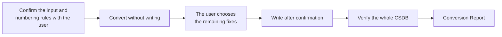

`experience-to-s1000d` is a Skill that converts an experiential manual (a JSON of [experiential-manual-model](https://github.com/shuji-bonji/experiential-manual-model)) into an S1000D® CSDB (data modules, a publication module and the original illustration files). A Skill is a procedure that tells Claude which MCP servers to call in which order and what to ask the user at each step; it has no conversion or verification processing of its own. Every judgement rests on the responses of the MCP servers.

## What it does

- **You provide**: the path of the manual JSON, the CSDB folder to write to, the security classification and the numbering rules (model identification code, system difference code, SNS, the information code for each kind, CAGE code). You can pass a JSON saved by the prototype of the authoring tool (provisionally called manual-editor).
- **You receive**: one data module per Topic and one publication module, the original illustration files, and a Conversion Report that summarises the result of the conversion (verification status, fixes applied automatically, what could not be expressed, and the files written). The files are written after you confirm.

## Required MCP servers

| MCP server | Required | Minimum version | Role |
| --- | --- | --- | --- |
| [s1000d-writer-mcp](/s1000d-stack/mcp/writer-mcp/) | Required | 0.1.1 | Converts and verifies the manual (`convert_manual`) and applies the fixes you chose (`apply_fixes`) |
| [s1000d-verify-mcp](/s1000d-stack/mcp/verify-mcp/) | Required | 0.6.0 | Verifies the whole CSDB that was written (`verify_csdb`) |
| [s1000d-brex-mcp](/s1000d-stack/mcp/brex-mcp/) | Optional | 0.4.0 | Checks the illustration formats and the allowed security classification values against the BREX of the project (`list_notations`, `lookup_value`) |
| [s1000d-reader-mcp](/s1000d-stack/mcp/reader-mcp/) | Optional | 0.7.0 | Reads the converted result as structure and shows it to you (`read_data_module`) |

When a required server is not connected, the Skill does not start; it explains how to connect the server and stops. When an optional server is not connected, the Skill writes "not performed (tool not connected)" in the matching item of the report.

## Flow



1. It confirms the path of the manual, the CSDB folder to write to and the security classification. It does not interpret the value of the security classification; it writes the value you gave as it is.
2. It asks for the numbering rules. There is no default information code, so it asks for the codes your project has registered.
3. It converts without writing, and reports the list of data modules, the verification status and what could not be expressed (such as the coordinates of hotspots).
4. Among the remaining fixes, you choose from the candidates when there are several, and it asks you when there is none. A fix that has exactly one candidate is applied automatically by the server and listed in the report.
5. After you confirm the destination, it writes the files and verifies the whole CSDB.
6. It proposes saving the numbering ledger (`<manual>.ledger.json`) next to the manual. If you pass this ledger in the next conversion, the same Topic gets the same DMC.
7. It summarises the result of the conversion and the verification status in a Conversion Report.

## What the Skill does not do

- It does not write XML. The writer server builds the XML.
- It does not decide the value of an information code without asking you.
- It does not fix with a value outside the candidates.
- It does not write that something was converted when it could not be expressed in a data module, such as the coordinates of hotspots.
- It does not create the applicability, condition and product cross-reference tables (ACT, CCT and PCT).
- It does not write `schema-not-found` or `not-run` as a pass. It does not judge conformance to S1000D.

## Installing

In Claude Code, install it with the following command.

```text
/plugin install experience-to-s1000d@shuji-bonji
```

The required MCP servers are declared as dependencies in the `plugin.json` of the Skill. The settings of the MCP servers (such as `S1000D_SPEC_DIR`) are described in [Getting started](/s1000d-stack/guide/getting-started/).

:::note[Availability]
This Skill has not been published yet. Registration in claude-plugins is in preparation, so the command above cannot install it until the registration is done.
:::

## Related pages

- [s1000d-writer-mcp](/s1000d-stack/mcp/writer-mcp/): the server that converts and applies fixes.
- [s1000d-verify-mcp](/s1000d-stack/mcp/verify-mcp/): the server that verifies the CSDB that was written.
- [experiential-manual-model](https://github.com/shuji-bonji/experiential-manual-model): the library that defines the format of the manual JSON.
- [Use cases](/s1000d-stack/use-cases/): use case 3 describes the flow in which this Skill is used.
