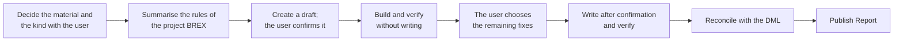

`s1000d-publish` is a Skill that builds S1000D® data modules one by one from a structured draft, verifies them and puts them in a CSDB. It is a procedure for the authors of technical documents, and it does not go through an experiential manual. A Skill tells Claude which MCP servers to call in which order and what to ask the user at each step; it has no building or verification processing of its own.

## What it does

- **You provide**: the material (text, notes or existing data modules), the CSDB folder to write to, the security classification and the numbering rules. You decide the kind of data module (descriptive, procedural, process or fault isolation) together with the Skill.
- **You receive**: one verified data module, the result of checking whether the new data module is listed in the data management list (DML), and a Publish Report (verification status, fixes applied automatically and the files written). The files are written after you confirm.

## Required MCP servers

| MCP server | Required | Minimum version | Role |
| --- | --- | --- | --- |
| [s1000d-writer-mcp](/s1000d-stack/mcp/writer-mcp/) | Required | 0.1.1 | Builds and verifies a data module from a draft (`build_data_module`) and applies the fixes you chose (`apply_fixes`) |
| [s1000d-verify-mcp](/s1000d-stack/mcp/verify-mcp/) | Required | 0.6.0 | Verifies the data module that was written (`verify_data_module`) and reconciles it with the DML (`reconcile_dml`) |
| [s1000d-brex-mcp](/s1000d-stack/mcp/brex-mcp/) | Optional | 0.4.0 | Explains the rules of the BREX of the project to the author (`explain_brex`) |
| [s1000d-reader-mcp](/s1000d-stack/mcp/reader-mcp/) | Optional | 0.7.0 | Reads an existing data module to use as the basis of a rewrite (`read_data_module`) |

When a required server is not connected, the Skill does not start; it explains how to connect the server and stops. When an optional server is not connected, the Skill writes "not performed (tool not connected)" in the matching item of the report.

## Flow



1. It confirms the material, whether this is new or a rewrite, the CSDB folder to write to and the security classification, and decides the kind of data module with you.
2. When the brex server is connected, it summarises the rules of the BREX of the project for the author. It adds no rule that is not in the response.
3. It asks for the numbering rules. There is no default information code, so it asks for the codes your project has registered.
4. It creates a draft made only of titles, paragraphs, steps, warnings, tables and references, and shows it to you for confirmation. It does not write the DMC or the BREX reference.
5. It builds and verifies without writing. Among the remaining fixes, you choose from the candidates when there are several, and it asks you when there is none.
6. After you confirm the destination, it writes the data module and verifies it.
7. It reconciles with the DML and reports whether the new data module is listed in it. When it is not listed, the Skill tells you.
8. It summarises the result and the verification status in a Publish Report.

## What the Skill does not do

- It does not write XML. It writes only the draft, and the writer server builds the XML.
- It does not decide the information code, the security classification or the applicability without asking you.
- It does not fix with a value outside the candidates.
- It does not explain the rules of a BREX with content that is not in the response of the server.
- It does not create or update a DML. The writer server does not have that function yet, so when the data module is not listed, you add it with your own tool.
- It does not write `schema-not-found` or `not-run` as a pass. It does not judge conformance to S1000D.

## Installing

In Claude Code, install it with the following command.

```text
/plugin install s1000d-publish@shuji-bonji
```

The required MCP servers are declared as dependencies in the `plugin.json` of the Skill. The settings of the MCP servers (such as `S1000D_SPEC_DIR`) are described in [Getting started](/s1000d-stack/guide/getting-started/).

:::note[Availability]
This Skill has not been published yet. Registration in claude-plugins is in preparation, so the command above cannot install it until the registration is done.
:::

## Related pages

- [s1000d-writer-mcp](/s1000d-stack/mcp/writer-mcp/): the server that builds data modules.
- [s1000d-verify-mcp](/s1000d-stack/mcp/verify-mcp/): the server that verifies and reconciles with the DML.
- [s1000d-brex-mcp](/s1000d-stack/mcp/brex-mcp/): the server that explains the BREX of the project.
- [experience-to-s1000d](/s1000d-stack/skill/experience-to-s1000d/): the Skill for converting an experiential manual in one go.
