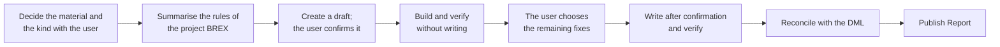
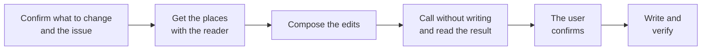

`s1000d-publish` is a Skill that builds S1000D® data modules one by one from a structured draft, verifies them and puts them in a CSDB. It is a procedure for the authors of technical documents, and it does not go through an experiential manual. It also handles requests to insert, remove or move steps, paragraphs, warnings and list items in a procedural or descriptive data module that is already in the CSDB. A Skill tells Claude which MCP servers to call in which order and what to ask the user at each step; it has no building or verification processing of its own.

[GitHub](https://github.com/shuji-bonji/s1000d-publish-skill) / [Release](https://github.com/shuji-bonji/s1000d-publish-skill/releases)

## What it does

- **You provide**: the material (text, notes or existing data modules), the CSDB folder to write to, the security classification and the numbering rules. You decide the kind of data module (descriptive, procedural, process or fault isolation) together with the Skill.
- **You receive**: one verified data module, the result of checking whether the new data module is listed in the data management list (DML), and a Publish Report (verification status, fixes applied automatically and the files written). The files are written after you confirm.

## Required MCP servers

| MCP server | Required | Minimum version | Role |
| --- | --- | --- | --- |
| [s1000d-writer-mcp](/s1000d-stack/mcp/writer-mcp/) | Required | 0.5.1 | Builds and verifies a data module from a draft (`build_data_module`) and applies the fixes you chose (`apply_fixes`). Edits the structure of a data module in the CSDB (`edit_data_module`) |
| [s1000d-verify-mcp](/s1000d-stack/mcp/verify-mcp/) | Required | 0.6.1 | Verifies the data module that was written (`verify_data_module`) and reconciles it with the DML (`reconcile_dml`) |
| [s1000d-brex-mcp](/s1000d-stack/mcp/brex-mcp/) | Optional | 0.4.0 | Explains the rules of the BREX of the project to the author (`explain_brex`) |
| [s1000d-reader-mcp](/s1000d-stack/mcp/reader-mcp/) | Optional | 0.12.0 | Checks the title, issue and references of a data module in the CSDB (`read_data_module`). It is not used to rebuild a data module from what was read. The `edit_data_module` procedure needs it to get the places to edit |

When a required server is not connected, the Skill does not start; it explains how to connect the server and stops. When an optional server is not connected, the Skill writes "not performed (tool not connected)" in the matching item of the report.

## Flow



1. It confirms the material, whether this is a new data module or a new issue built from revised material, the CSDB folder to write to and the security classification, and decides the kind of data module with you.
2. When the brex server is connected, it summarises the rules of the BREX of the project for the author. It adds no rule that is not in the response.
3. It asks for the numbering rules. There is no default information code, so it asks for the codes your project has registered.
4. It creates a draft made only of titles, paragraphs, steps, warnings, tables and references, and shows it to you for confirmation. It does not write the DMC or the BREX reference.
5. It builds and verifies without writing. Among the remaining fixes, you choose from the candidates when there are several, and it asks you when there is none.
6. After you confirm the destination, it writes the data module and verifies it.
7. It reconciles with the DML and reports whether the new data module is listed in it. When it is not listed, the Skill tells you.
8. It summarises the result and the verification status in a Publish Report.

## Changing the structure of a data module in the CSDB

A request to insert, remove or move steps, paragraphs, warnings (cautions, notes) or list items in a procedural or descriptive data module that is already in the CSDB is handled with `edit_data_module` of the writer server. The Skill does not read the data module and build it again from a draft, because the elements and attributes that a draft cannot express would be lost. `edit_data_module` rewrites only the edited ranges of the original XML.



1. It confirms which data module to change, where and how, and looks at the issue information (`issueInfo`). A released issue (`inWork` is `00`) cannot be edited as it is. The Skill tells you that this tool does not raise the issue and does not add change markup, and asks what you want to do.
2. It calls `read_data_module` of the reader server with `includeLocation: true` and copies the `location.path` of the nodes. It does not build a place itself.
3. It composes the edits (`insert`, `remove`, `move`). A node to insert is a draft node; the Skill writes no XML. It does not add an `id` that you did not give.
4. It calls the tool without writing. For a refused edit (`refusals[]`), it acts according to the reason. When the edits introduce XSD errors (`newSchemaErrors[]`), it changes the position or the edit and calls again. When another data module refers to an `id` that was removed (`referencedFromOtherObjects[]`), it asks you.
5. It shows you the places that change, the verification status and the fact that the issue and change markup are not changed, and waits for your confirmation.
6. It writes the data module, verifies it with the verify server and reports.

The Skill cannot handle the following requests yet, and says so.

- Inserting, removing or moving tables, illustrations or the items of the preliminary requirements
- Rewriting the text of a paragraph, or replacing a node with other content
- Revising a released data module (raising the issue and adding change markup)
- Removing or moving only a paragraph that the reader returns as the `text` of a step node (the reader does not return the place of such a paragraph)

## What the Skill does not do

- It does not write XML. It writes only the draft, and the writer server builds the XML.
- It does not decide the information code, the security classification or the applicability without asking you.
- It does not fix with a value outside the candidates.
- It does not explain the rules of a BREX with content that is not in the response of the server.
- It does not create or update a DML. The writer server does not have that function yet, so when the data module is not listed, you add it with your own tool.
- It does not write `schema-not-found` or `not-run` as a pass. It does not judge conformance to S1000D.
- It does not rewrite a released issue unless you say so explicitly (it does not pass `allowReleasedIssue: true` on its own judgment).
- It does not report that the issue was raised or that change markup was added. `edit_data_module` does neither.

## Installing

In Claude Code, install it with the following command.

```text
/plugin install s1000d-publish@shuji-bonji
```

The required MCP servers are declared as dependencies in the `plugin.json` of the Skill. The settings of the MCP servers (such as `S1000D_SPEC_DIR`) are described in [Getting started](/s1000d-stack/guide/getting-started/).

## Related pages

- [s1000d-writer-mcp](/s1000d-stack/mcp/writer-mcp/): the server that builds data modules.
- [s1000d-verify-mcp](/s1000d-stack/mcp/verify-mcp/): the server that verifies and reconciles with the DML.
- [s1000d-brex-mcp](/s1000d-stack/mcp/brex-mcp/): the server that explains the BREX of the project.
- [experience-to-s1000d](/s1000d-stack/skill/experience-to-s1000d/): the Skill for converting an experiential manual in one go.
