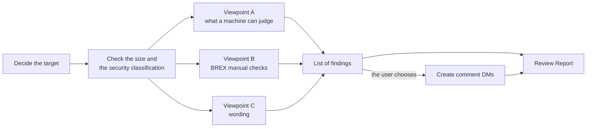

`s1000d-review` is a Skill that reviews existing S1000D® data modules and leaves the findings in the CSDB as comment data modules (comment DMs). It does not rewrite the data modules. A Skill tells Claude which MCP servers to call in which order and what to ask the user at each step; it has no judgement processing of its own.

## What it does

- **You provide**: the data modules to review (a DMC, a file path or a folder) and the CSDB folder. When you also want the wording reviewed, you provide a glossary file (a two-column CSV, a Markdown table or a DeepL glossary). To create comment DMs, you choose the values of `commentType` and `commentPriorityCode` by the rules of your project and tell the Skill.
- **You receive**: a list of findings in which the viewpoints are kept apart, comment DMs that hold the findings you chose, and a Review Report (the target, the findings for each viewpoint, what was and was not made into comment DMs, and the verification status). The comment DMs are written after you confirm.

## Required MCP servers

| MCP server | Required | Minimum version | Role |
| --- | --- | --- | --- |
| [s1000d-reader-mcp](/s1000d-stack/mcp/reader-mcp/) | Required | 0.7.0 | Lists and reads data modules (`list_data_modules`, `read_data_module`). Before reading, it checks the size and the security classification |
| [s1000d-verify-mcp](/s1000d-stack/mcp/verify-mcp/) | Required | 0.6.0 | Returns the findings on XSD, BREX, references and applicability, with fix candidates (`suggest_fixes`) |
| [s1000d-brex-mcp](/s1000d-stack/mcp/brex-mcp/) | Optional | 0.4.0 | Returns the text of the BREX agreements that cannot be judged by machine (`check_against_brex`, `explain_brex`) |
| [s1000d-writer-mcp](/s1000d-stack/mcp/writer-mcp/) | Optional | 0.1.1 | Creates comment DMs (`create_comment`). When it is not connected, the Skill only returns the findings as text |

When a required server is not connected, the Skill does not start; it explains how to connect the server and stops. When an optional server is not connected, the Skill writes "not performed (tool not connected)" in the matching item of the report.

## The three viewpoints of a finding

Every finding states which viewpoint it belongs to. The viewpoints are not mixed.

| Viewpoint | Basis | Certainty |
| --- | --- | --- |
| What can be judged by machine | The fix suggestions of the verify server (XSD, BREX, references, applicability) | The judgement of the server. It becomes the finding as it is |
| BREX agreements that cannot be judged by machine | The list of manual checks of the brex server and the text of the data module | A remark by the LLM after comparing with the text. It is written as "please confirm" |
| Wording (terms and style) | The glossary and the style rules you provided | A remark by the LLM. The matching row of the glossary is quoted. Without a glossary, it is marked "no glossary basis" |

## Flow



1. It confirms the target and the CSDB folder, and looks at the size and the security classification of the data module. It does not interpret the value of the security classification; it shows the value to you and asks whether the text may be quoted in the findings. When you decide not to quote, it writes only the location and the viewpoint.
2. It collects findings from the three viewpoints.
3. It shows a list in which every finding has a serial number and a viewpoint. You choose the findings to make into comment DMs.
4. When the writer server is connected, it creates the comment DMs without writing, shows them to you, and writes them after you confirm. When it is not connected, it returns the list and ends.
5. It summarises the target, the findings for each viewpoint, and what was and was not made into comment DMs in a Review Report.

## What the Skill does not do

- It does not rewrite data modules. To apply fixes, use the procedure of [s1000d-publish](/s1000d-stack/skill/s1000d-publish/).
- It does not interpret the value of the BREX severity level (`brSeverityLevel`).
- It does not judge conformance to Simplified Technical English (ASD-STE100, STE). The dictionary is not included, so it compares words only when you provide a dictionary file.
- It does not quote the text before it has asked you about the security classification.
- It does not read the contents of illustrations. For an illustration, it reads only the ICN reference and the title.
- It does not write `schema-not-found` or `not-run` as a pass. It does not judge conformance to S1000D.

## Installing

In Claude Code, install it with the following command.

```text
/plugin install s1000d-review@shuji-bonji
```

The required MCP servers are declared as dependencies in the `plugin.json` of the Skill. The settings of the MCP servers (such as `S1000D_SPEC_DIR`) are described in [Getting started](/s1000d-stack/guide/getting-started/).

:::note[Availability]
This Skill has not been published yet. Registration in claude-plugins is in preparation, so the command above cannot install it until the registration is done.
:::

## Related pages

- [s1000d-reader-mcp](/s1000d-stack/mcp/reader-mcp/): the server that reads data modules as structure.
- [s1000d-verify-mcp](/s1000d-stack/mcp/verify-mcp/): the server that returns findings and fix candidates.
- [s1000d-brex-mcp](/s1000d-stack/mcp/brex-mcp/): the server that explains the agreements of a BREX.
- [s1000d-writer-mcp](/s1000d-stack/mcp/writer-mcp/): the server that creates comment DMs.
- [s1000d-publish](/s1000d-stack/skill/s1000d-publish/): the Skill for rewriting a data module on the basis of the findings.
