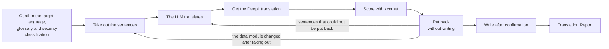

`s1000d-translate` is a Skill that translates S1000D® data modules into another language and creates data modules with the same DMC and only the language different. The writer server neither translates nor scores; it only takes sentences out and puts them back. The LLM translates, and xcomet scores. A Skill tells Claude which servers to call in which order and what to ask the user at each step.

## What it does

- **You provide**: the data module to translate (a DMC or a file path), the target language (for example `en` and `US`) and the CSDB folder. If you have a glossary, pass it as a two-column CSV, a Markdown table or a DeepL glossary.
- **You receive**: a data module with the same DMC and a different language, and a Translation Report (the number of sentences, the distribution of scores, the sentences replaced after comparing with DeepL, the sentences that could not be put back, the sentences that remained untranslated, and the verification status). The file is written after you confirm.

## Required MCP servers

| MCP server | Required | Minimum version | Role |
| --- | --- | --- | --- |
| [s1000d-writer-mcp](/s1000d-stack/mcp/writer-mcp/) | Required | 0.1.1 | Takes out the sentences for translation (`extract_segments`), puts the translated sentences back into the data module and verifies it (`apply_segments`) |
| [xcomet-mcp-server](https://www.npmjs.com/package/xcomet-mcp-server) | Optional | 0.7.0 (version tested) | Scores the translated sentences (`xcomet_batch_evaluate`) |
| DeepL MCP server | Optional | — | Returns a translation for comparison and the glossaries (`translate-text`, `list-glossaries`) |
| [s1000d-reader-mcp](/s1000d-stack/mcp/reader-mcp/) | Optional | 0.7.0 | Checks the security classification and reads the translated data module to show it to you (`read_data_module`) |

When a required server is not connected, the Skill does not start; it explains how to connect the server and stops. When an optional server is not connected, the Skill writes "not performed (tool not connected)" in the matching item of the report.

## Flow



1. It confirms the target language, the glossary and the security classification. Before sending the text to DeepL, it shows you the value of the security classification and asks whether the text may be sent.
2. It takes out the sentences to translate. Inline elements in a sentence have been replaced by `{1}` and `{2}`, so the translation keeps each placeholder exactly once.
3. The LLM translates. When DeepL is connected and the text may be sent, DeepL also translates the same sentences.
4. When xcomet is connected, it scores the translations. For a sentence with a low score, it compares with the DeepL translation and decides which to adopt. The scores are copied from xcomet as they are, and the LLM does not assign scores of its own.
5. It puts the sentences back without writing. A sentence whose placeholders do not match, or whose `id` was not taken out, is not applied and the original sentence remains, so the translation is corrected and the step is repeated. When the data module has changed since the sentences were taken out, it stops with `skeleton-mismatch`, and the work restarts from taking out the sentences.
6. After you confirm the target language, the destination and the file name, it writes the file.
7. Sentences that are not taken out (such as the sentences of the data restrictions in the identification and status section) remain in the original language, so the Translation Report lists them.

## What the Skill does not do

- It does not score the translations in place of xcomet. When xcomet is not connected, the LLM does not assign scores, and the report says "not performed (tool not connected)".
- It does not join, split or reorder sentences, and does not add sentences that were not taken out.
- It does not write that a sentence was translated when it was not taken out.
- It does not send the text to DeepL before you confirm.
- It does not translate documents other than data modules, such as PDFs.
- It does not write `schema-not-found` or `not-run` as a pass. It does not judge conformance to S1000D.

## Installing

In Claude Code, install it with the following command.

```text
/plugin install s1000d-translate@shuji-bonji
```

The required MCP servers are declared as dependencies in the `plugin.json` of the Skill. The settings of the MCP servers (such as `S1000D_SPEC_DIR`) are described in [Getting started](/s1000d-stack/guide/getting-started/).

:::note[Availability]
This Skill has not been published yet. Registration in claude-plugins is in preparation, so the command above cannot install it until the registration is done.
:::

## Related pages

- [s1000d-writer-mcp](/s1000d-stack/mcp/writer-mcp/): the server that takes out sentences and puts them back.
- [s1000d-reader-mcp](/s1000d-stack/mcp/reader-mcp/): the server that reads data modules as structure.
- [s1000d-review](/s1000d-stack/skill/s1000d-review/): the Skill for reviewing a translated data module.
- [Use cases](/s1000d-stack/use-cases/): use case 2 describes the flow for existing data modules.
