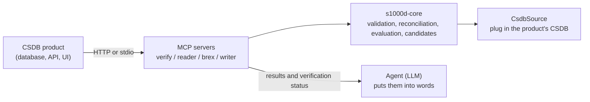

This use case is for vendors of CSDB products (systems that store and manage S1000D® data modules; see [CSDB](/s1000d-stack/guide/csdb/)) who embed AI agents in their product. The product's server calls the MCP servers of s1000d-stack, and the product's database or API is plugged in as the CSDB. Assembling the agent, the screens and authentication stay with the product.

## What an agent can do inside a CSDB

The following four things are provided as the minimum an LLM agent should be able to do inside a CSDB. In all four, the decision is made deterministically by the server (the shared library `s1000d-core`); the LLM only puts the result into words (see [Design principles](/s1000d-stack/guide/design-principles/)).

| What it can do | Tool | What comes back |
| --- | --- | --- |
| Schema validation | verify-mcp `validate_schema` / `verify_data_module` | valid / invalid against the official XSD the user obtained, with line-numbered errors |
| Cross-reference check | verify-mcp `check_references`, `reconcile_dml` | Whether the targets of `dmRef` / `pmRef` / ICN / `internalRef` / `applicRefId` exist, with reasons. Reconciliation of a DML or DDN with the CSDB (missing, different issue, not listed in the DML) |
| Applicability check | reader-mcp `describe_applicability` / `read_data_module` | applicable / notApplicable / undetermined per product. The expressions themselves are never passed to the LLM |
| Fix suggestion | verify-mcp `suggest_fixes` | For each finding, candidates for what to change, where, and to which value. The server decides the candidates and attaches a certainty (exact / several / none) and where they come from |

The writing side (building data modules, applying fixes, creating comment data modules, handing sentences out and back for translation) is handled by [s1000d-writer-mcp](/s1000d-stack/mcp/writer-mcp/). The procedures for review and translation are in the Skills ([s1000d-review](/s1000d-stack/skill/s1000d-review/), [s1000d-translate](/s1000d-stack/skill/s1000d-translate/) and others), and can be used as examples when designing the product agent's procedures.

## Parts used for embedding

| Part | Description |
| --- | --- |
| `CsdbSource` | By default `s1000d-core` treats `DMC-….XML` files inside a folder as the CSDB, but a product's CSDB is a database or an API. Listing the CSDB objects (`list()`) and fetching their content (`readText()`) are gathered in the `CsdbSource` interface, so the product can plug in its own implementation. The interface is synchronous; a store that can only be read asynchronously is loaded first and passed to `MemoryCsdbSource` |
| HTTP transport | The four MCP servers start over Streamable HTTP with `--http` (default `http://127.0.0.1:3000/mcp`), so a product's server or a web application can call them over HTTP. When bound to an address other than loopback they do not check `Host` and `Origin`, so they go behind the product's reverse proxy or authentication |
| Config file | The locations of the distribution (XSD, default BREX) and the CSDB are given by the environment variables `S1000D_SPEC_DIR` / `S1000D_CSDB_DIR` or by the config file `~/.config/s1000d-stack/config.json`. A product vendor already holds the distribution, so this arrangement can be used as is |
| Verification status | The responses of verify, reader and writer carry `verification` (the state of the XSD, BREX and reference steps). The product can store it as an audit record |
| Writing | The writer writes to the CSDB only with `write: true`. When you do not need the server to write, omit `write` and the product can write the returned XML into its own store |
| Security classification | reader-mcp responses start with `securityClassification` (the data module's value and the number of body elements per value). The values are not interpreted, so handling follows the product's rules |

## What stays with the product

- **Authentication, authorization and multi-tenancy** are not included. When exposed over HTTP, the servers go behind the product's authentication.
- **Assembling the agent** is the product's job. This stack provides core, MCP servers and Skills (procedures); the division of roles between Author / Reviewer / Translator / Project Manager, and the screens, are left to the product's design.
- **The specification, XSD and default BREX are not bundled.** The ones the user (the product vendor) obtained are used.
- **Conformance is not decided.** The stack reports that the XSD and the machine-checkable BREX rules found nothing; conformance to S1000D is judged by a person.

## Plans

As a real user of this foundation, a simple technical-manual web system that displays an S1000D CSDB directly is planned. With a minimal feature set — follow data modules from the table of contents of a publication module, hide sections that do not apply to the selected product, show issue, verification status and security classification at the top of each page — it is also the place where anything missing from the API is fed back to core and the MCP servers.

The design history is in [docs/design/agent-platform.md](https://github.com/shuji-bonji/s1000d-stack/blob/main/docs/design/agent-platform.md) in the hub repository.
