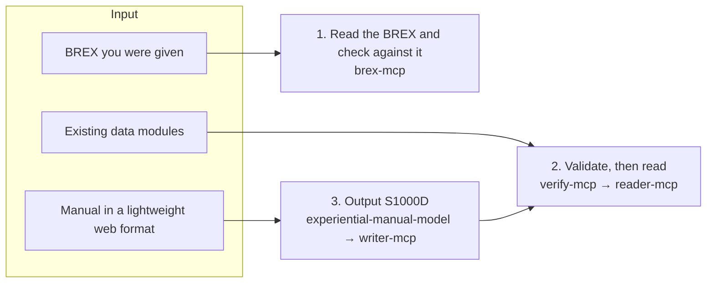

s1000d-stack is a set of tools that lets an LLM read, check and create S1000D® technical documents in line with BREX (Business Rules Exchange). This page explains how to combine those tools in which situation, divided into three use cases. Use cases 1 and 2 work with existing S1000D data; use case 3 creates S1000D from a workplace that does not have S1000D.

## 1. Read the BREX you were given and check data modules against it

An author who receives a BREX data module from a customer or project uses this to understand its content and to confirm, before delivery, that the data modules they produced follow the rules.

- `explain_brex` lists the BREX rules as sentences that say what is required of each element
- `check_against_brex` checks a data module against the BREX chain (project → organisation → S1000D default BREX) and returns every violation with its location (XPath and line number), value, rule ID and severity level
- `lookup_value` looks up the meaning of attribute values and SNS (standard numbering system) codes

The component to use is [s1000d-brex-mcp](/s1000d-stack/mcp/brex-mcp/). BREX itself is explained in [BREX (Business Rules Exchange)](/s1000d-stack/guide/brex/).

## 2. Validate existing data modules and let the LLM read them

This use case targets an existing CSDB (a folder holding `DMC-….XML` files) and lets the LLM answer questions about maintenance procedures and fault information with evidence. Instead of handing the XML to the LLM as it is, it validates first and passes only the structured content.

- [s1000d-verify-mcp](/s1000d-stack/mcp/verify-mcp/) performs validation against the official XSD, the BREX check and broken reference detection together, and attaches a verification status
- [s1000d-reader-mcp](/s1000d-stack/mcp/reader-mcp/) returns the data module as a structure of headings, steps, warnings and illustrations, resolves reference targets and evaluates which product it applies to (applicability). It does not pass applicability expressions to the LLM; it returns only applicable / notApplicable / undetermined and the display text

Reviewing data modules is done with the Skill [s1000d-review](/s1000d-stack/skill/s1000d-review/), and translating them into another language with the Skill [s1000d-translate](/s1000d-stack/skill/s1000d-translate/).

## 3. Author in a lightweight web format, then output S1000D when needed

In this use case, a workplace that has not adopted S1000D creates a manual in a web format that teaches screen and equipment operation through hands-on experience, and outputs it as data modules at the point when a customer asks for S1000D. Building this path is the goal of stages 2–4 ([Architecture and stages](/s1000d-stack/guide/architecture/)). Instructions for the authoring tool and the viewer live on the product site; this page describes only the flow.

This use case rests on the fact that the data structure of the 2021 work [experience_based_operation_explanation](https://github.com/shuji-bonji/experience_based_operation_explanation) (operating instructions for a reserved-seat ticket machine) corresponds to the ideas of S1000D as follows.

| Experiential manual JSON | S1000D |
| --- | --- |
| Screen screenshots and explanatory text | Illustrations (referenced by ICN) and the content section of a data module |
| `screenId` | DMC (data module code) |
| Buttons and their destinations | Process data module (controls the order of presentation) |
| Grouping per purchase method | Publication module |
| JSON managed in one place and reused | Single source, multiple outputs from the CSDB |
| `index.html` and JavaScript | IETM (viewer) |

This correspondence is defined as experiential-manual-model, a common data model that does not depend on S1000D, and [s1000d-writer-mcp](/s1000d-stack/mcp/writer-mcp/) generates data modules from it. The LLM does not write XML: the writer builds the XML from a draft, verifies it, and automatically applies only the fixes that have exactly one candidate. The generated data modules can be validated with verify-mcp from use case 2, so the correctness of the output can be confirmed from the S1000D side.

The authoring tool is at the prototype stage, and its name (manual-editor) is provisional. When you pass a JSON saved by the tool to the Skill [experience-to-s1000d](/s1000d-stack/skill/experience-to-s1000d/), the conversion by the writer and the verification by verify proceed with your confirmation at each step. To create data modules from text without going through an experiential manual, use the Skill [s1000d-publish](/s1000d-stack/skill/s1000d-publish/).
